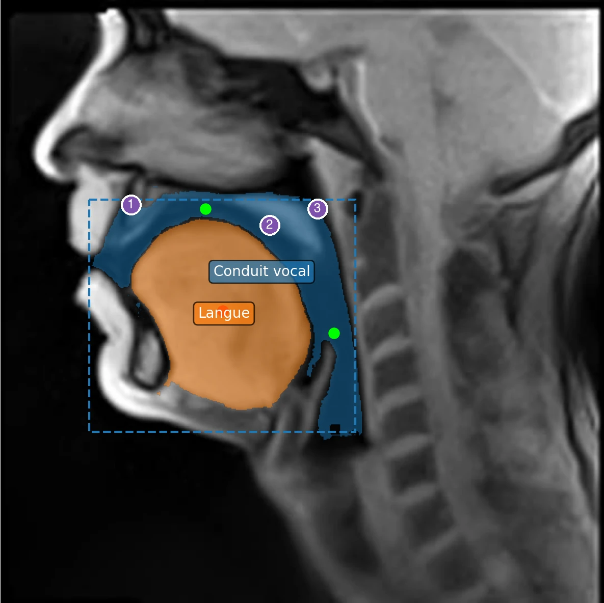
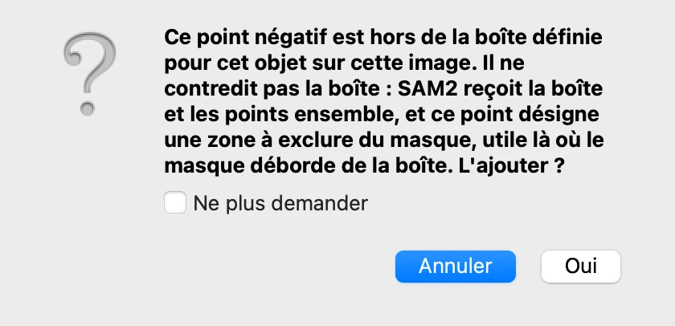
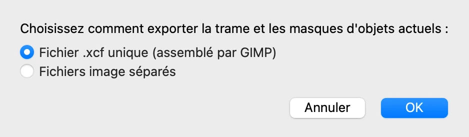
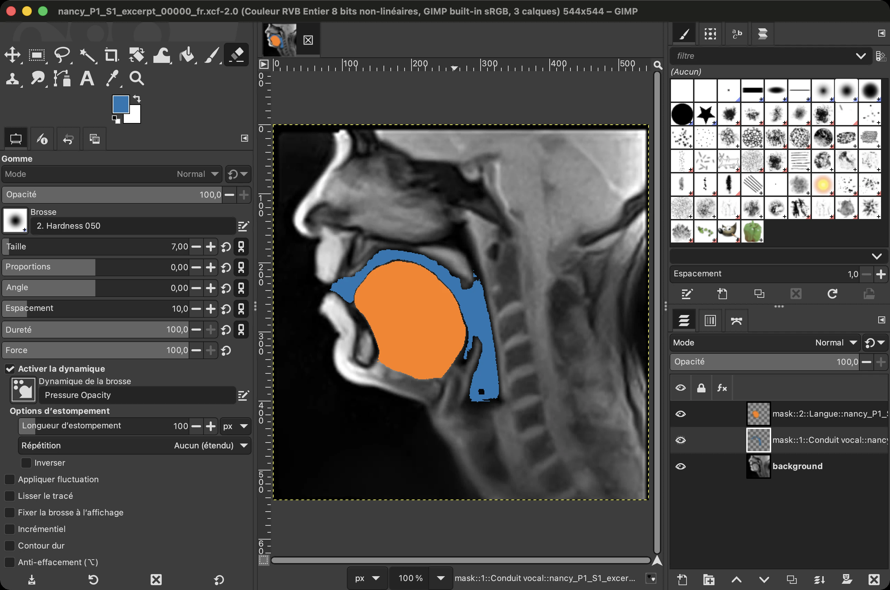
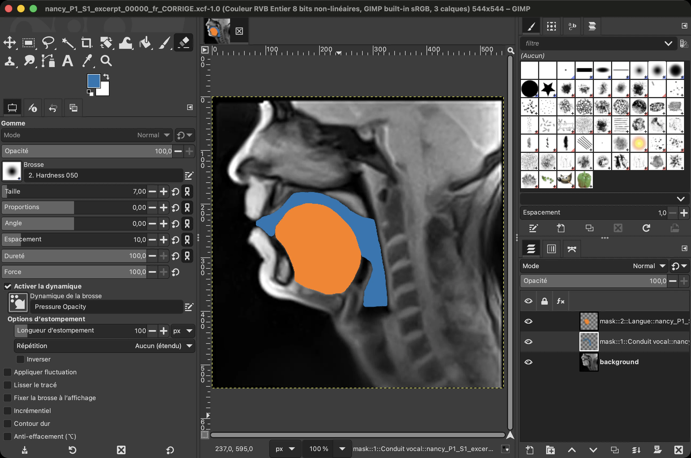
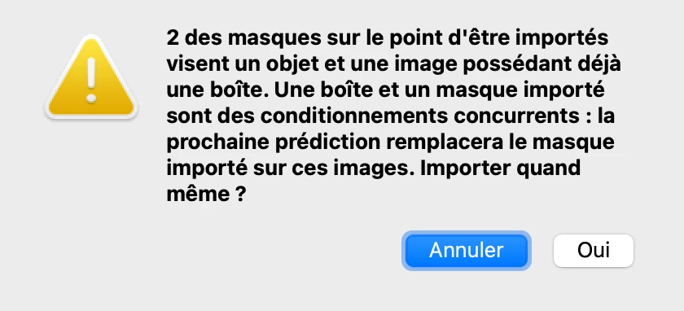
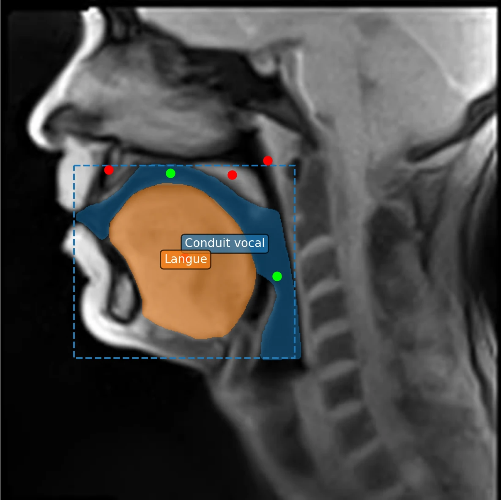

# 5. Corriger les masques

*[English version](corrections.md)*

Le conduit vocal délimité à l'étape 3 est relativement proche de ce qui est attendu,
mais sa délimitation comprend encore des erreurs : l'objet ainsi défini englobe des
structures qui n'appartiennent pas au conduit vocal. Cette étape le corrige, d'abord
avec d'autres points, puis à la main dans GIMP pour ce que les points ne suffisent pas à
rectifier.

## Repérer ce qui ne va pas

Revenez à la trame 1 et cliquez sur **Conduit vocal** dans la liste des objets. Sur cette
trame, le masque de l'étape 3 couvre :

1. la région alvéolaire[^alveolaire], derrière les incisives supérieures ;
2. le voile du palais[^voile] ;
3. une partie du rhinopharynx[^rhinopharynx], en arrière du voile, où le masque atteint le
   bord haut de la boîte et le dépasse même un peu : dans le cadre de ce tutoriel, on fait
   le choix de se limiter à la partie orale du conduit vocal, et donc de ne pas inclure
   cette partie qui relève plutôt de la cavité nasale.

La boîte a déjà écarté l'essentiel de la cavité nasale et le larynx, que le masque
aurait sinon englobés.

Ces erreurs sont courantes. Le modèle délimite ce qui ressemble à une seule région de
l'image, et à cette résolution les limites entre l'air et les tissus ne sont pas
toujours claires. Vérifier les masques, trame après trame, et les corriger fait partie
du travail nécessaire pour obtenir une segmentation correcte.

## Corriger sur une trame

L'enchaînement est celui de l'étape 3 : cliquer sur l'image dans l'onglet **Objets**,
**Conduit vocal** étant sélectionné, puis prédire depuis l'onglet **Prédiction**. Ici,
chaque clic est un clic droit, suivi d'une prédiction. Plusieurs points pourraient être
définis entre deux prédictions ; les ajouter un à un montre mieux ce que chacun change.

**1. Le voile du palais et le rhinopharynx.** Faites un clic droit sur le voile du
palais, et prédisez. Puis faites un autre clic droit juste au-dessus, dans le
rhinopharynx : ce point tombe au-dessus du bord haut de la boîte, et VOLUTE demande
confirmation.

Un point négatif hors de la boîte ne la contredit pas : il désigne une zone à exclure,
là où le masque déborde de la boîte. Cliquez sur **Oui**, puis prédisez de nouveau. Un
point positif hors de la boîte, lui, la contredirait, et le message le signale. **Ne
plus demander** supprime cette question jusqu'à la fermeture de VOLUTE.

**2. La région alvéolaire.** Faites un clic droit derrière les incisives supérieures, et
prédisez.

Le masque s'en tient maintenant, pour l'essentiel, à l'air des cavités buccale et
pharyngale. Derrière les incisives, une fine bande de la région alvéolaire y reste
toutefois : la [retouche dans GIMP](#retoucher-un-masque-à-la-main-dans-gimp), plus bas,
permet de l'en retirer.

## Annuler

- **Édition › Annuler** (Ctrl + Z, ou ⌘ + Z sur Mac) annule la dernière modification — un
  point, une boîte, un nom, une couleur — et **Édition › Rétablir** (Ctrl + Maj + Z, ou
  ⇧ + ⌘ + Z) la rétablit.
- **Supprimer des points**, en haut de l'onglet **Objets**, retire les points compris dans
  un rectangle tracé sur l'image.
- **Effacer tous les points** retire tous les points de l'objet sélectionné sur la trame
  affichée.

## Retoucher un masque à la main dans GIMP

Certaines erreurs résistent aux points : une structure fine, une limite que le modèle ne
voit pas. On peut alors peindre le masque à la main dans GIMP, un logiciel libre de
retouche d'images (version 3.0 ou ultérieure), puis le ramener dans VOLUTE. GIMP ne
s'installe pas avec VOLUTE : téléchargez-le sur [gimp.org](https://www.gimp.org).

1. Sur la trame à retoucher, choisissez **Fichier › Exporter la trame pour édition…**,
   gardez **Fichier .xcf unique (assemblé par GIMP)**, cliquez sur **OK** et choisissez où
   enregistrer le fichier. GIMP assemble un fichier contenant la trame en arrière-plan et
   un calque par objet.

2. Ouvrez le fichier dans GIMP. Dans le panneau **Calques**, sélectionnez le calque de
   l'objet à retoucher : son nom commence par `mask::` et contient le nom de l'objet.
   Peignez avec la couleur du masque pour l'étendre, et gommez pour le réduire. Laissez
   les noms des calques tels quels, puis enregistrez le fichier (**Fichier ›
   Enregistrer**).

3. De retour dans VOLUTE, choisissez **Fichier › Importer des masques…** et sélectionnez
   le fichier enregistré. Chaque calque est associé à son objet et sa trame à partir de son
   nom.

   Ici, les deux objets ont une boîte sur la trame 1 : VOLUTE prévient qu'une boîte et un
   masque importé se font concurrence, la boîte l'emportant à la prochaine prédiction sur
   cette trame. Ce sont les masques retouchés qui doivent désormais servir : celui du
   conduit vocal, et celui de la langue, légèrement retouché le long de sa racine. On ne
   relancera donc pas de prédiction sur cette trame : cliquez sur **Oui**.

   La trame 1 montre désormais le conduit vocal tel qu'il a été peint dans GIMP :

   La boîte et les points posés auparavant restent affichés, mais sur cette trame le
   masque importé prend désormais leur place.

Les masques importés sont conservés quand le projet est enregistré, sauf choix contraire.

La trame 1 porte maintenant une délimitation juste des deux objets.
L'[étape 6](tracking.fr.md) les suit dans toute la vidéo : pour le conduit vocal, à
partir du masque retouché dans GIMP.

[^alveolaire]: La crête située juste derrière les incisives supérieures, au niveau de laquelle sont articulées des consonnes comme /t/, /d/, /n/ ou /l/.
[^voile]: Partie arrière, molle et mobile, du palais. En s'abaissant, il ouvre le passage entre le pharynx et les fosses nasales ; en se relevant, il le ferme.
[^rhinopharynx]: La partie haute du pharynx, au-dessus du voile du palais et en arrière des fosses nasales.

Précédent : [4. Plusieurs objets](objects.fr.md) · Suite : [6. Suivre les objets dans la vidéo](tracking.fr.md)
