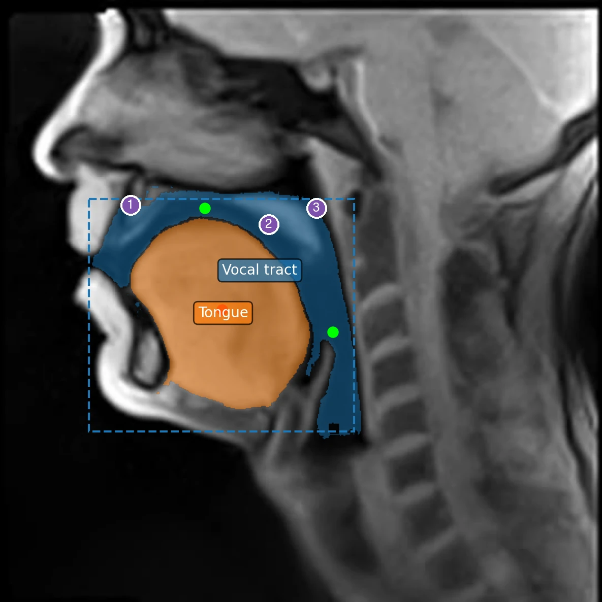
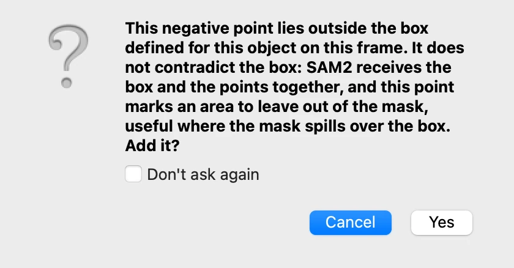
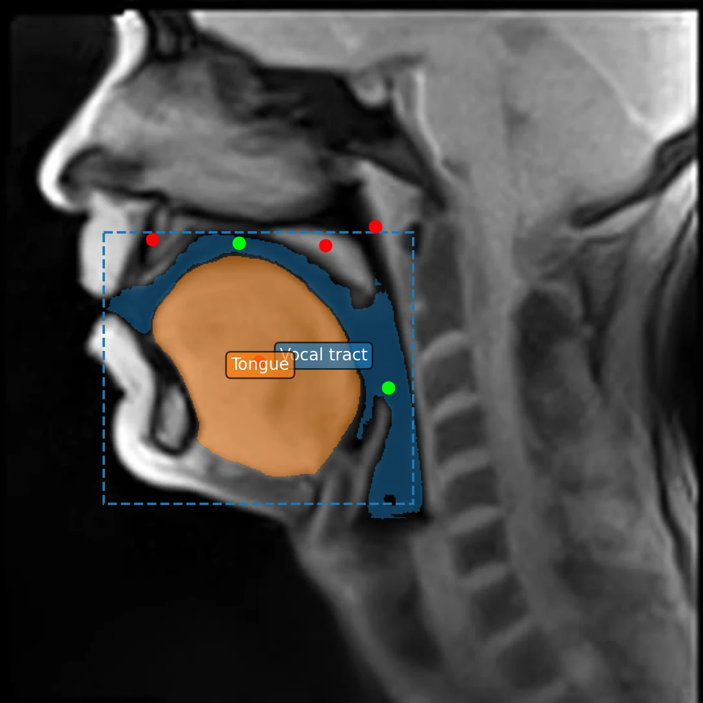
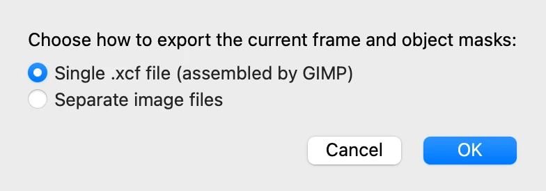
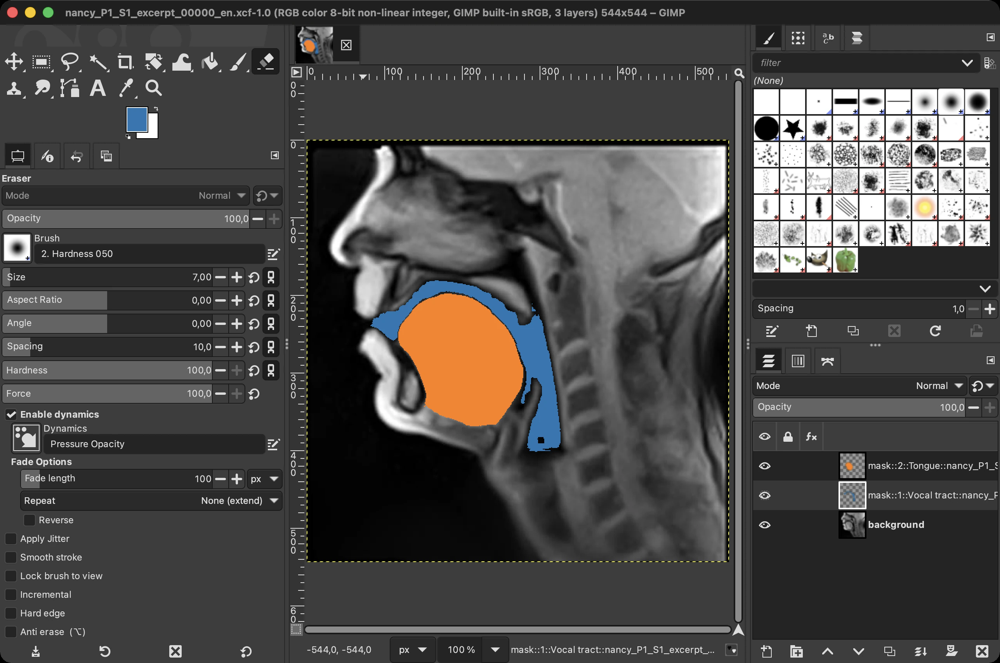
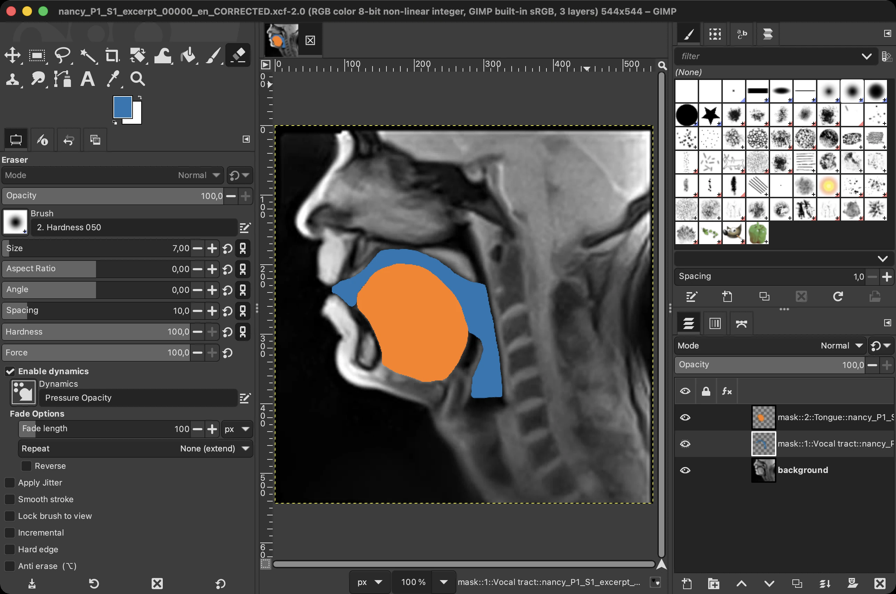
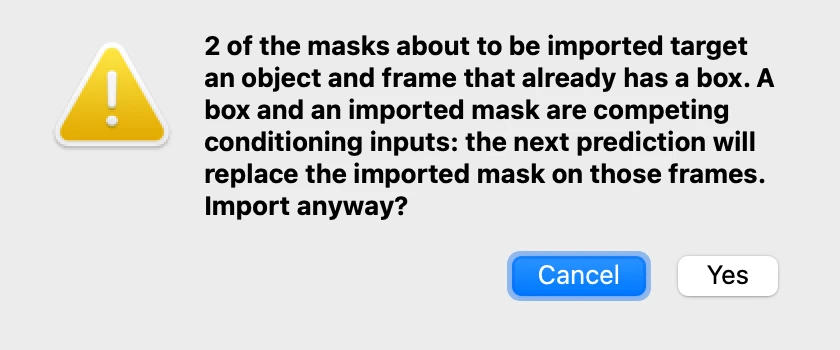

# 5. Correcting masks

*[Version française](corrections.fr.md)*

The vocal tract outlined in step 3 is fairly close to what is expected, but its outline
still holds errors: the object so defined takes in structures that do not belong to the
vocal tract. This step corrects it, first with more points, then by hand in GIMP for what
points cannot fix.

## Spotting what is wrong

Go back to frame 1 and click **Vocal tract** in the object list. On this frame, the mask
of step 3 covers:

1. the alveolar region[^alveolaire], behind the upper incisors;
2. the soft palate[^voile];
3. part of the nasopharynx[^rhinopharynx], behind the soft palate, where the mask reaches
   the upper edge of the box and even goes a little beyond it: this tutorial chooses to
   keep to the oral part of the vocal tract, and so not to include this part, which
   belongs rather to the nasal cavity.

The box has already left out most of the nasal cavity and the larynx, which the mask
would otherwise have taken in.

Such errors are common. The model outlines what looks like one region of the image, and
at this resolution the boundaries between air and tissue are not always clear. Checking
the masks, frame by frame, and correcting them is part of the work needed for a correct
segmentation.

## Correcting on one frame

The routine is that of step 3: click on the image in the **Objects** tab, with **Vocal
tract** selected, then predict from the **Prediction** tab. Here, each click is a right
click, followed by a prediction. Several points could be placed between two predictions;
adding them one at a time shows better what each one changes.

**1. The soft palate and the nasopharynx.** Right-click on the soft palate, and
predict. Then right-click just above it, in the nasopharynx: this point falls above the
upper edge of the box, and VOLUTE asks for confirmation.

A negative point outside the box does not contradict it: it marks an area to leave out,
where the mask spills over the box. Click **Yes**, then predict again. A positive point
outside the box, on the other hand, would contradict it, and the message says so.
**Don't ask again** stops this question until VOLUTE is closed.

**2. The alveolar region.** Right-click behind the upper incisors, and predict.

The mask now keeps, for the most part, to the air of the oral and pharyngeal cavities.
Behind the incisors, a thin band of the alveolar region still remains in it, though:
[retouching in GIMP](#retouching-a-mask-by-hand-in-gimp), below, can remove it.

## Undoing

- **Edit › Undo** (Ctrl + Z, or ⌘ + Z on a Mac) cancels the last change — a point, a box,
  a name, a colour — and **Edit › Redo** (Ctrl + Shift + Z, or ⇧ + ⌘ + Z) restores it.
- **Remove points**, at the top of the **Objects** tab, removes the points inside a
  rectangle drawn on the image.
- **Clear all points** removes all the points of the selected object on the frame shown.

## Retouching a mask by hand in GIMP

Some errors resist points: a thin structure, a boundary the model does not see. The mask
can then be painted by hand in GIMP, a free image editor (version 3.0 or later), and
brought back into VOLUTE. GIMP is not installed with VOLUTE: download it from
[gimp.org](https://www.gimp.org).

1. On the frame to retouch, choose **File › Export Frame for Editing…**, keep **Single
   .xcf file (assembled by GIMP)**, click **OK** and choose where to save the file. GIMP
   assembles a file holding the frame as background and one layer per object.

2. Open the file in GIMP. In the **Layers** panel, select the layer of the object to
   retouch: its name starts with `mask::` and holds the object's name. Paint with the
   mask's colour to add to the mask, and erase to remove from it. Leave the layer names
   as they are, then save the file (**File › Save**).

3. Back in VOLUTE, choose **File › Import Masks…** and select the saved file. Each layer
   is matched to its object and its frame from its name.

   Here both objects have a box on frame 1: VOLUTE warns that a box and an imported mask
   compete, the box winning at the next prediction on that frame. The retouched masks
   are the ones to use from now on: the vocal tract's, and the tongue's, slightly
   retouched along its root. No prediction will therefore be run again on that frame:
   click **Yes**.

   Frame 1 now shows the vocal tract as painted in GIMP:

   The box and the points placed earlier are still shown, but on this frame the
   imported mask now takes their place.

Imported masks are kept when the project is saved, unless you choose otherwise.

Frame 1 now holds an accurate outline of both objects. [Step 6](tracking.md) follows
them through the whole video: for the vocal tract, from the mask retouched in GIMP.

[^alveolaire]: The ridge just behind the upper incisors, where consonants such as /t/, /d/, /n/ or /l/ are articulated.
[^voile]: The back part of the palate, soft and mobile. Lowered, it opens the passage between the pharynx and the nasal cavity; raised, it closes it.
[^rhinopharynx]: The upper part of the pharynx, above the soft palate and behind the nasal cavity.

Previous: [4. Several objects](objects.md) · Next: [6. Following the objects through the video](tracking.md)
