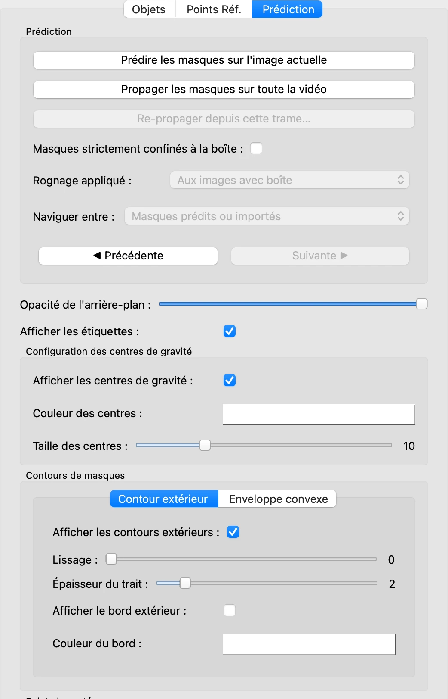
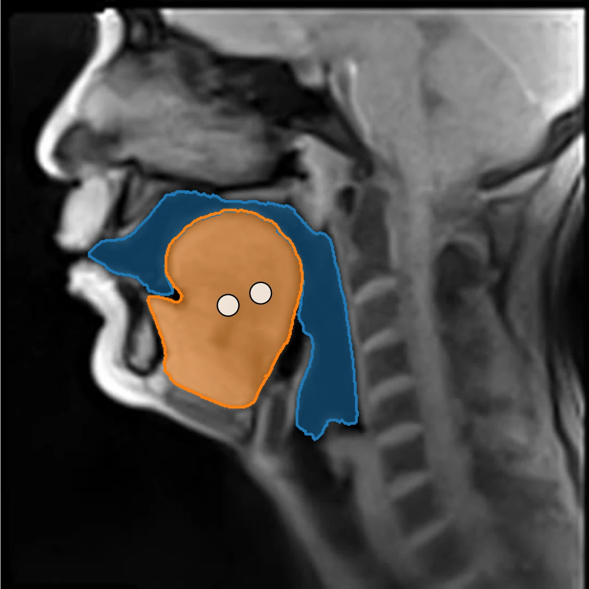
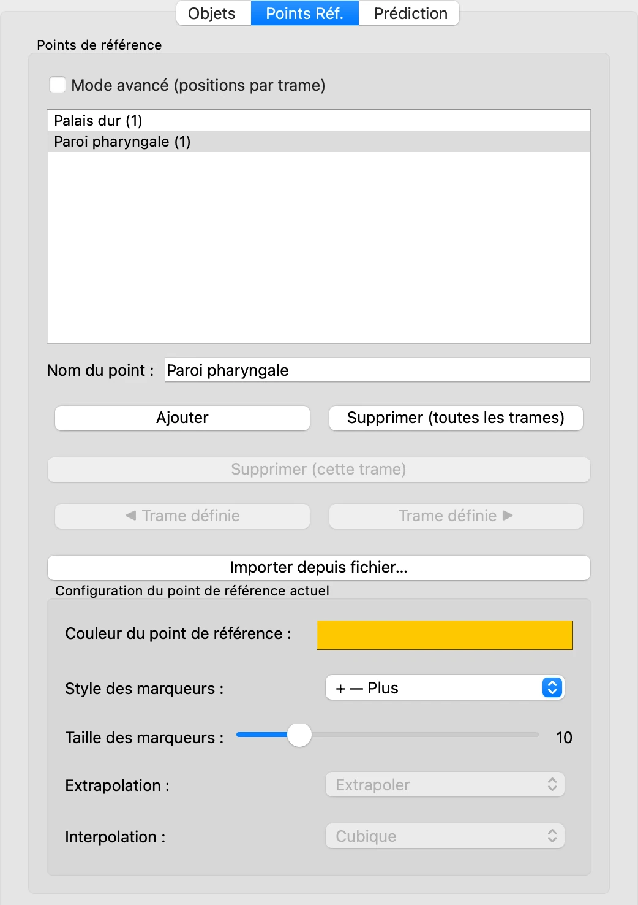
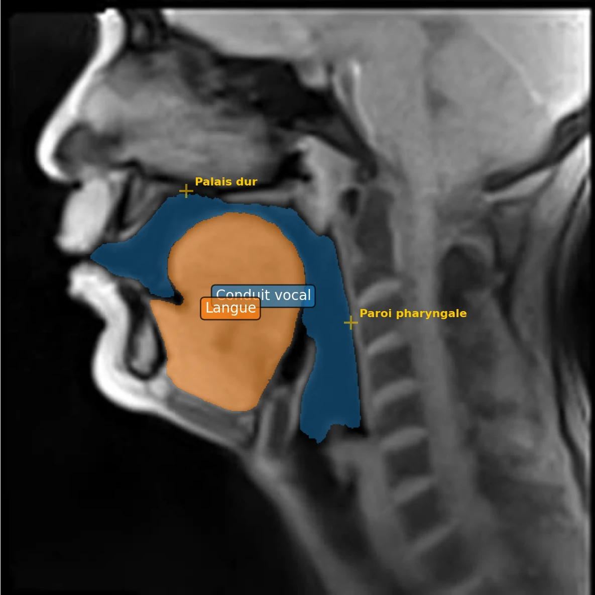

# 7. Affichage et points de référence

*[English version](display.md)*

Les masques colorés ne sont qu'une façon d'afficher la délimitation des objets. Cette
étape passe en revue les réglages d'affichage, puis place des **points de référence** :
des repères sur l'image, indépendants des objets, à partir desquels VOLUTE mesure des
distances lors de l'export.

## Réglages d'affichage

Dans l'onglet **Prédiction**, sous les boutons de prédiction, se trouvent les réglages qui
modifient ce qui est dessiné sur l'image.

- **Opacité de l'arrière-plan** estompe l'image, pour faire ressortir les masques.
- **Afficher les étiquettes** écrit le nom de chaque objet au centre de son masque.
- **Afficher les centres de gravité**, sous **Configuration des centres de gravité**,
  marque le centre de gravité de chaque masque d'un point, dont on règle la couleur et la
  taille.
- **Contours de masques** trace le contour de chaque masque. L'onglet **Contour
  extérieur** suit le bord du masque, que **Lissage** régularise ; l'onglet **Enveloppe
  convexe** trace le plus petit contour convexe qui l'entoure. Tous deux ont une
  **Épaisseur du trait**, et un bord facultatif qui garde le trait lisible sur n'importe
  quel fond.

Ici, sur la trame 75, avec les contours extérieurs et les centres de gravité affichés, et
les étiquettes masquées pour ne pas les recouvrir :

L'opacité du masque de chaque objet se règle dans l'onglet **Objets**, sous
**Configuration de l'objet actuel** : **Opacité du masque** à 0 ne laisse que le contour.
Ces réglages changent ce qui est montré, jamais les masques eux-mêmes.

## Points de référence

Un point de référence marque un repère supposé fixe, comme le palais dur[^palais-dur] ou
la paroi postérieure du pharynx[^paroi]. À l'export, VOLUTE peut mesurer la distance de
chaque point de référence au point le plus proche d'un masque : à quelle distance la
langue s'approche du palais, par exemple.

1. Dans l'onglet **Points Réf.**, cliquez sur **Ajouter**. Un point nommé **Point réf.
   1** apparaît dans la liste ; dans **Nom du point**, tapez `Palais dur`.
2. Cliquez sur l'image, sous le palais dur, au bord de l'air de la cavité buccale : un
   marqueur y apparaît.
3. Cliquez de nouveau sur **Ajouter**, nommez le point `Paroi pharyngale`, et cliquez sur
   la paroi postérieure du pharynx, juste derrière l'air de la cavité pharyngale.

Quand l'onglet **Points Réf.** est ouvert, un clic sur l'image place le point de référence
sélectionné, et rien d'autre : les points des objets s'ajoutent depuis l'onglet
**Objets**.

Par défaut, un point de référence a une seule position, la même sur toutes les trames :
ici, sur la trame 75, les deux points sont là où ils ont été placés sur la trame 1.

**Un repère qui peut se déplacer légèrement**, comme cela peut être le cas pour le palais
dur ou la paroi pharyngale si le locuteur n'a pas maintenu la tête parfaitement fixe
pendant l'acquisition des données, demande le **Mode avancé (positions par trame)**. Le
point est alors placé sur plusieurs trames, et VOLUTE complète les trames intermédiaires,
selon la méthode d'interpolation sélectionnée, par une courbe (**Cubique**) ou des
segments de droite (**Linéaire**) ; ces positions
complétées sont affichées plus pâles. **Extrapolation** décide de ce qui se passe avant la
première et après la dernière trame placée. **◀ Trame définie** et **Trame définie ▶**
passent d'une trame placée à la suivante.

Pour suivre des points ou structures qui se déplacent de façon plus importante et moins
régulière, comme par exemple la lèvre inférieure ou la mâchoire, les points de référence
ne sont pas un choix adapté ; selon les cas, il sera préférable d'opter pour le
[suivi de points](points.fr.md) ou de définir un autre objet pour suivre la structure
correspondante.

Également dans l'onglet :

- **Supprimer (cette trame)** et **Supprimer (toutes les trames)** effacent la position du
  point sélectionné sur la trame affichée, ou le point tout entier.
- **Importer depuis fichier…** crée des points à partir d'un fichier texte, un nom par
  ligne.
- **Configuration du point de référence actuel** règle la couleur, le style et la taille
  du marqueur de chaque point.

Les points de référence sont enregistrés avec le projet.

[^palais-dur]: Partie avant, osseuse, du palais, qui sépare la cavité buccale des fosses nasales.
[^paroi]: La paroi arrière du pharynx, en avant de la colonne vertébrale.

Précédent : [6. Suivre les objets dans la vidéo](tracking.fr.md) · Suite : [8. Exporter les résultats](export.fr.md)
