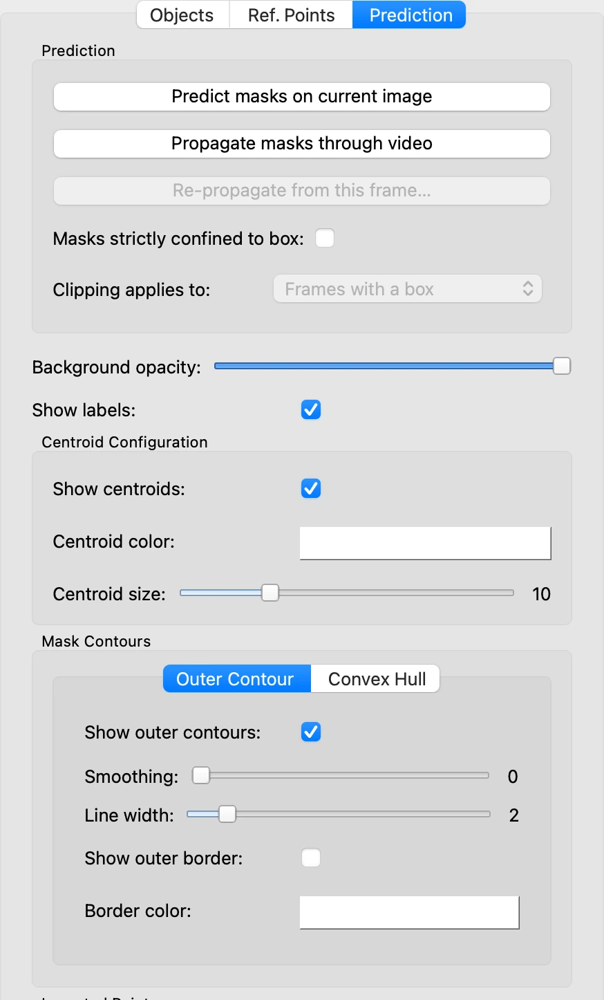
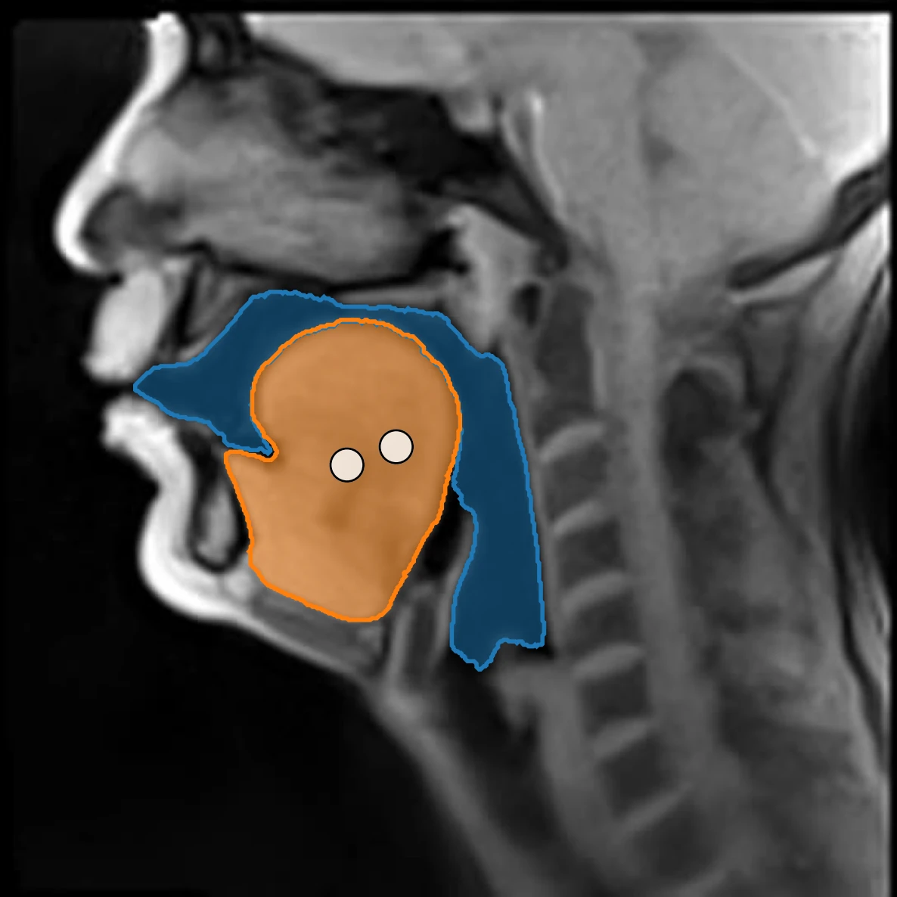
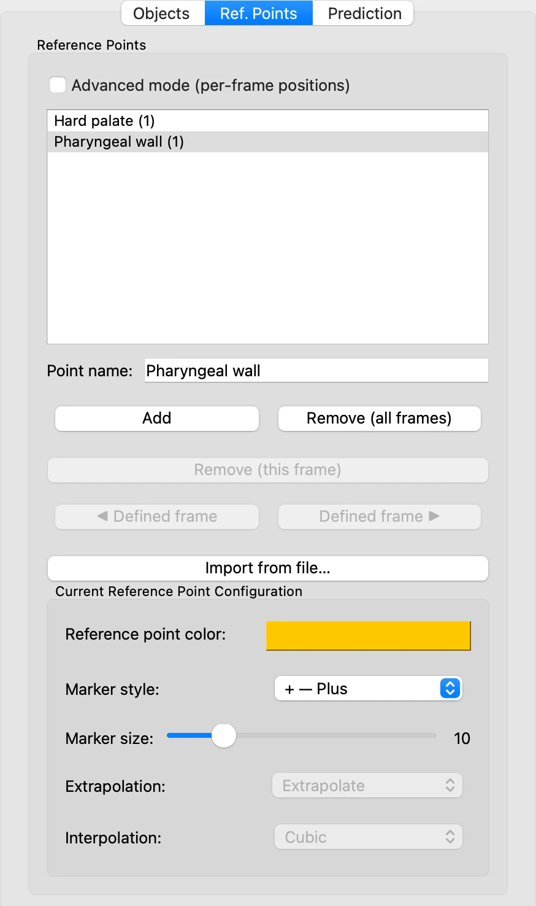
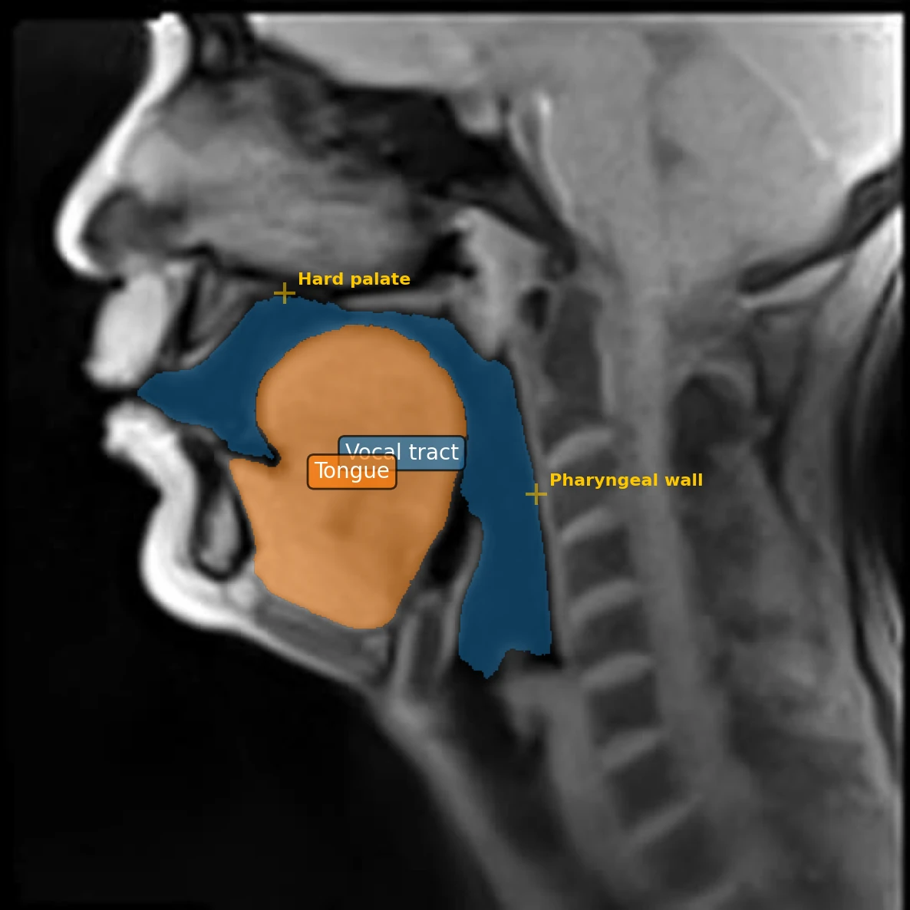

# 7. Display and reference points

*[Version française](display.fr.md)*

Coloured masks are only one way of showing the outline of the objects. This step goes
through the display settings, then places **reference points**: landmarks on the image,
independent of the objects, from which VOLUTE measures distances when exporting.

## Display settings

In the **Prediction** tab, below the prediction buttons, are the settings that change
what is drawn over the image.

- **Background opacity** fades the image, to bring out the masks.
- **Show labels** writes each object's name at the centre of its mask.
- **Show centroids**, under **Centroid Configuration**, marks each mask's centre of
  gravity with a dot, whose colour and size can be set.
- **Mask Contours** draws the outline of each mask. The **Outer Contour** tab follows the
  mask's edge, which **Smoothing** evens out; the **Convex Hull** tab draws the smallest
  convex outline around it. Both have a **Line width**, and an optional border that keeps
  the line legible on any background.

Here, on frame 75, with the outer contours and the centroids shown, and the labels hidden
so as not to cover the centroids:

The opacity of each object's mask is set in the **Objects** tab, under **Current Object
Configuration**: **Mask opacity** at 0 leaves only the contour. These settings change
what is shown, never the masks themselves.

## Reference points

A reference point marks a landmark assumed to be fixed, such as the hard
palate[^palais-dur] or the posterior wall of the pharynx[^paroi]. At export, VOLUTE can
measure the distance from each reference point to the nearest point of a mask: how close
the tongue comes to the palate, for instance.

1. In the **Ref. Points** tab, click **Add**. A point named **Ref. point 1** appears in
   the list; in **Point name**, type `Hard palate`.
2. Click on the image, on the underside of the hard palate, at the edge of the air of
   the oral cavity: a marker appears there.
3. Click **Add** again, name the point `Pharyngeal wall`, and click on the posterior wall
   of the pharynx, just behind the air of the pharyngeal cavity.

With the **Ref. Points** tab open, a click on the image places the selected reference
point, and only that: points of objects are added from the **Objects** tab.

By default, a reference point has a single position, the same on every frame: here, on
frame 75, the two points are where they were placed on frame 1.

**A landmark that may move slightly**, as the hard palate or the pharyngeal wall may if
the speaker did not keep their head perfectly still during the recording, calls for
**Advanced mode (per-frame positions)**. The point is then placed on several frames, and
VOLUTE fills in the frames between them, according to the interpolation method selected,
with a curve (**Cubic**) or straight lines (**Linear**); these filled-in positions are
shown paler. **Extrapolation** decides what happens before the first and after the last
frame placed. **◀ Defined frame** and
**Defined frame ▶** jump from one placed frame to the next.

To follow points or structures that move further and less regularly, such as the lower lip
or the jaw, reference points are not the right choice; depending on the case,
[point tracking](points.md) or another object following the structure will serve better.

Also in the tab:

- **Remove (this frame)** and **Remove (all frames)** delete the selected point's
  position on the frame shown, or the point altogether.
- **Import from file…** creates points from a text file, one name per line.
- **Current Reference Point Configuration** sets each point's colour, marker style and
  size.

Reference points are saved with the project.

[^palais-dur]: The front, bony part of the palate, which separates the oral cavity from the nasal cavity.
[^paroi]: The back wall of the pharynx, in front of the spine.

Previous: [6. Following the objects through the video](tracking.md) · Next: [8. Exporting the results](export.md)
