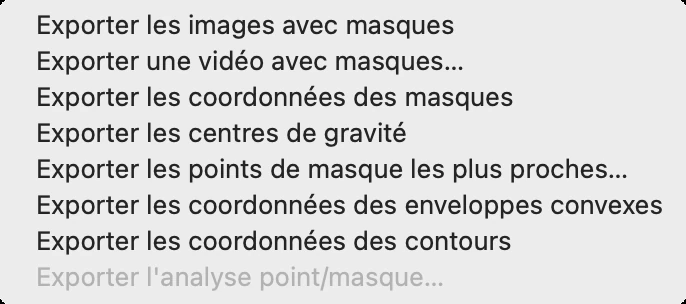
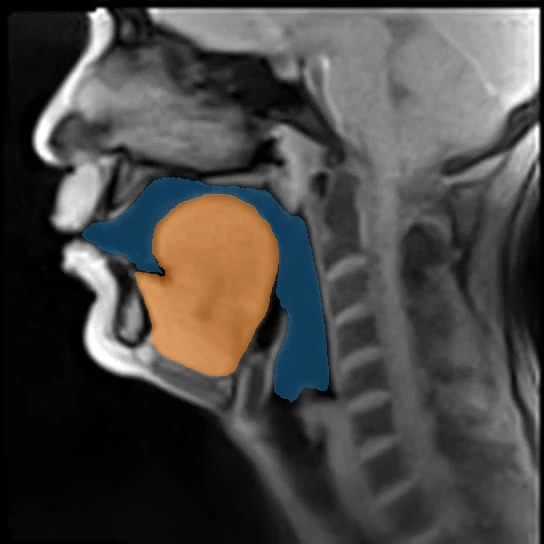
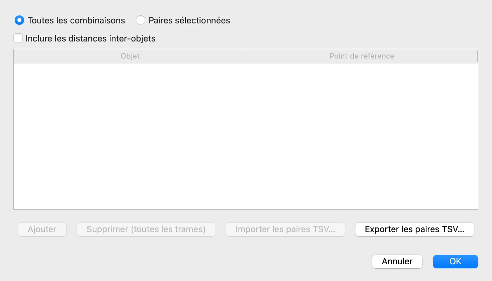
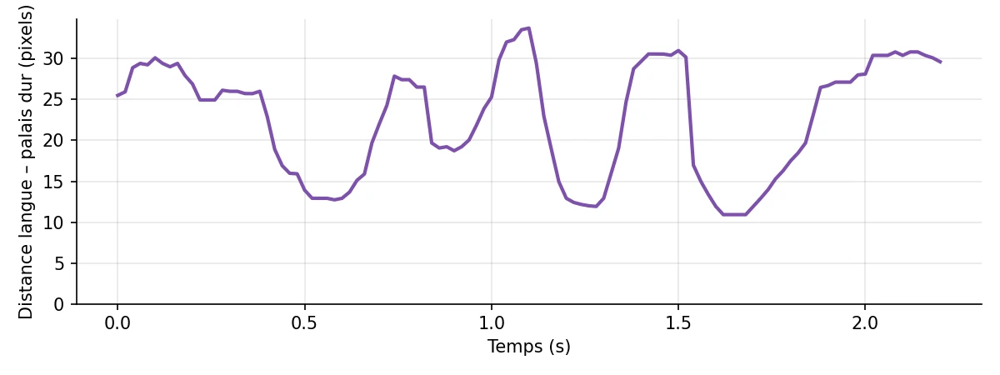

# 8. Exporter les résultats

*[English version](export.md)*

Masques, contours et points de référence restent dans VOLUTE tant qu'ils ne sont pas
exportés : cette étape en fait des fichiers de données qui peuvent être ouverts et
analysés avec d'autres outils logiciels comme un tableur, ou par des scripts R ou Python.

## Le menu Exportation

Toutes les exportations se trouvent dans **Fichier › Exportation**. Ses entrées restent
grisées tant qu'aucun masque n'a été prédit.

La dernière, **Exporter l'analyse point/masque…**, concerne les points importés de
SAM2++, sujet de l'étape 10. Chaque entrée demande où enregistrer, puis écrit un fichier,
ou un dossier d'images, qui couvre toutes les trames et tous les objets. Les trames
gardent le nom de leur fichier d'origine, si bien que chaque ligne renvoie à son image.

| Entrée | Format | Contenu du fichier |
|---|---|---|
| **Exporter les images avec masques** | images JPEG | chaque trame, avec les masques dessinés par-dessus |
| **Exporter les coordonnées des masques** | JSON, CSV, Pickle | pour chaque trame, chaque pixel de chaque masque |
| **Exporter les centres de gravité** | XLSX, CSV, JSON | les coordonnées en pixels du centre de gravité de chaque masque, trame par trame |
| **Exporter les points de masque les plus proches…** | XLSX, CSV, JSON | la distance en pixels de chaque masque à chaque point de référence |
| **Exporter les coordonnées des enveloppes convexes** | XLSX, CSV, JSON | les sommets de chaque enveloppe convexe |
| **Exporter les coordonnées des contours** | XLSX, CSV, JSON | les points de chaque contour extérieur |

Le format suit l'extension du nom de fichier, choisie dans la fenêtre d'enregistrement :
`.xlsx` s'ouvre dans un tableur, `.csv` est du texte brut que de nombreux logiciels
peuvent lire, `.json` peut être lu par divers programmes et scripts. Pickle ne sert qu'à
Python. Les coordonnées sont en pixels des trames, comptés depuis le coin supérieur
gauche, l'axe vertical orienté vers le bas.

## Les images avec leurs masques

**Exporter les images avec masques** demande de choisir un dossier, et y écrit un dossier
`masked_images` contenant une image par trame, avec les masques dessinés par-dessus,
mais sans étiquettes ni points de référence. Ici, la trame 75 :

## Les distances aux points de référence

**Exporter les points de masque les plus proches…** mesure, sur chaque trame, la
distance de chaque masque à chaque point de référence posé à l'étape 7 : le point du
masque le plus proche du point de référence, et la distance qui les sépare. Une fenêtre
demande d'abord quelles paires mesurer.

- **Toutes les combinaisons** mesure chaque objet par rapport à chaque point de
  référence : ici, le conduit vocal et la langue par rapport au palais dur[^palais-dur] et à la paroi
  pharyngale.
- **Paires sélectionnées** ne garde que les paires de la liste, ajoutées avec
  **Ajouter** et choisies dans les listes de chaque ligne.
- **Inclure les distances inter-objets** mesure aussi la plus courte distance entre les
  masques de deux objets.

Gardez **Toutes les combinaisons**, cliquez sur **OK** et enregistrez le fichier. Il
contient une ligne par objet, point de référence et trame. Ses premières lignes pour la
langue et le palais dur sont :

| Object_Name | Target_Name | Frame_Index | Closest_X | Closest_Y | Distance_px |
|---|---|---|---|---|---|
| Langue | Palais dur | 0 | 175 | 199 | 25.51 |
| Langue | Palais dur | 1 | 175 | 199 | 25.51 |
| Langue | Palais dur | 2 | 175 | 201 | 27.46 |
| Langue | Palais dur | 3 | 175 | 203 | 29.42 |

Les identifiants, les noms de fichiers et les coordonnées du point de référence sont ici
omis, et les distances arrondies.

`Closest_X` et `Closest_Y` donnent le point du masque le plus proche du point de
référence, `Distance_px` la distance qui les sépare, en pixels ; `Frame_Index` compte
les trames à partir de 0. Ouvert dans un tableur ou un logiciel d'analyse statistique, le
fichier donne par exemple la distance de la langue au palais dur au fil des
2,2 secondes de l'extrait :

Ce graphique n'est pas tracé par VOLUTE : il montre une représentation possible de ce que
contient le fichier exporté.

[^palais-dur]: Partie avant, osseuse, du palais, qui sépare la cavité buccale des fosses nasales.

Précédent : [7. Affichage et points de référence](display.fr.md) · Suite : [9. Enregistrer, reprendre, traiter par lot](project.fr.md)
