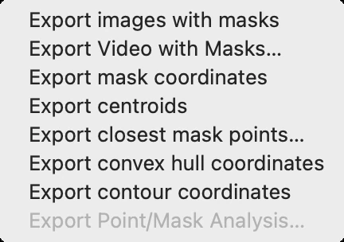
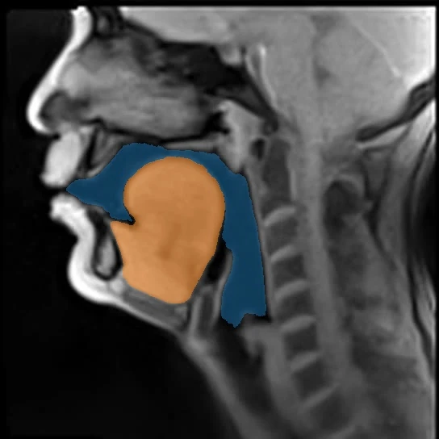
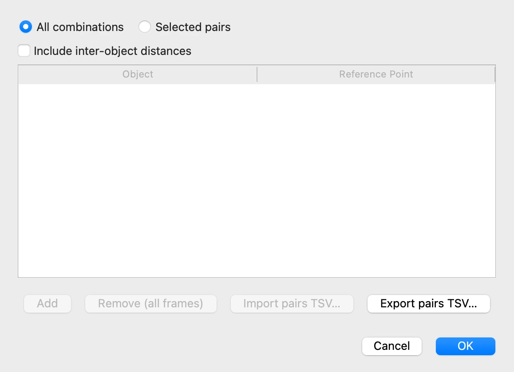
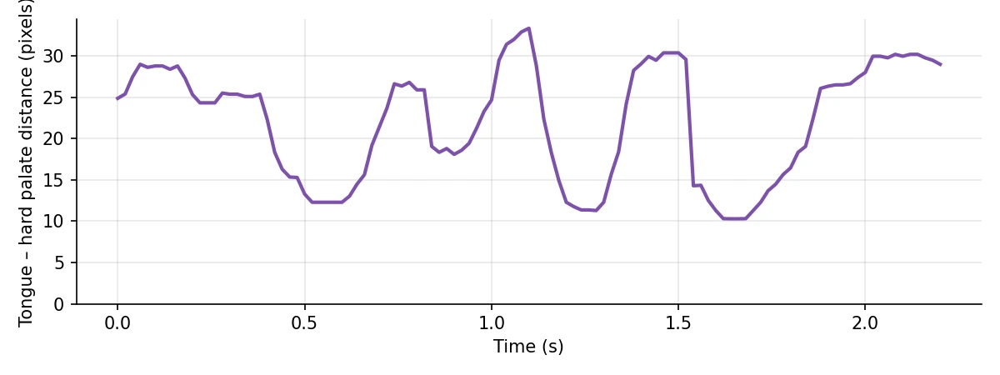

# 8. Exporting the results

*[Version française](export.fr.md)*

Masks, contours and reference points stay inside VOLUTE until they are exported: this
step turns them into data files that other software tools can open and analyse, such as a
spreadsheet, or scripts in R or Python.

## The Export menu

Every export is in **File › Export**. Its entries stay greyed out until masks have been
predicted.

The last one, **Export Point/Mask Analysis…**, concerns points imported from SAM2++, the
subject of step 10. Each entry asks where to save, then writes one file, or a folder of
images, covering every frame and every object. The frames keep the name of their original
file, so that each row can be traced back to its image.

| Entry | Format | What the file holds |
|---|---|---|
| **Export images with masks** | JPEG images | each frame, with the masks drawn over it |
| **Export mask coordinates** | JSON, CSV, Pickle | for each frame, every pixel of each mask |
| **Export centroids** | XLSX, CSV, JSON | the pixel coordinates of the centre of gravity of each mask, frame by frame |
| **Export closest mask points…** | XLSX, CSV, JSON | the distance in pixels from each mask to each reference point |
| **Export convex hull coordinates** | XLSX, CSV, JSON | the corners of each convex hull |
| **Export contour coordinates** | XLSX, CSV, JSON | the points of each outer contour |

The format follows the file name's extension, chosen in the save window: `.xlsx` opens in
a spreadsheet, `.csv` is plain text that many programs can read, `.json` can be
read by various programs and scripts. Pickle
is for Python only. Coordinates are in pixels of the frames, from the top-left corner, the
vertical axis pointing down.

## Images with their masks

**Export images with masks** asks you to choose a folder, and writes into it a
`masked_images` folder holding one image per frame, with the masks drawn over it, but
neither labels nor reference points. Here, frame 75:

## Distances to the reference points

**Export closest mask points…** measures, on each frame, the distance from each mask to
each reference point placed in step 7: the point of the mask nearest to the reference
point, and the distance between them. A window first asks which pairs to measure.

- **All combinations** measures every object against every reference point: here, the
  vocal tract and the tongue against the hard palate[^palais-dur] and the pharyngeal wall.
- **Selected pairs** keeps only the pairs listed below, added with **Add** and chosen in
  each row's lists.
- **Include inter-object distances** also measures the shortest distance between the
  masks of two objects.

Keep **All combinations**, click **OK**, and save the file. It holds one row per object,
reference point and frame. The first rows for the tongue and the hard palate read:

| Object_Name | Target_Name | Frame_Index | Closest_X | Closest_Y | Distance_px |
|---|---|---|---|---|---|
| Tongue | Hard palate | 0 | 175 | 199 | 24.86 |
| Tongue | Hard palate | 1 | 175 | 199 | 24.86 |
| Tongue | Hard palate | 2 | 177 | 202 | 28.25 |
| Tongue | Hard palate | 3 | 176 | 203 | 28.98 |

Here, the identifiers, file names and reference point coordinates are left out, and
the distances rounded.

`Closest_X` and `Closest_Y` give the point of the mask nearest to the reference point,
`Distance_px` the distance between them, in pixels; `Frame_Index` counts frames from 0.
Opened in a spreadsheet or a statistical analysis program, the file gives, for instance, the
distance from the tongue to the hard palate over the 2.2 seconds of the excerpt:

This chart is not drawn by VOLUTE: it shows one possible way of representing what the
exported file holds.

[^palais-dur]: The front, bony part of the palate, which separates the oral cavity from the nasal cavity.

Previous: [7. Display and reference points](display.md) · Next: [9. Saving, resuming, batch processing](project.md)
