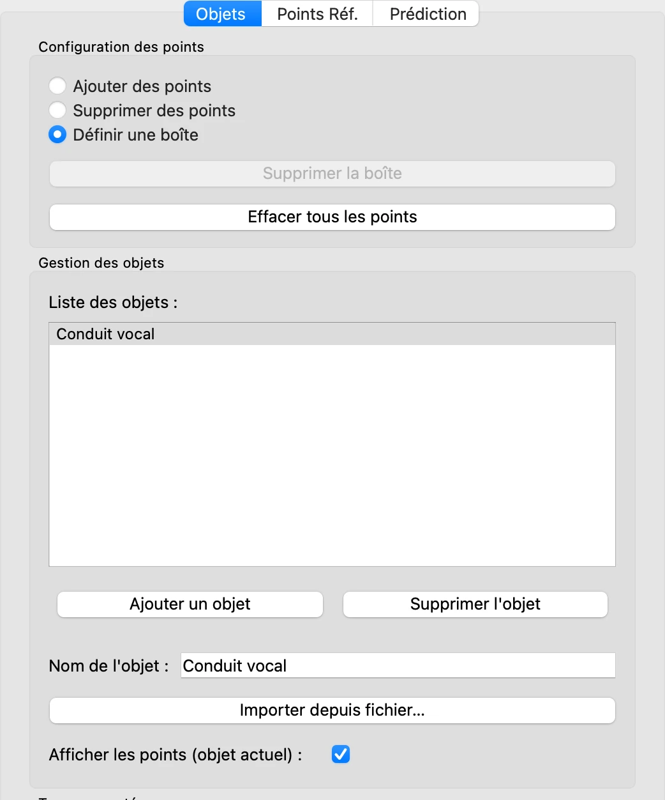
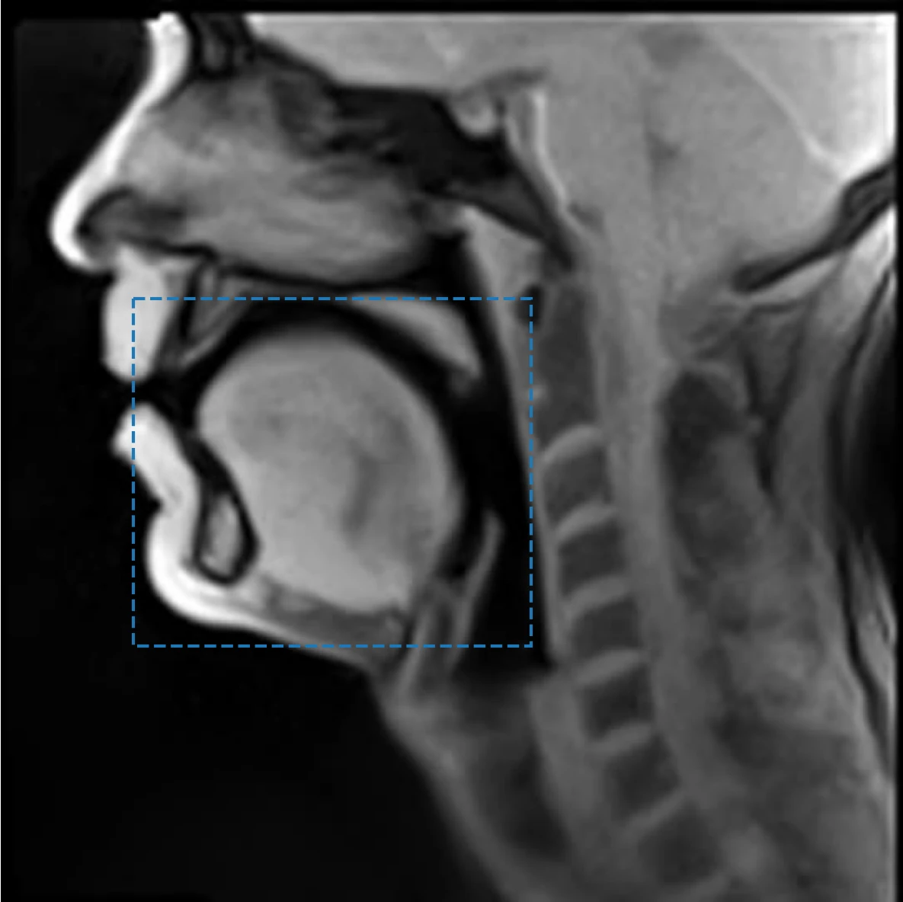
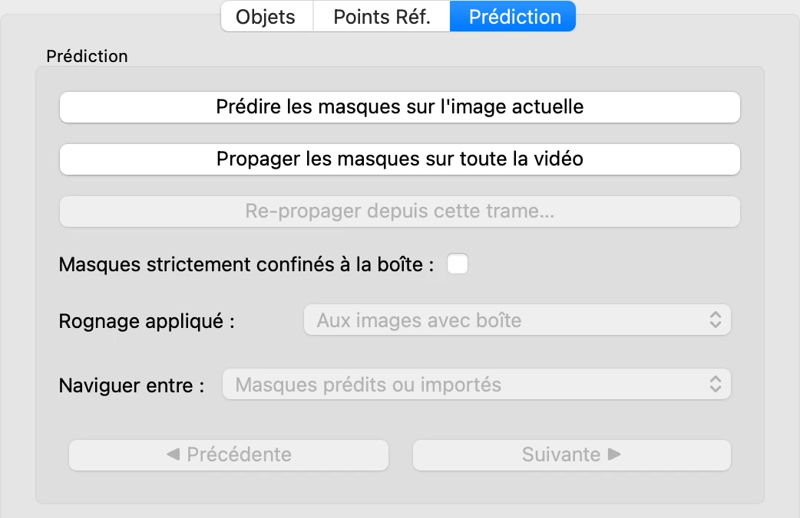
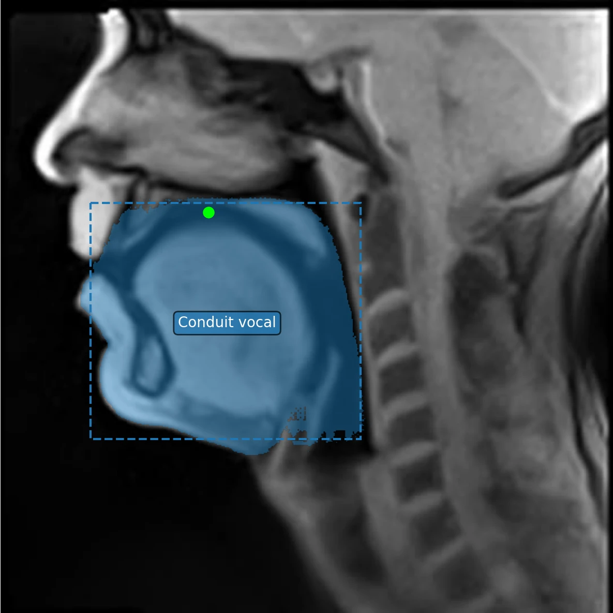
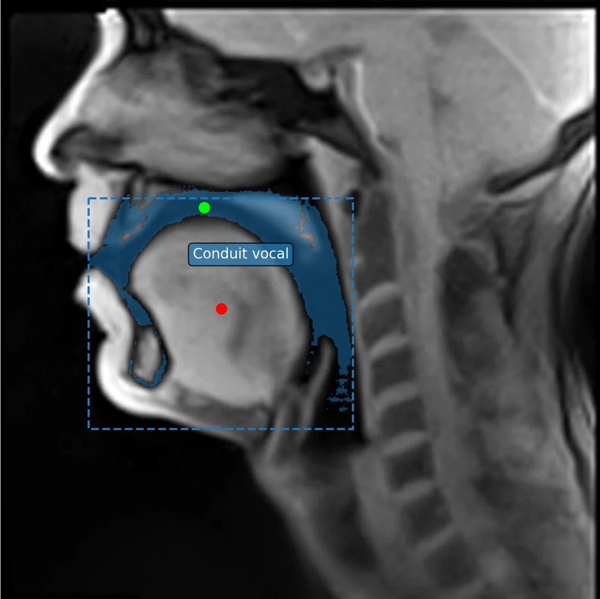

# 3. Un premier objet

*[English version](first-object.md)*

Un **objet** est ce que VOLUTE délimite et suit d'une trame à l'autre. Ici, c'est
l'intérieur du **conduit vocal** : l'espace rempli d'air de la cavité buccale[^buccale] et de la
cavité pharyngale[^pharyngale], jusqu'à la glotte[^glotte], sombre sur les images, dont la forme change à chaque
son. Le contour que VOLUTE calcule
sur chaque trame s'appelle un **masque**.

## Nommer l'objet

VOLUTE démarre avec un objet, **Objet 1**, dans l'onglet **Objets**. Dans **Nom de
l'objet**, tapez `Conduit vocal` : le nom s'affiche dans la liste, et plus tard dans les
fichiers exportés.

## Délimiter la région par une boîte

La première étape consiste le plus souvent à indiquer à VOLUTE où se trouve l'objet, en
traçant une zone rectangulaire appelée **boîte** autour de lui.

1. En haut de l'onglet **Objets**, sélectionnez **Définir une boîte**.
2. Faites glisser la souris sur l'image, depuis l'avant des lèvres, juste sous le palais
   dur[^palais-dur], jusqu'à la paroi arrière du pharynx, au-dessus du larynx[^larynx]. La
   boîte apparaît en pointillés, dans la couleur de l'objet.

Le bord haut de la boîte, sous le palais, laisse de côté autant que possible la cavité
nasale, car dans le cadre de ce tutoriel on considère le conduit vocal à segmenter comme
se limitant à sa partie orale ; le bord bas laisse de côté le larynx.

## Prédire le masque

Ouvrez l'onglet **Prédiction** et cliquez sur **Prédire les masques sur l'image
actuelle**.

VOLUTE confirme que la prédiction a réussi : cliquez sur **OK**. Le masque se dessine en
bleu sur l'image — et il couvre presque tout le contenu de la boîte : l'air du conduit
vocal, mais aussi la langue, la lèvre inférieure et le bas de la bouche.

Ce n'est pas une erreur. Une boîte indique *dans quelle zone* se trouve l'objet, pas
*comment le délimiter précisément* : le modèle a délimité la plus grande région que la
boîte englobe. Pour un objet compact qui remplit sa boîte, comme la langue à
[l'étape 4](objects.fr.md), cela est souvent suffisant. Le conduit vocal, mince et
courbé autour de la langue, n'occupe qu'une petite partie de la sienne : des points vont
préciser ce qui en fait partie.

Le masque déborde même de la boîte par endroits : la boîte est une indication donnée au
modèle, et non une limite stricte (voir [Modifier la boîte](#modifier-la-boîte)).

## Affiner avec des points

Les clics sur l'image indiquent à VOLUTE ce qui doit être considéré comme faisant ou non
partie de l'objet :

- un **clic gauche** pose un **point positif**, par défaut en vert : *ceci fait partie
  de l'objet* ;
- un **clic droit**, ou Ctrl + clic, pose un **point négatif**, par défaut en rouge :
  *ceci n'en fait pas partie*.

Revenez à l'onglet **Objets** et sélectionnez **Ajouter des points** : en mode
**Définir une boîte**, un glisser remplacerait la boîte.

Chaque correction suit le même enchaînement : cliquer sur l'image dans l'onglet
**Objets**, puis prédire de nouveau depuis l'onglet **Prédiction**. VOLUTE recalcule
chaque fois le masque à partir de la boîte et de tous les points de la trame.

Plusieurs points, positifs ou négatifs, peuvent aussi être posés entre deux prédictions.
Dans ce tutoriel ils sont ajoutés un par un, pour mieux montrer ce que chaque point
change à la prédiction.

**1. Désigner l'air du conduit vocal.** Cliquez du bouton gauche dans la bande sombre de
la cavité buccale, entre la langue et le palais, puis prédisez. Le masque change à
peine.

Ce point n'est pas inutile pour autant : il ancre la prédiction dans l'air du conduit
vocal. Sans lui, le point négatif suivant donnerait un masque troué et éparpillé.

**2. Exclure la langue.** Faites un clic droit au milieu de la langue, puis prédisez.
La langue sort du masque, qui se resserre sur le conduit vocal, mais s'arrête vers le
milieu du pharynx.

**3. Ajouter le bas du pharynx.** Faites un clic gauche dans la bande sombre du
pharynx, en arrière de la base de la langue, puis prédisez. Le masque va des lèvres
jusqu'au bord bas de la boîte, au-dessus du larynx.

Bien qu'améliorée, cette délimitation du conduit vocal n'est pas encore satisfaisante :
le masque englobe encore des structures qui n'en font pas partie, autour du voile du
palais notamment. L'étape 5, [Corriger les masques](corrections.fr.md), montre comment
les repérer et les corriger.

> **Un point mal placé ?** **Édition › Annuler** (Ctrl + Z, ou ⌘ + Z sur Mac) retire le
> dernier. **Supprimer des points**, en haut de l'onglet **Objets**, retire tous les points
> compris dans un rectangle tracé sur l'image.

## Modifier la boîte

- Un nouveau glisser en mode **Définir une boîte** remplace la boîte ; **Supprimer la
  boîte**, en haut de l'onglet **Objets**, l'efface.
- Pour que la boîte devienne une limite stricte, cochez **Masques strictement confinés à
  la boîte** dans l'onglet **Prédiction** : ce que les prédictions suivantes trouvent hors
  de la boîte est alors effacé. Ce mode n'est pas activé par défaut car il peut aboutir à
  des masques coupés de façon abrupte aux limites des boîtes, ce qui dans la majorité des
  cas n'est pas le comportement recherché.
- Si une nouvelle boîte laisse à l'extérieur des points déjà posés, VOLUTE indique
  combien et propose de les supprimer : les points positifs hors de la boîte la
  contredisent, tandis que les points négatifs vont dans son sens, mais peuvent ne plus
  être utiles. **Édition › Annuler** rétablit alors d'un coup l'ancienne boîte et les
  points supprimés.
- Un point posé hors de la boîte demande une confirmation : l'étape 5 le montre.

## Et ensuite

Pour l'instant, le masque n'existe que sur la trame 1. Avant de le suivre dans toute la
vidéo, à l'[étape 6](tracking.fr.md), on délimite sur cette même trame les autres objets
(étape 4), puis on corrige les masques (étape 5) : la propagation partira ainsi de
délimitations justes.

Pour conserver ce travail, **Fichier › Données du Projet › Exporter les données du
projet** (Ctrl + S, ou ⌘ + S sur Mac) enregistre les objets et leurs points dans un
fichier, que l'on pourra rouvrir plus tard (étape [9](project.fr.md)).

[^buccale]: L'espace de la bouche, limité par les lèvres et les dents à l'avant et par le palais en haut, et occupé en grande partie par la langue.
[^pharyngale]: L'espace intérieur du pharynx, le conduit situé en arrière de la cavité buccale et des fosses nasales, qui descend jusqu'au larynx.
[^glotte]: L'espace entre les plis vocaux, couramment appelés cordes vocales, dans le larynx : la limite inférieure du conduit vocal.
[^palais-dur]: Partie avant, osseuse, du palais, qui sépare la cavité buccale des fosses nasales.
[^larynx]: Organe situé au bas du pharynx, au sommet de la trachée, qui contient les plis vocaux.

Précédent : [2. Charger les trames](load-frames.fr.md) · Suite : [4. Plusieurs objets](objects.fr.md)
