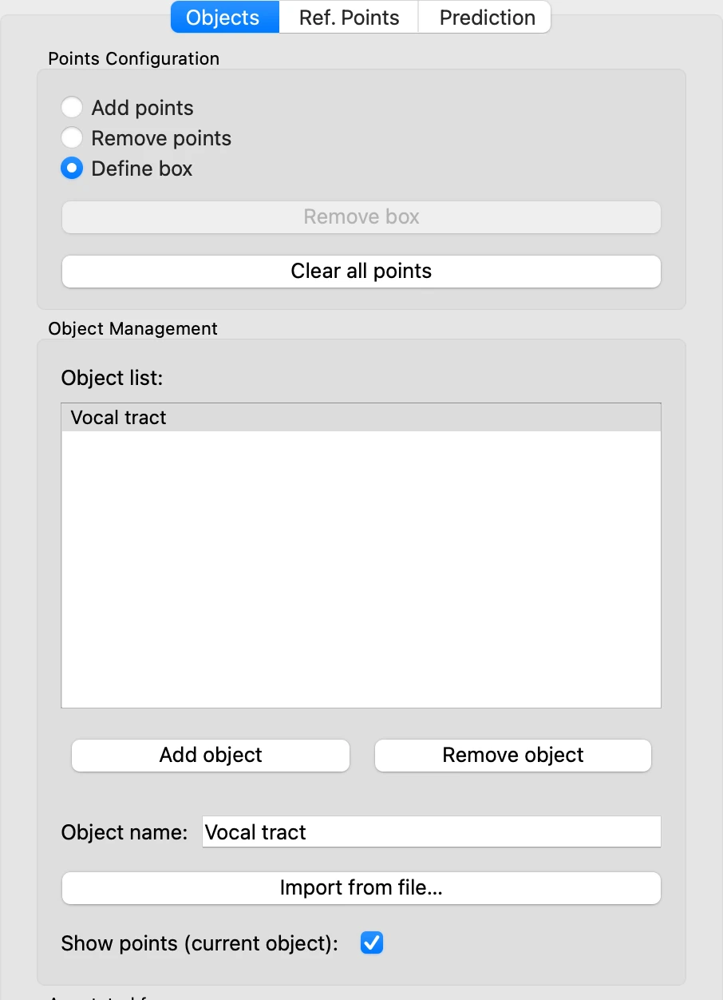
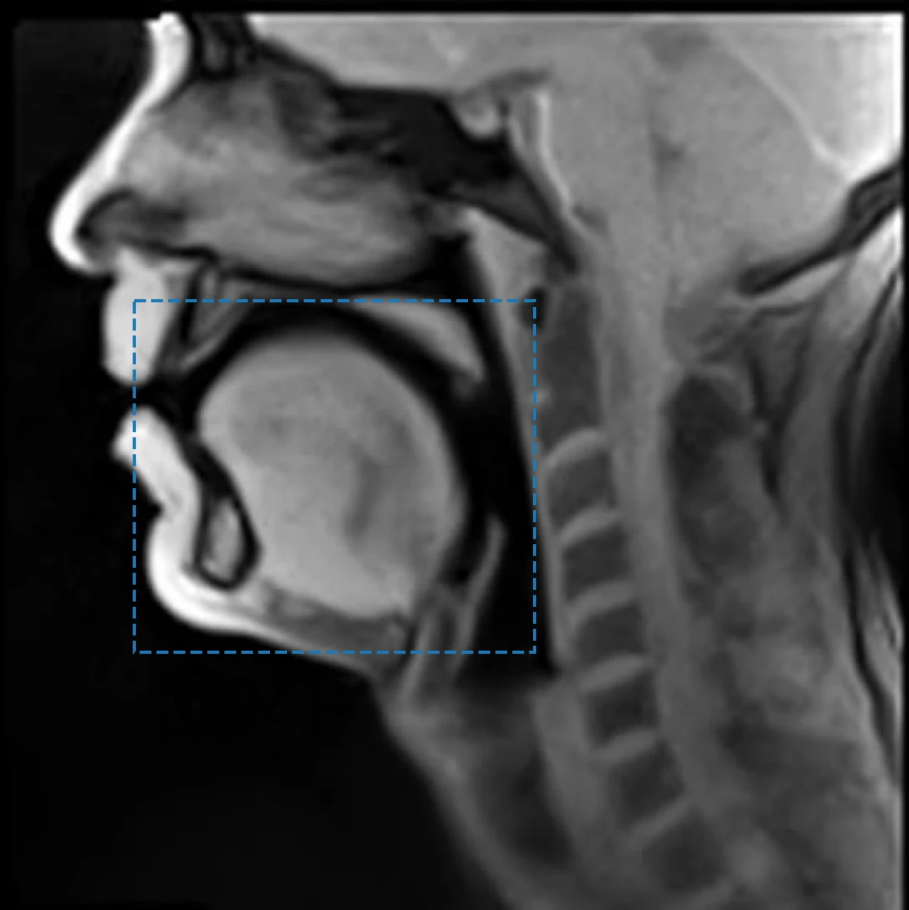
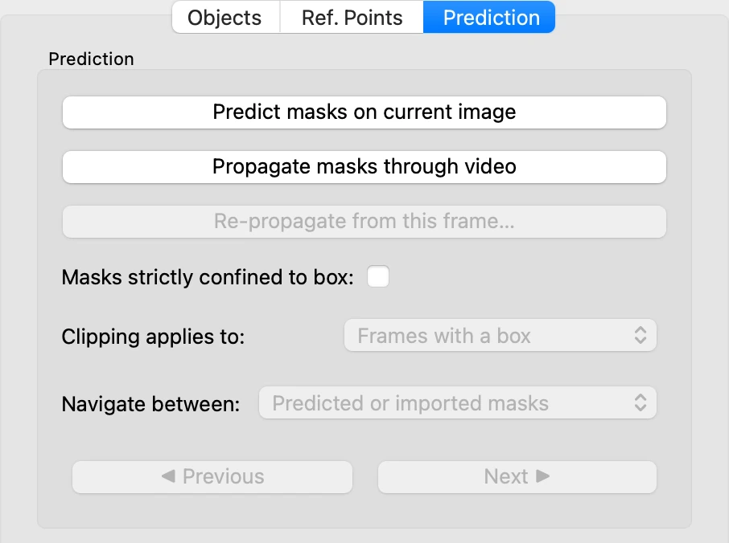
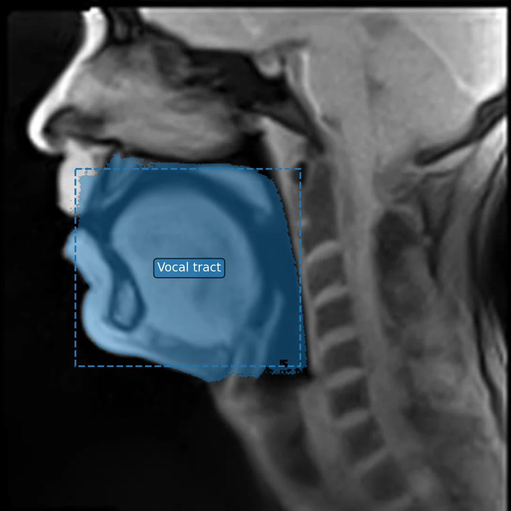
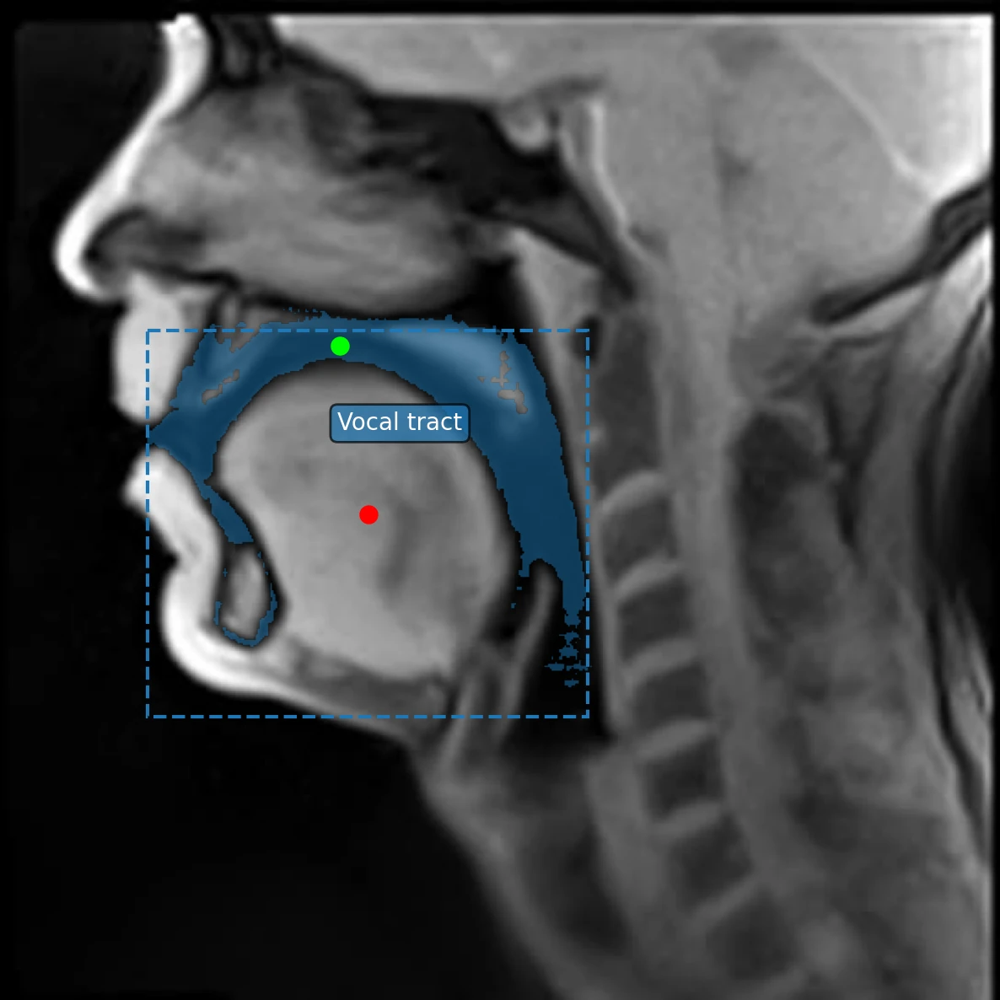

# 3. A first object

*[Version française](first-object.fr.md)*

An **object** is what VOLUTE outlines and follows from frame to frame. Here it is the
inside of the **vocal tract**: the air-filled space of the oral cavity[^buccale] and the pharyngeal
cavity[^pharyngale], down to the glottis[^glotte], dark in the images, whose shape changes with every sound. The outline VOLUTE computes on each
frame is called a **mask**.

## Naming the object

VOLUTE starts with one object, **Object 1**, in the **Objects** tab. In **Object name**,
type `Vocal tract`: the name appears in the list, and later in the exported files.

## Bounding the region with a box

The first step is most often to tell VOLUTE where the object lies, by drawing a
rectangular area called a **box** around it.

1. At the top of the **Objects** tab, select **Define box**.
2. Drag the mouse over the image, from in front of the lips, just below the hard
   palate[^palais-dur], to the back wall of the pharynx, above the larynx[^larynx]. The
   box appears as a dashed outline, in the object's colour.

The upper edge of the box, below the palate, leaves out as much of the nasal cavity as
possible, since this tutorial takes the vocal tract to be segmented as its oral part
only; the lower edge leaves out the larynx.

## Predicting the mask

Open the **Prediction** tab and click **Predict masks on current image**.

VOLUTE confirms that the prediction succeeded: click **OK**. The mask is drawn in blue
over the image — and it covers almost everything inside the box: the air of the vocal
tract, but also the tongue, the lower lip and the floor of the mouth.

This is no error. A box tells *in which area* the object lies, not *how to outline it
precisely*: the model outlined the largest region the box takes in. For a compact object
that fills its box, like the tongue in [step 4](objects.md), this is often enough. The
vocal tract, thin and curved around the tongue, takes up only a small part of its box:
points will specify what belongs to it.

The mask even spills over the box in places: the box is a hint given to the model, not a
strict limit (see [Changing the box](#changing-the-box)).

## Refining with points

Clicks on the image tell VOLUTE what should be taken as part of the object or not:

- a **left click** puts a **positive point**, green by default: *this belongs to the
  object*;
- a **right click**, or Ctrl + click, puts a **negative point**, red by default: *this
  does not*.

Go back to the **Objects** tab and select **Add points**: in **Define box** mode, a drag
would replace the box.

Each correction follows the same routine: click on the image in the **Objects** tab,
then predict again from the **Prediction** tab. VOLUTE recomputes the mask from the box
and all the points of the frame each time.

Several points, positive or negative, can also be placed between two predictions. In this
tutorial they are added one at a time, to show better what each point changes in the
prediction.

**1. Point at the air of the vocal tract.** Left-click in the dark band of the oral
cavity, between the tongue and the palate, then predict. The mask hardly changes.

This point is not useless for all that: it anchors the prediction in the air of the
vocal tract. Without it, the next, negative, point would give a mask full of holes and
scattered pieces.

**2. Leave out the tongue.** Right-click in the middle of the tongue, then predict. The
tongue leaves the mask, which narrows to the vocal tract, but stops about halfway down
the pharynx.

**3. Add the lower pharynx.** Left-click in the dark band of the pharynx, behind the
root of the tongue, then predict. The mask runs from the lips to the lower edge of the
box, above the larynx.

Although improved, this outline of the vocal tract is not yet satisfactory: the mask
still takes in structures that do not belong to it, around the soft palate in
particular. Step 5, [Correcting masks](corrections.md), shows how to spot and correct
them.

> **A point in the wrong place?** **Edit › Undo** (Ctrl + Z, or ⌘ + Z on a Mac) removes
> the last one. **Remove points**, at the top of the **Objects** tab, removes all the
> points inside a rectangle drawn on the image.

## Changing the box

- A new drag in **Define box** mode replaces the box; **Remove box**, at the top of the
  **Objects** tab, deletes it.
- To make the box a strict limit, tick **Masks strictly confined to box** in the
  **Prediction** tab: whatever the following predictions find outside the box is then
  cleared. This mode is not on by default, as it can leave masks cut off abruptly at the
  edges of the box, which in most cases is not what is wanted.
- If a new box leaves points already placed outside it, VOLUTE says how many and offers
  to delete them: the positive points outside the box contradict it, while the negative
  ones agree with it, but may no longer be needed. **Edit › Undo** then restores the
  former box and the deleted points at once.
- A point placed outside the box asks for confirmation: step 5 shows it.

## What next

The mask exists only on frame 1 so far. Before following it through the video, in
[step 6](tracking.md), the other objects are outlined on this same frame (step 4), then
the masks are corrected (step 5): propagation will thus start from accurate outlines.

To keep this work, **File › Project Data › Export Project Data** (Ctrl + S, or ⌘ + S on
a Mac) saves the objects and their points to a file, which can be opened again later
(step [9](project.md)).

[^buccale]: The space of the mouth, bounded by the lips and teeth at the front and by the palate above, and largely taken up by the tongue.
[^pharyngale]: The inner space of the pharynx, the tube behind the oral and nasal cavities that runs down to the larynx.
[^glotte]: The space between the vocal folds, commonly called vocal cords, in the larynx: the lower end of the vocal tract.
[^palais-dur]: The front, bony part of the palate, which separates the oral cavity from the nasal cavity.
[^larynx]: The organ at the bottom of the pharynx, at the top of the trachea, which holds the vocal folds.

Previous: [2. Loading the frames](load-frames.md) · Next: [4. Several objects](objects.md)
