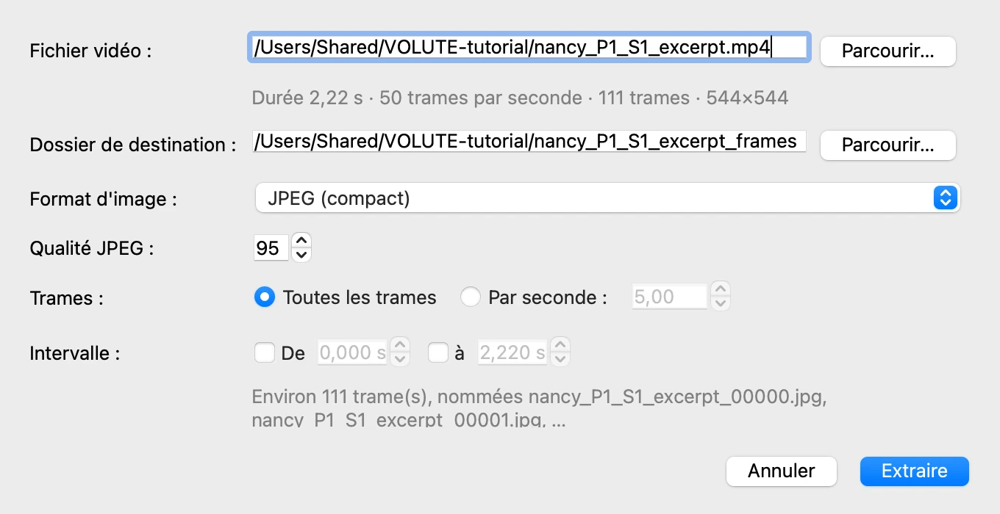
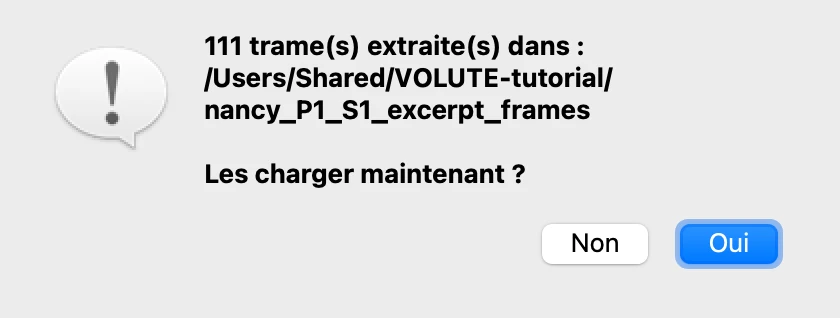
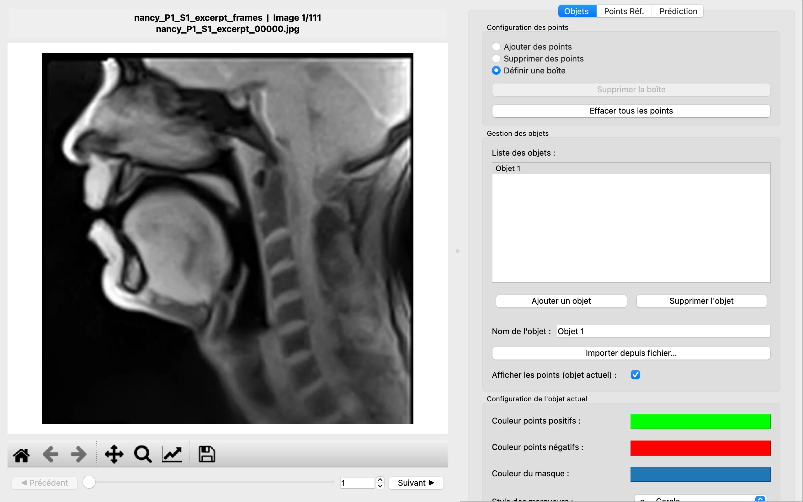

# 2. Charger les trames

*[English version](load-frames.md)*

VOLUTE travaille sur un **dossier d'images**, une par trame, plutôt que sur la vidéo
elle-même. À partir d'une vidéo, il commence donc par en extraire les trames dans un tel
dossier.

## Extraire les trames de la vidéo

1. Choisissez **Fichier › Extraire les trames d'une vidéo…**.
2. À côté de **Fichier vidéo**, cliquez sur **Parcourir…** et choisissez la vidéo
   téléchargée au début, `nancy_P1_S1_excerpt.mp4`.

VOLUTE lit la vidéo et indique ce qu'elle contient : 2,22 secondes, 50 trames par
seconde, 111 trames de 544 × 544 pixels. Il propose un **dossier de destination** à côté
de la vidéo, nommé d'après elle.

Les autres réglages conviennent à la plupart des cas, et à celui-ci :

- **Format d'image** : JPEG est compact ; PNG ne perd rien, mais prend bien plus de place.
- **Trames** : **Toutes les trames** les garde toutes. **Par seconde** en garde moins,
  pour une longue vidéo dont toutes les trames ne sont pas nécessaires.
- **Intervalle** : pour ne garder qu'une partie de la vidéo, cochez **De** et **à** et
  indiquez les instants en secondes.

Cliquez sur **Extraire**. Quelques secondes plus tard, VOLUTE indique combien de trames
il a écrites et propose de les charger : cliquez sur **Oui**.

La première trame s'affiche, surmontée du nom de son dossier et de son fichier.

> **Des images que vous avez déjà.** Quand les trames sont déjà dans un dossier, choisissez
> plutôt **Fichier › Sélectionner un dossier d'images** (Ctrl + D, ou ⌘ + D sur Mac). Les
> images doivent toutes avoir la même taille ; elles sont prises dans l'ordre de leurs
> noms, les nombres étant comparés comme tels : `trame_2` passe avant `trame_10`.

## Passer d'une trame à l'autre

- **◀ Précédent** et **Suivant ▶** reculent ou avancent d'une trame.
- Le **curseur** parcourt toute la vidéo : faites-le glisser pour voir bouger la langue
  et les lèvres.
- Le **numéro**, à droite, indique la trame en cours ; tapez un numéro et appuyez sur
  Entrée pour aller directement à cette trame.

Revenez à la trame 1 avant l'étape suivante.

Précédent : [1. Avant de commencer](start.fr.md) · Suite : [3. Un premier objet](first-object.fr.md)
