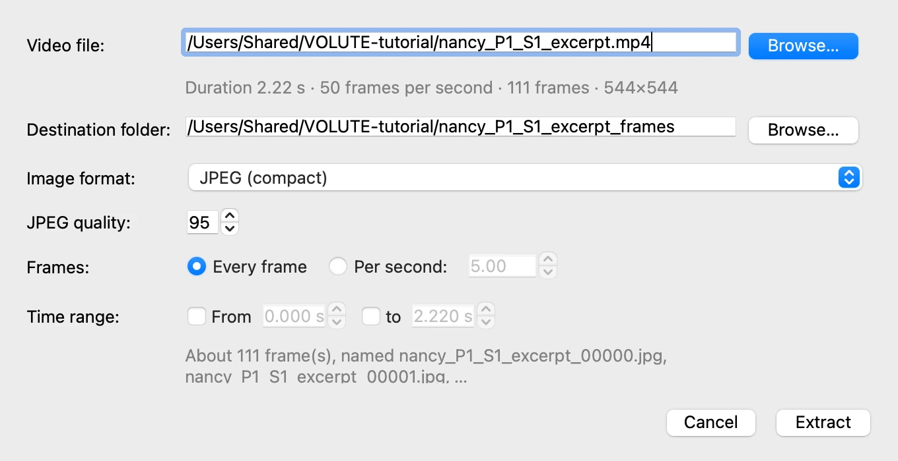
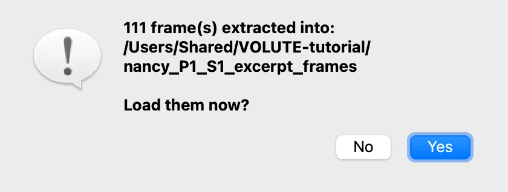
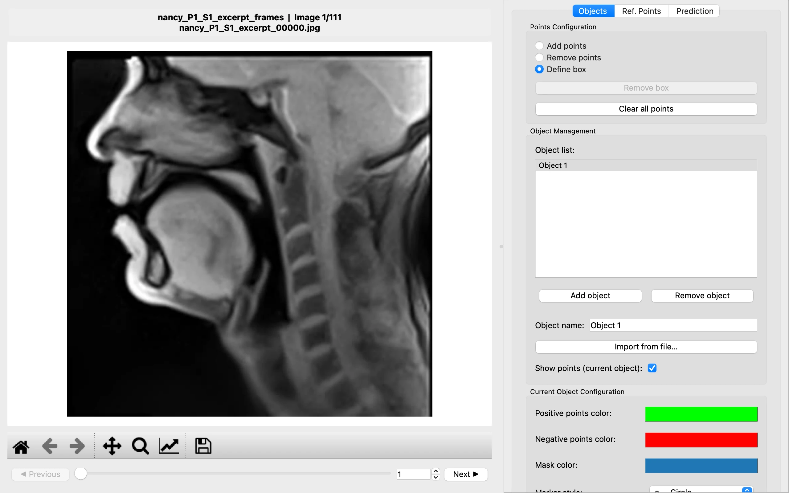
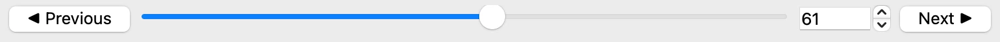

# 2. Loading the frames

*[Version française](load-frames.fr.md)*

VOLUTE works on a **folder of images**, one per frame, rather than on the video itself.
Starting from a video, it first extracts its frames into such a folder.

## Extracting the frames of the video

1. Choose **File › Extract Frames from Video…**.
2. Next to **Video file**, click **Browse…** and choose the video downloaded at the start,
   `nancy_P1_S1_excerpt.mp4`.

VOLUTE reads the video and shows what it holds: 2.22 seconds, 50 frames per second, 111
frames of 544 × 544 pixels. It suggests a **destination folder** next to the video, named
after it.

The other settings suit most cases, and this one:

- **Image format**: JPEG is compact; PNG loses nothing, but takes far more space.
- **Frames**: **Every frame** keeps them all. **Per second** keeps fewer, for a long video
  in which every frame is not needed.
- **Time range**: to keep only part of the video, tick **From** and **to** and give the
  times in seconds.

Click **Extract**. A few seconds later, VOLUTE reports how many frames it wrote and
offers to load them: click **Yes**.

The first frame appears, with its folder and file name above it.

> **Images you already have.** When the frames are already in a folder, choose **File ›
> Select image folder** (Ctrl + D, or ⌘ + D on a Mac) instead. The images must all have
> the same size; they are taken in the order of their names, numbers compared as numbers:
> `frame_2` comes before `frame_10`.

## Moving from frame to frame

- **◀ Previous** and **Next ▶** move one frame back or forward.
- The **slider** runs through the whole video: drag it to see the tongue and lips move.
- The **number** on the right shows the current frame; type a number and press Enter to go
  straight to that frame.

Go back to frame 1 before the next step.

Previous: [1. Before you start](start.md) · Next: [3. A first object](first-object.md)
