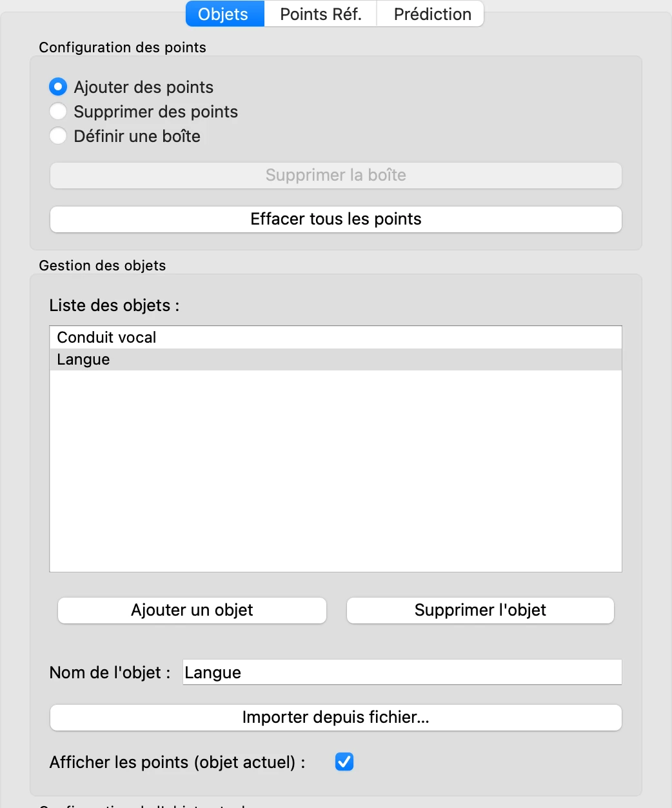
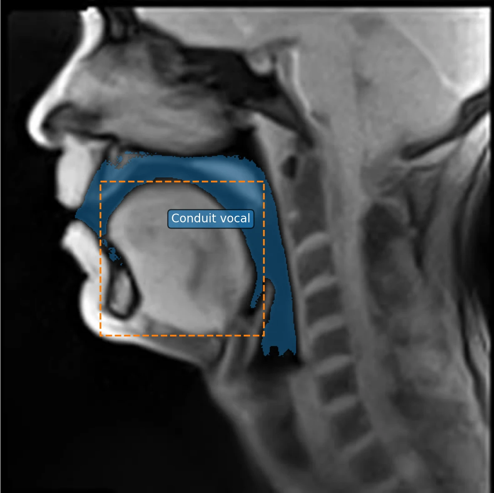
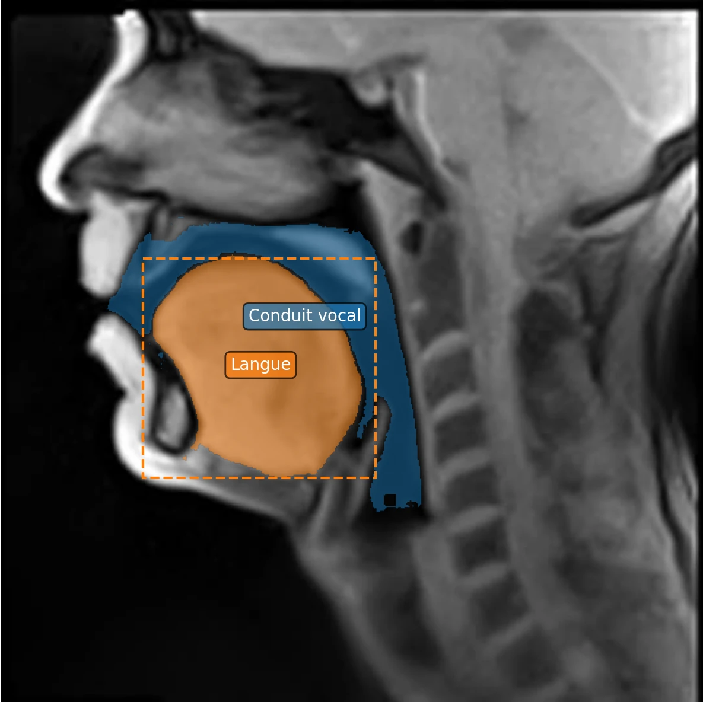

# 4. Plusieurs objets

*[English version](objects.md)*

VOLUTE tire parti de la capacité des modèles sur lesquels il repose à suivre plusieurs
objets à la fois, chacun avec son nom, sa couleur et ses points. Cette étape ajoute un
second objet au conduit vocal de l'étape précédente : la langue, délimitée cette fois
par une boîte seule.

## Ajouter un objet

Dans l'onglet **Objets**, cliquez sur **Ajouter un objet**. **Objet 2** apparaît dans la
liste, sélectionné ; dans **Nom de l'objet**, tapez `Langue`.

L'objet sélectionné dans la liste est celui qui reçoit les clics et la boîte. Pour
revenir à un autre objet, cliquez d'abord sur son nom dans la liste.

## Délimiter par une boîte seule

La langue, compacte et nettement séparée de l'air qui la borde en haut et en arrière,
remplit presque toute la boîte tracée autour d'elle : la boîte suffit à la désigner, sans
aucun point.

1. En haut de l'onglet **Objets**, sélectionnez **Définir une boîte**.
2. Faites glisser la souris sur l'image, depuis au-dessus et à gauche de la langue jusqu'en
   dessous et à droite. La boîte apparaît en pointillés, dans la couleur de l'objet.

3. Dans l'onglet **Prédiction**, cliquez sur **Prédire les masques sur l'image
   actuelle**. La langue apparaît, dans une couleur qui lui est propre.

Comme à l'étape 3, sélectionnez de nouveau **Ajouter des points** avant de cliquer sur
l'image : en mode **Définir une boîte**, un glisser remplace la boîte.

## La liste des objets

Autour de la liste des objets, visible plus haut :

- **Ajouter un objet** ajoute un objet, autant qu'il en faut.
- **Supprimer l'objet** efface l'objet sélectionné, avec ses points et ses masques.
- Sous la liste, **Configuration de l'objet actuel** règle les couleurs de l'objet
  sélectionné — points et masque — ainsi que le style et la taille de ses points.
- Quand **Afficher les points (objet actuel)** est coché, seuls les points de l'objet
  sélectionné sont affichés, pour ne pas les confondre.

Les deux objets seront suivis ensemble dans toute la vidéo à l'[étape 6](tracking.fr.md),
une fois leurs masques corrigés sur la trame 1. Plus il y a d'objets, plus le suivi prend
de temps.

Précédent : [3. Un premier objet](first-object.fr.md) · Suite : [5. Corriger les masques](corrections.fr.md)
