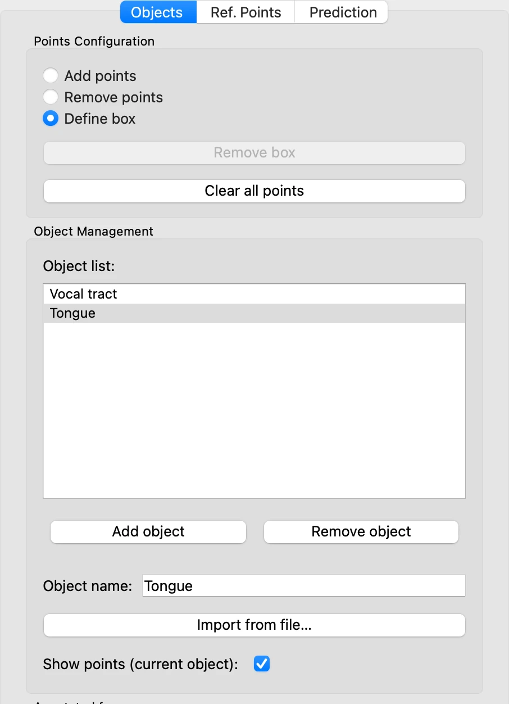
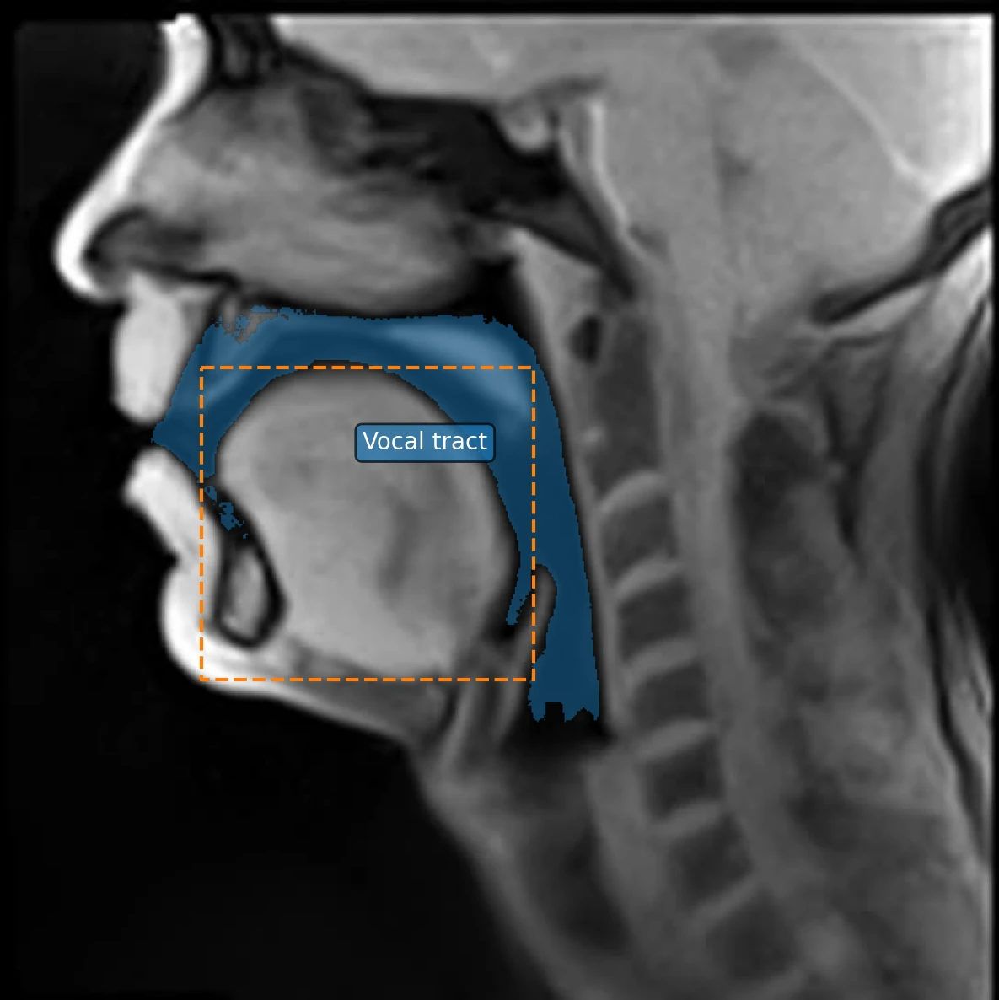
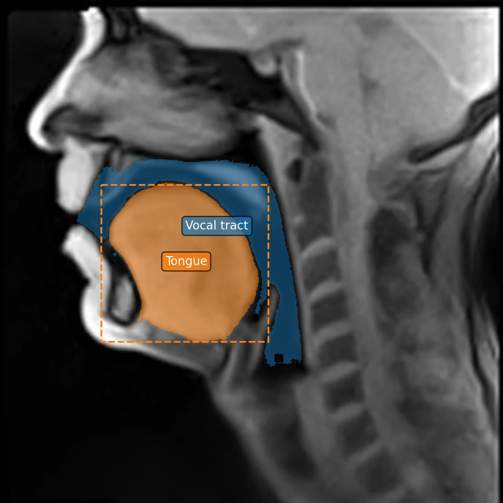

# 4. Several objects

*[Version française](objects.fr.md)*

VOLUTE draws on the ability of the models it relies on to follow several objects at
once, each with its own name, colour and points. This step adds a second object to the
vocal tract of the previous step: the tongue, outlined this time with a box alone.

## Adding an object

In the **Objects** tab, click **Add object**. **Object 2** appears in the list, selected;
in **Object name**, type `Tongue`.

The object selected in the list is the one that receives the clicks and the box. To work
on another object again, click its name in the list first.

## Outlining with a box alone

The tongue, compact and clearly set apart from the air that borders it above and behind,
almost fills the box drawn around it: the box is enough to point it out, without any
point.

1. At the top of the **Objects** tab, **Define box** has been selected since the object
   was created.
2. Drag across the image, from above and left of the tongue to below and right of it.
   The box appears as a dashed rectangle, in the object's colour.

3. In the **Prediction** tab, click **Predict masks on current image**. The tongue appears,
   in a colour of its own.

As in step 3, VOLUTE switched to **Add points** mode once the box was drawn: the tongue
needs none here, but clicks on the image would add some to it.

## The object list

Around the object list, shown above:

- **Add object** adds an object, as many as needed.
- **Remove object** deletes the selected object, with its points and masks.
- Below the list, **Current Object Configuration** sets the selected object's colours —
  points and mask — and the style and size of its points.
- With **Show points (current object)** ticked, only the selected object's points are
  shown, so that they do not get mixed up.

Both objects will be followed together through the whole video in [step 6](tracking.md),
once their masks have been corrected on frame 1. The more objects, the longer the tracking
takes.

Previous: [3. A first object](first-object.md) · Next: [5. Correcting masks](corrections.md)
