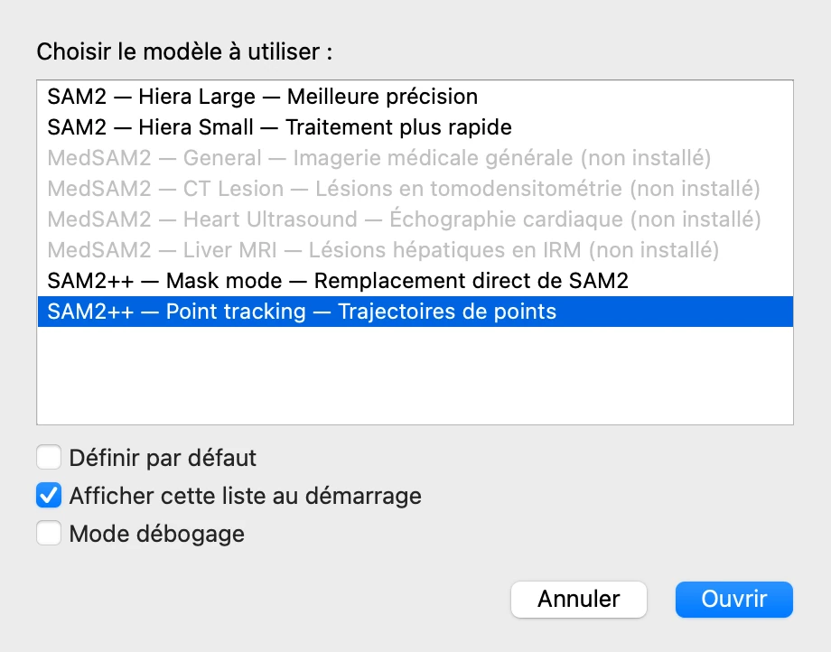
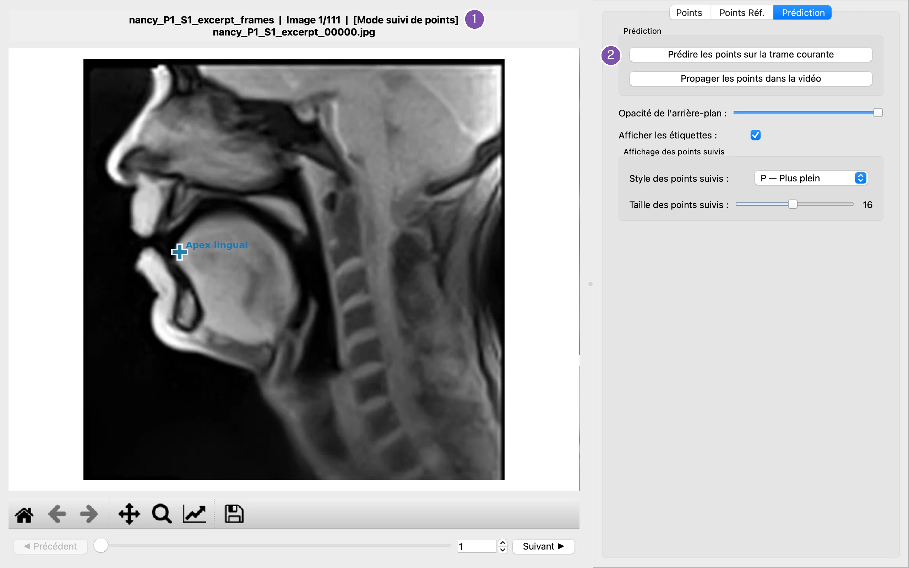
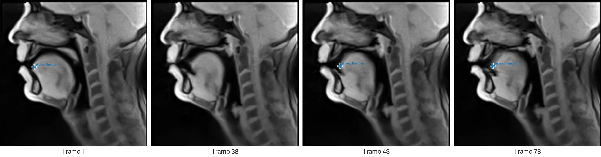
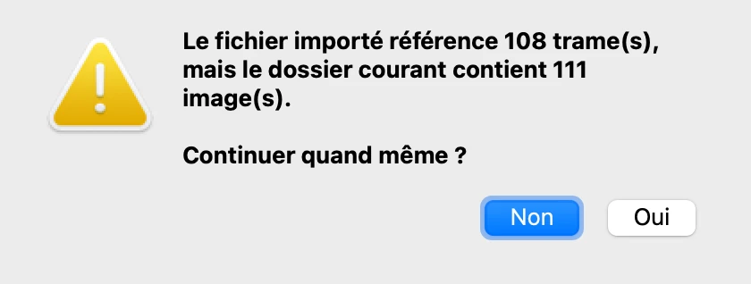
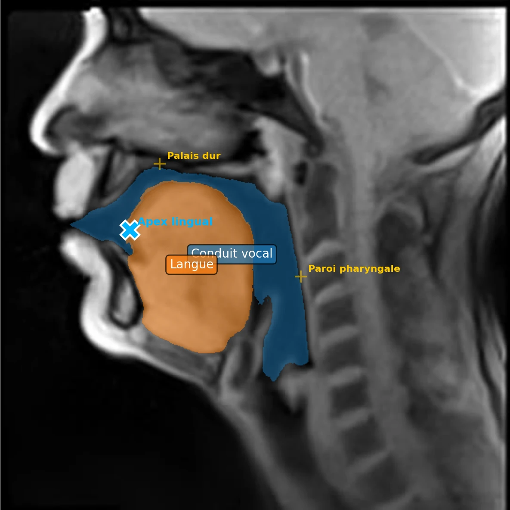
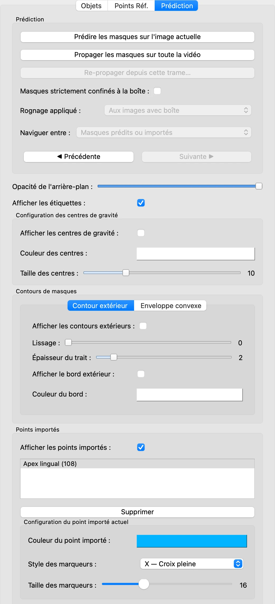

# 10. Suivre des points avec SAM2++

*[English version](points.md)*

Certaines mesures portent sur un point plutôt que sur une région : la pointe de la langue,
une commissure des lèvres. **SAM2++**, en mode suivi de points, suit à travers toute la
vidéo un point posé sur une trame. Cette étape suit l'apex lingual[^apex], puis ramène ses
positions à côté des masques des étapes précédentes.

SAM2++ est un modèle à part, que l'installateur propose en option (voir les guides
d'installation pour [macOS](../install-macos.fr.md) et [Windows](../install-windows.fr.md)).

## Lancer VOLUTE avec SAM2++

Le modèle est choisi au lancement de VOLUTE. Enregistrez le projet (étape 9), fermez
VOLUTE et relancez-le ; dans la fenêtre de choix du modèle, choisissez **SAM2++ — Point
tracking**.

Choisissez ensuite **Fichier › Sélectionner un dossier d'images** et sélectionnez le
dossier des trames de l'étape 2.

## Définir le point

La fenêtre est celle des étapes précédentes, à quelques différences près : l'onglet
**Objets** s'appelle **Points**, le titre se termine par **[Mode suivi de points]** (1),
et l'onglet **Prédiction** prédit des points plutôt que des masques (2).

1. Dans l'onglet **Points**, dans **Nom de l'objet**, tapez `Apex lingual`.
2. Faites un clic gauche sur la pointe de la langue, juste derrière les incisives
   inférieures. Chaque objet n'a qu'un point, et le clic droit n'a pas d'effet en mode
   suivi de points : un nouveau clic déplace le point.
3. Dans l'onglet **Prédiction**, cliquez sur **Prédire les points sur la trame
   courante**.

**Affichage des points suivis**, dans l'onglet **Prédiction**, règle le style et la
taille des marqueurs ; la taille est ici portée à 16, pour que la croix soit visible sur
l'image entière.

## Suivre le point

Cliquez sur **Propager les points dans la vidéo**. SAM2++ suit le point de trame en
trame, plus vite que des masques : environ une minute pour les 111 trames.

L'apex est suivi quand la langue recule, sur les trames 43 et 78. Autour de la trame 38,
le modèle le perd, et ne donne aucune position : la trame 38 n'a pas de croix. Les
trames perdues peuvent changer d'une exécution à l'autre, SAM2++ ne donnant pas
exactement le même résultat à chaque fois (voir dans la FAQ
[Les mêmes points donnent-ils toujours exactement les mêmes masques ?](../faq.fr.md#les-mêmes-points-donnent-ils-toujours-exactement-les-mêmes-masques-)).
Pour corriger le suivi, placez le point à sa bonne position sur une trame où il se
trompe, prédisez, puis propagez de nouveau : comme les masques à
l'[étape 6](tracking.fr.md#plusieurs-trames-annotées), le point est alors suivi à partir
de chacune des trames où il a été placé. Vérifiez la trajectoire trame par trame, et
traitez les trames sans point comme des valeurs manquantes.

## Exporter les positions

En mode suivi de points, le menu **Fichier › Exportation** contient quatre entrées :

- **Exporter les points suivis** (Ctrl + Maj + P, ou ⇧ + ⌘ + P) écrit une ligne par trame
  où le point a été trouvé : son nom, la trame, et ses coordonnées `X_px` et `Y_px` ;
- **Exporter les images avec les points suivis** écrit chaque trame avec ses marqueurs ;
- **Exporter une vidéo avec points suivis…** en fait une vidéo, comme à
  l'[étape 8](export.fr.md#une-vidéo-avec-les-masques) pour les masques ;
- **Exporter les distances aux points de référence…** mesure, comme à l'étape 8, la
  distance de chaque point aux points de référence posés dans cette session.

Choisissez **Exporter les points suivis** et gardez le nom proposé,
`nancy_P1_S1_excerpt_frames_tracked_points.xlsx`.

## Combiner les points et les masques

Fermez VOLUTE et relancez-le avec **SAM2 — Hiera Large**. Sélectionnez le dossier des
trames, ouvrez le projet et propagez les masques, comme à l'étape 9. Choisissez ensuite
**Fichier › Importer les points suivis…** (Ctrl + Maj + J, ou ⇧ + ⌘ + J) et sélectionnez
le fichier exporté.

VOLUTE vérifie que le fichier correspond aux trames, et signale ici qu'il en couvre 108
sur 111, les trois trames où le point a été perdu manquant :

Cliquez sur **Oui**. L'apex apparaît désormais à côté des masques, comme **point
importé**, sur chaque trame où il a été trouvé. Ici, la trame 43 :

Le panneau **Points importés**, dans l'onglet **Prédiction**, les affiche ou les masque
tous, et règle la couleur, le marqueur et la taille de chaque point.

## Le point et les masques ensemble

**Fichier › Exportation › Exporter l'analyse point/masque…** (Ctrl + Maj + A, ou
⇧ + ⌘ + A) mesure, pour chaque objet et chaque point importé, trame par trame, si le
point se trouve dans le masque (`Inside_Mask`), et sa distance au masque et à son centre
de gravité. Après la même fenêtre de sélection des paires qu'à l'étape 8, les lignes de
la langue pour les trames 1, 38, 43 et 78 sont, avec des distances arrondies :

| Object_Name | Imported_Point_Name | Frame_Index | Inside_Mask | Distance_To_Centroid_px | Distance_To_Mask_px |
|---|---|---|---|---|---|
| Langue | Apex lingual | 0 | True | 83.78 | 0 |
| Langue | Apex lingual | 37 | False | 80.86 | 1 |
| Langue | Apex lingual | 42 | True | 75.12 | 0 |
| Langue | Apex lingual | 77 | True | 63.31 | 0 |

Sur les trames 1, 43 et 78, l'apex se trouve dans le masque de la langue, d'où les
distances au masque de 0 ; il se rapproche de son centre de gravité à mesure que la langue
recule. Sur la trame 38 (`Frame_Index` 37), où la croix vue plus haut est juste au-dessus
de la langue, il tombe hors du masque, à 1 pixel de son bord.

**Une autre exécution, un autre résultat.** Les copies d'écran de la version anglaise de
ce tutoriel ont été prises lors d'une autre exécution, sur le même extrait et avec les
mêmes réglages : SAM2++ y perd l'apex sur les trames 37 à 39. À l'import, VOLUTE signale
alors que le fichier ne couvre que 108 trames sur 111 et demande s'il faut continuer ;
ces trois trames n'ont ensuite aucune ligne dans l'analyse point/masque exportée. Voir
[Combining the points and the masks](https://nicolasaudibert.github.io/VOLUTE/tutorial/points/#combining-the-points-and-the-masks)
(en anglais).

[^apex]: La pointe de la langue.

Précédent : [9. Enregistrer, reprendre, traiter par lot](project.fr.md) · Suite : [11. Paramètres, langue, raccourcis](settings.fr.md)
