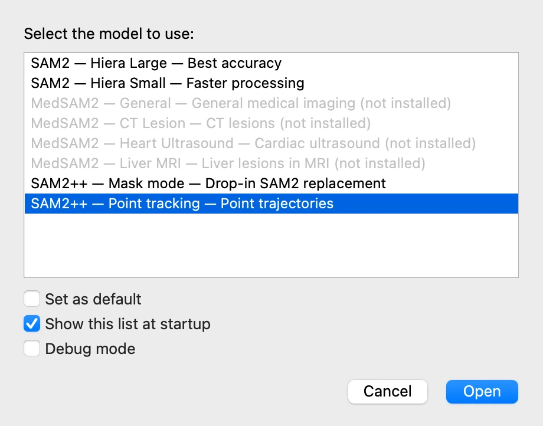
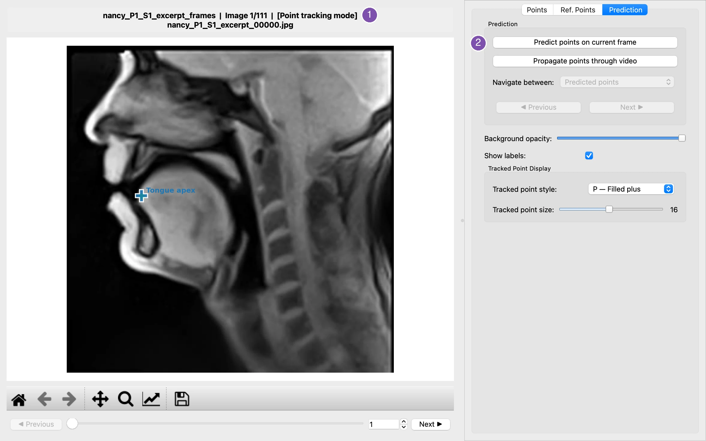
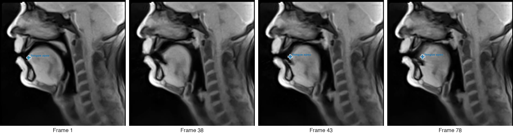
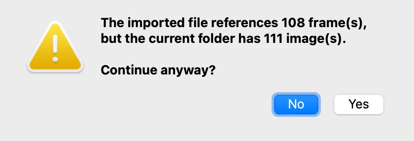
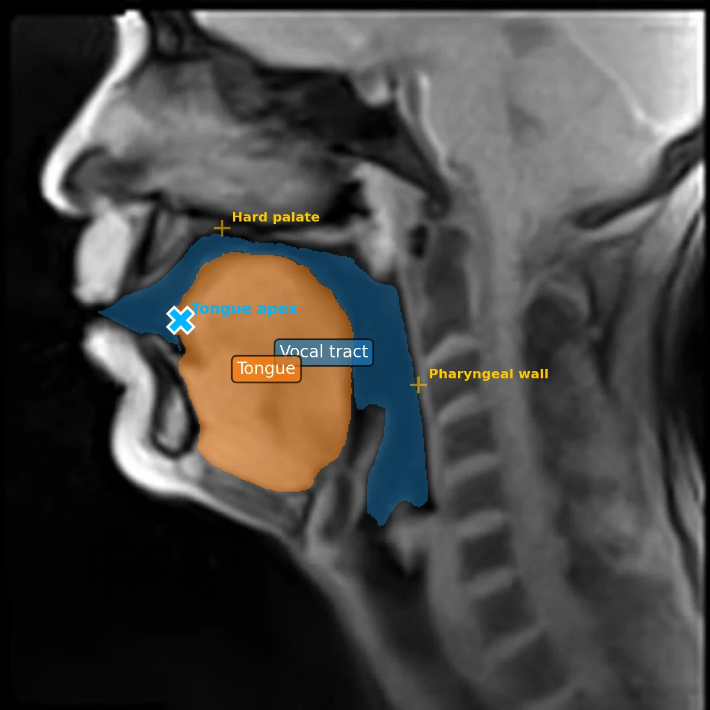
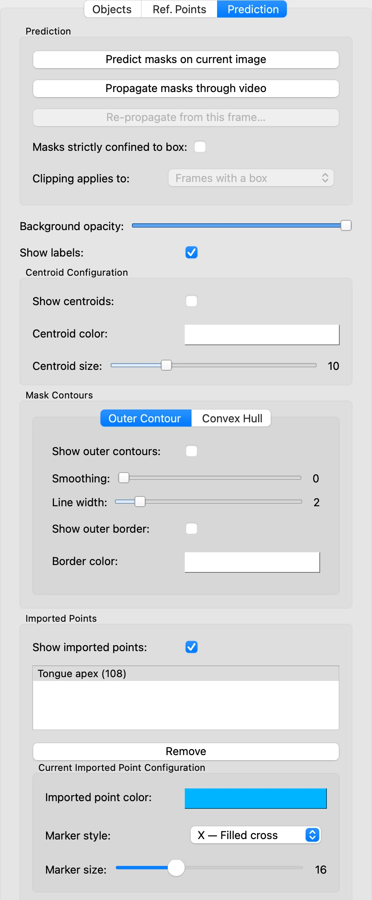

# 10. Following points with SAM2++

*[Version française](points.fr.md)*

Some measurements concern a point rather than a region: the tip of the tongue, a corner of
the lips. **SAM2++**, in point tracking mode, follows a point placed on one frame through
the whole video. This step follows the tongue apex[^apex], then brings its positions back beside
the masks of the previous steps.

SAM2++ is a model of its own, offered by the installer as an option (see the installation
guides for [macOS](../install-macos.md) and [Windows](../install-windows.md)).

## Starting VOLUTE with SAM2++

The model is chosen when VOLUTE starts. Save the project (step 9), close VOLUTE and start
it again; in the model selection window, choose **SAM2++ — Point tracking**.

Then choose **File › Select image folder** and select the frame folder of step 2.

## Placing the point

The window is the one of the previous steps, with a few differences: the **Objects** tab
is called **Points**, the title ends with **[Point tracking mode]** (1), and the
**Prediction** tab predicts points rather than masks (2).

1. In the **Points** tab, in **Object name**, type `Tongue apex`.
2. Left-click on the tip of the tongue, just behind the lower incisors. Each object has a
   single point, and right-clicking has no effect in point tracking mode: a new click
   moves the point.
3. In the **Prediction** tab, click **Predict points on current frame**.

**Tracked Point Display**, in the **Prediction** tab, sets the style and size of the
markers; here the size is raised to 16, so that the cross is visible on the whole image.

## Following the point

Click **Propagate points through video**. SAM2++ follows the point from frame to frame,
faster than masks: about a minute for the 111 frames.

The apex is followed as the tongue draws back, on frames 43 and 78. On frames 37 to 39,
the model loses it, and gives no position at all: frame 38 has no cross. The frames
lost can change from one run to the next, SAM2++ not giving exactly the same result every
time (see
[Do the same points always give exactly the same masks?](../faq.md#do-the-same-points-always-give-exactly-the-same-masks)
in the FAQ). Point tracking offers no correction: check the track frame by frame, and treat the
frames without a point as missing values.

## Exporting the positions

In point tracking mode, the **File › Export** menu holds three entries:

- **Export tracked points** (Ctrl + Shift + P, or ⇧ + ⌘ + P) writes one row per frame on
  which the point was found: its name, the frame, and its coordinates `X_px` and `Y_px`;
- **Export images with tracked points** writes each frame with its markers;
- **Export closest tracked point distances…** measures, as in step 8, the distance from
  each point to reference points placed in this session.

Choose **Export tracked points** and keep the suggested name,
`nancy_P1_S1_excerpt_frames_tracked_points.xlsx`.

## Combining the points and the masks

Close VOLUTE and start it again with **SAM2 — Hiera Large**. Select the frame folder, open
the project and propagate the masks, as in step 9. Then choose **File › Import Tracked
Points…** (Ctrl + Shift + J, or ⇧ + ⌘ + J) and select the exported file.

VOLUTE checks that the file matches the frames, and notes here that it covers 108 frames
out of 111, the three frames where the point was lost being missing:

Click **Yes**. The apex now shows beside the masks, as an **imported point**, on every frame
where it was found. Here, frame 43:

The **Imported Points** panel, in the **Prediction** tab, shows or hides them all, and sets
each point's colour, marker and size.

## The point and the masks together

**File › Export › Export Point/Mask Analysis…** (Ctrl + Shift + A, or ⇧ + ⌘ + A) measures,
for each object and each imported point, frame by frame, whether the point lies inside
the mask (`Inside_Mask`), and its distance to the mask and to the mask's centre of gravity.
After the same pair selection window as in step 8, the rows for the tongue on frames 1, 43
and 78 read, distances rounded:

| Object_Name | Imported_Point_Name | Frame_Index | Inside_Mask | Distance_To_Centroid_px | Distance_To_Mask_px |
|---|---|---|---|---|---|
| Tongue | Tongue apex | 0 | True | 83.77 | 0 |
| Tongue | Tongue apex | 42 | True | 74.28 | 0 |
| Tongue | Tongue apex | 77 | True | 64.06 | 0 |

On these three frames, the apex lies inside the tongue's mask, hence distances to the mask
of 0; it comes nearer to its centre of gravity as the tongue draws back. Frame 38, where
the point was lost, is not represented by a row in the exported file.

**Another run, another result.** The screenshots of the French version of this tutorial
were taken during another run, on the same excerpt and with the same settings: there,
SAM2++ finds the apex on all 111 frames, and the file is imported without a warning. On
frame 38, the cross sits just above the tongue, and the point/mask analysis gives a row
with `Inside_Mask` False, 1 pixel from the mask. See
[Combiner les points et les masques](https://nicolasaudibert.github.io/VOLUTE/fr/tutorial/points/#combiner-les-points-et-les-masques)
(in French).

[^apex]: The tip of the tongue.

Previous: [9. Saving, resuming, batch processing](project.md) · Next: [11. Settings, language, shortcuts](settings.md)
