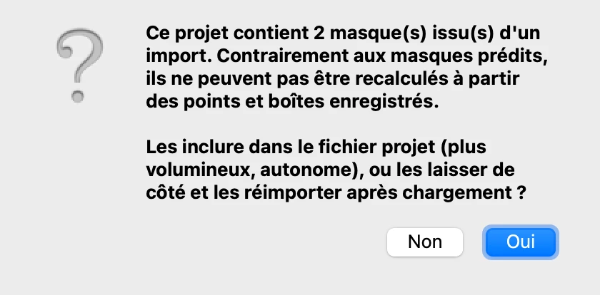
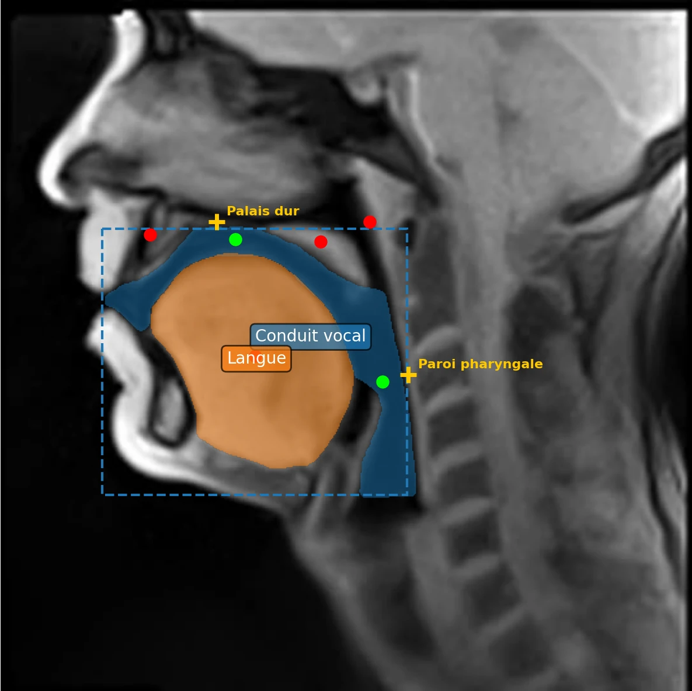
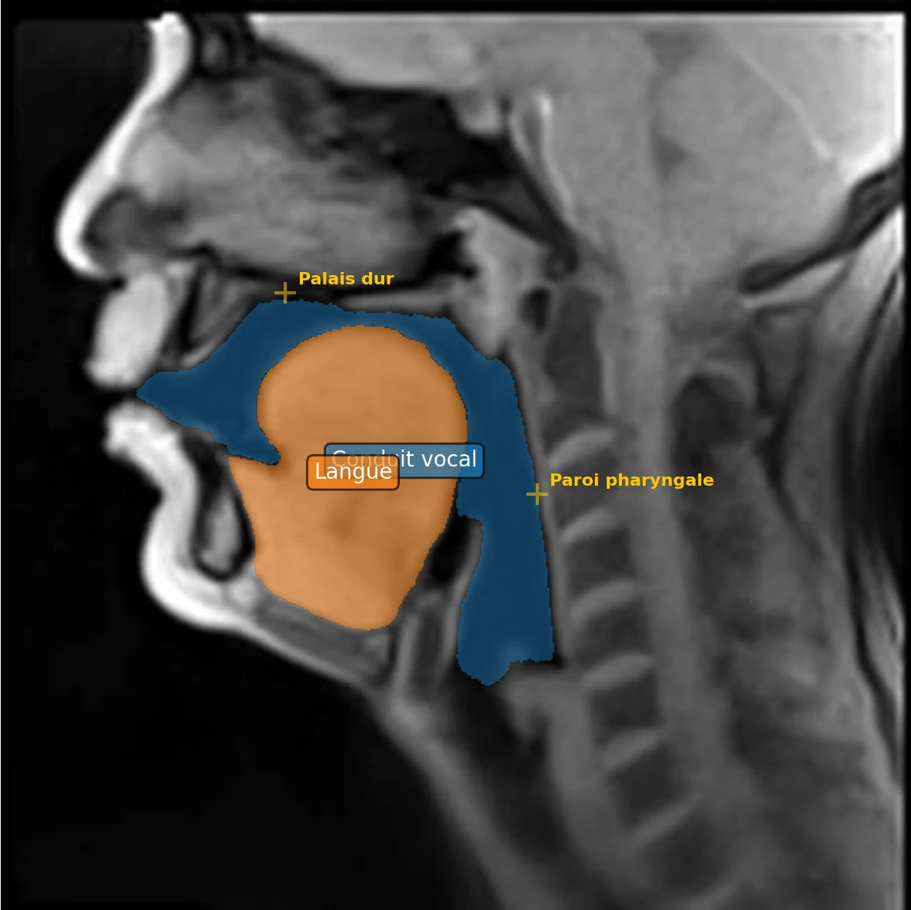
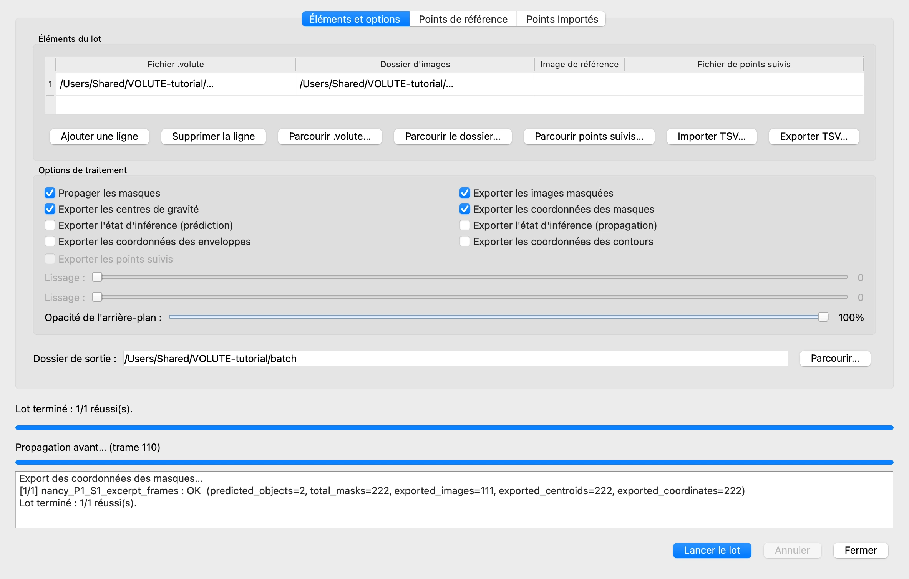

# 9. Enregistrer, reprendre, traiter par lot

*[English version](project.md)*

Tout ce qui a été fait jusqu'ici n'existe que dans la mémoire de VOLUTE, et se perd quand
VOLUTE est fermé. Cette étape enregistre le travail dans un **fichier projet**, le rouvre
dans une nouvelle session, puis le confie au **traitement par lot**, qui fait ou refait
les calculs sans nécessiter l'intervention de l'utilisateur.

## Enregistrer le projet

Choisissez **Fichier › Données du Projet › Exporter les données du projet** (Ctrl + S, ou
⌘ + S sur Mac). VOLUTE propose un nom tiré du dossier des trames,
`nancy_P1_S1_excerpt_frames_objects.volute`.

Le fichier projet conserve les objets, avec leurs noms et leurs couleurs, les points, les
boîtes, les points de référence, et les points importés de SAM2++ (étape 10). Il ne
conserve pas les masques prédits par VOLUTE : ils peuvent être recalculés à partir des
points et des boîtes, et ne pas les inclure permet d'éviter que le fichier devienne trop
volumineux.

Les masques importés de GIMP font exception, puisqu'aucun point ne permet de les
recalculer. VOLUTE demande s'il faut les inclure :



Cliquez sur **Oui** : le fichier contient alors tout ce qu'il faut pour reprendre.

## Reprendre

Fermez VOLUTE. Pour reprendre le travail, plus tard ou sur un autre ordinateur :

1. Lancez VOLUTE, avec le même modèle.
2. Choisissez **Fichier › Sélectionner un dossier d'images** et sélectionnez le dossier
   des trames extraites à l'étape 2, `nancy_P1_S1_excerpt_frames`.
3. Choisissez **Fichier › Données du Projet › Importer les données du projet** (Ctrl + O,
   ou ⌘ + O) et sélectionnez le fichier projet.

Les objets réapparaissent, avec leurs points, leurs boîtes et les points de référence ;
seule la boîte de l'objet sélectionné, ici le conduit vocal, est affichée. Sur la trame 1,
les masques importés de GIMP reviennent aussi ; les autres trames n'ont pas encore de
masque.



4. Dans l'onglet **Prédiction**, cliquez sur **Propager les masques sur toute la
   vidéo** : les masques de toutes les trames sont recalculés, à partir des masques
   importés de la trame 1 et, pour la langue, de la correction de la trame 63. La langue
   ayant deux trames annotées, VOLUTE demande d'abord comment partager les trames qui les
   séparent (voir l'[étape 6](tracking.fr.md#plusieurs-trames-annotées)) : gardez
   **Jonction au milieu** et cliquez sur **OK**.



Un fichier projet va avec ses trames : ouvrez-le sur les mêmes images, ou du moins sur des
images de même taille avec les mêmes objets et/ou points à suivre qui partagent la même
position de départ.

## Le traitement par lot

Une fois les objets définis sur une vidéo, **Fichier › Traitement par lot…** lance la
propagation et les exportations sans autre clic, sur autant de vidéos que vous le
souhaitez : une ligne par fichier projet et dossier de trames. Le même projet peut ainsi
être appliqué à plusieurs dossiers, ou plusieurs projets traités l'un après l'autre,
pendant une pause ou une nuit.

Cela permet par exemple de définir les objets et points sur des trames sélectionnées en
utilisant un ordinateur peu puissant, en enregistrant le fichier projet pour chaque vidéo
à traiter, puis d'effectuer la propagation à l'ensemble des trames en une fois sur un
ordinateur de calcul équipé d'une carte graphique (GPU) performante. Voir également, dans
la FAQ,
[Ma carte graphique est-elle utilisée ?](../faq.fr.md#ma-carte-graphique-est-elle-utilisée-)

Dans cet exemple, une seule ligne : le projet tout juste enregistré, et son dossier de
trames.



- **Ajouter une ligne**, **Parcourir .volute…** et **Parcourir le dossier…** remplissent
  le tableau ; **Image de référence**, laissée vide, part de la première trame portant
  des points, une boîte ou un masque importé. **Importer TSV…** lit une liste de lignes
  préparée dans un tableur, avec les colonnes `sam2_file`, `image_folder` et `ref_frame`.
- **Options de traitement** choisit ce qui est calculé et exporté : propagation, images
  avec masques, centres de gravité et coordonnées des masques par défaut, enveloppes et
  contours sur demande. Avec SAM2++ en mode suivi de points (étape 10), les images
  portent les points suivis, **Exporter les points suivis** est coché par défaut et les
  exportations propres aux masques sont grisées ; dans l'autre mode, c'est **Exporter les
  points suivis** qui reste grisé.
- L'onglet **Points de référence** ajoute les distances de l'étape 8, et l'onglet
  **Points Importés** l'analyse de l'étape 10.
- **Dossier de sortie** reçoit un dossier par dossier de trames.

Cliquez sur **Lancer le lot** : le journal, en dessous, suit l'avancement. Pour cette
ligne, le dossier de sortie contient :

```
nancy_P1_S1_excerpt_frames/
    masked_images/                                 une image par trame
    nancy_P1_S1_excerpt_frames_centroids.xlsx
    nancy_P1_S1_excerpt_frames_coordinates.json
```

Les mêmes fichiers que les exportations de l'étape 8, nommés d'après le dossier des
trames.

## L'état d'inférence, expérimental

**Fichier › État d'Inférence SAM2 (Expérimental)** enregistre, dans un fichier
`.voluteinf`, la mémoire propre de SAM2 pour la session. Ces fichiers sont volumineux, et
rien ne garantit qu'ils s'ouvrent sur un autre ordinateur ou avec une autre version du
modèle : le fichier projet reste le moyen sûr de conserver son travail.

Précédent : [8. Exporter les résultats](export.fr.md) · Suite : [10. Suivre des points avec SAM2++](points.fr.md)
