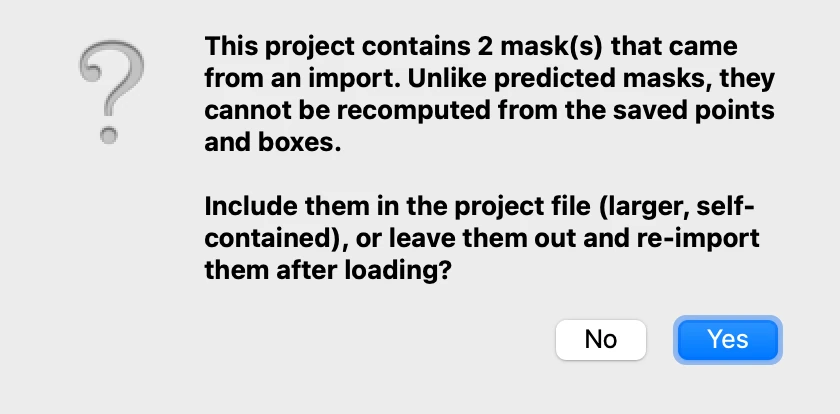
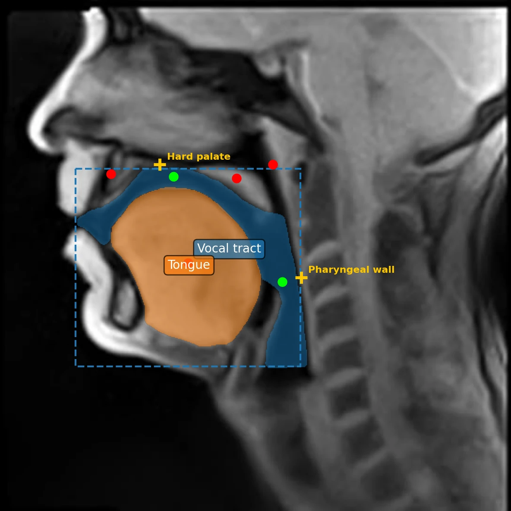
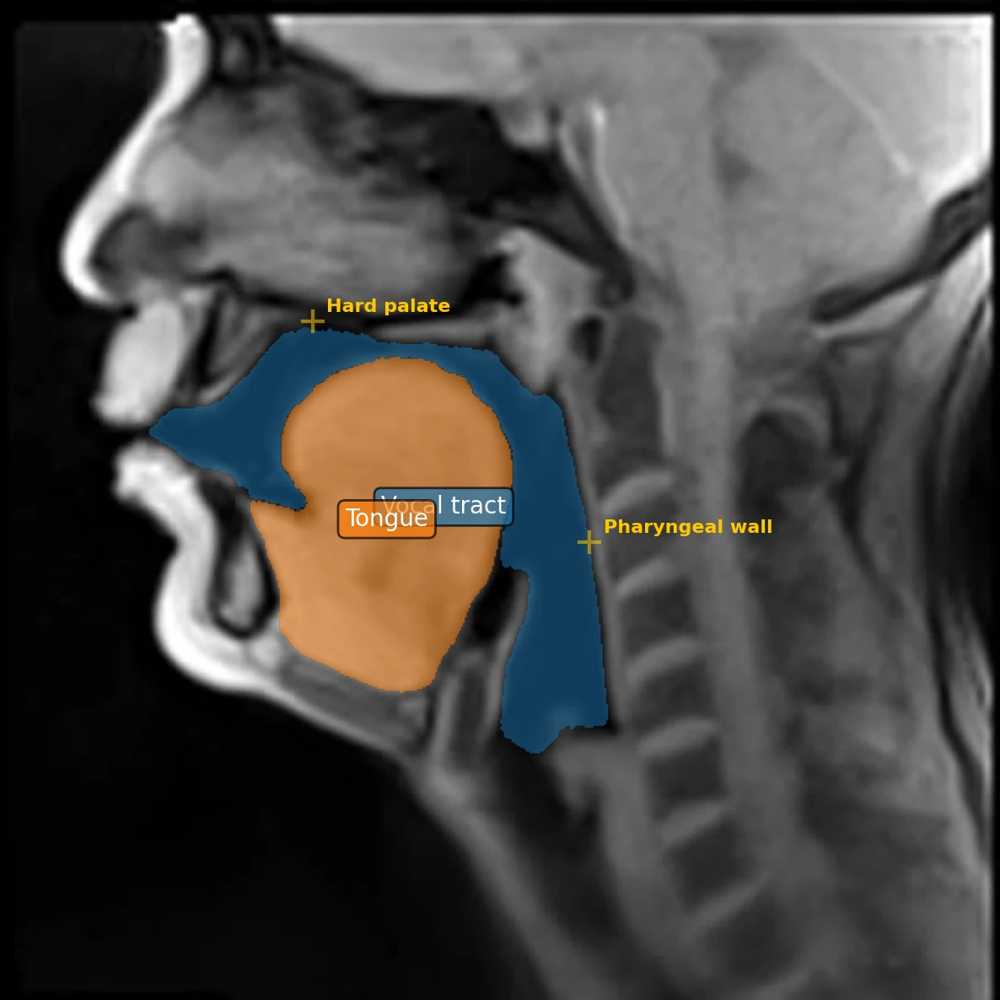
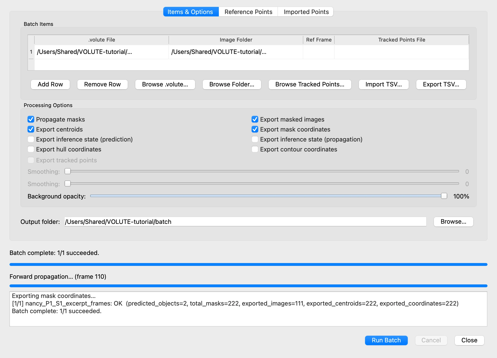

# 9. Saving, resuming, batch processing

*[Version française](project.fr.md)*

Everything done so far exists only in VOLUTE's memory, and is lost when VOLUTE is closed.
This step saves the work to a **project file**, opens it again in a new session, then
hands it over to **batch processing**, which does or redoes the computations without
requiring any action from the user.

## Saving the project

Choose **File › Project Data › Export Project Data** (Ctrl + S, or ⌘ + S on a Mac). VOLUTE
suggests a name after the frame folder, `nancy_P1_S1_excerpt_frames_objects.volute`.

The project file keeps the objects, with their names and colours, the points, the boxes,
the reference points, and the points imported from SAM2++ (step 10). It does not keep the
masks VOLUTE predicted: they can be computed again from the points and boxes, and leaving
them out keeps the file from growing too large.

Masks imported from GIMP are the exception, since no point can compute them again. VOLUTE
asks whether to include them:



Click **Yes**: the file then holds everything needed to resume.

## Resuming

Close VOLUTE. To take the work up again, later or on another computer:

1. Start VOLUTE, with the same model.
2. Choose **File › Select image folder** and select the folder of frames extracted in
   step 2, `nancy_P1_S1_excerpt_frames`.
3. Choose **File › Project Data › Import Project Data** (Ctrl + O, or ⌘ + O) and select
   the project file.

The objects reappear, with their points, their boxes and the reference points; only the
box of the selected object, here the vocal tract, is shown. On frame 1, the masks imported
from GIMP come back too; the other frames have no mask yet.



4. In the **Prediction** tab, click **Propagate masks through video**: the masks of every
   frame are computed again, from the imported masks of frame 1.



A project file goes with its frames: open it on the same images, or at least on images of
the same size, with the same objects or points to track, starting from the same positions.

## Batch processing

Once the objects are defined on a video, **File › Batch Processing…** runs the propagation
and the exports without any further click, on as many videos as you wish: one row per
project file and frame folder. The same project can thus be run on several folders, or
several projects one after the other, during a lunch break or overnight.

This makes it possible, for instance, to define the objects and points on selected frames on
a modest computer, saving a project file for each video to process, then to propagate them
through all the frames in one go on a computing server with a powerful graphics card (GPU).
See also, in the FAQ, [Is my graphics card used?](../faq.md#is-my-graphics-card-used)

In this example, a single row: the project just saved, and its frame folder.



- **Add Row**, **Browse .volute…** and **Browse Folder…** fill the table; **Ref Frame**,
  left empty, starts from the first frame with points, a box or an imported mask.
  **Import TSV…** reads a list of rows prepared in a spreadsheet, with the columns
  `sam2_file`, `image_folder` and `ref_frame`.
- **Processing Options** chooses what is computed and exported: propagation, images with
  masks, centroids and mask coordinates by default, hulls and contours on request.
  With SAM2++ in point tracking mode (step 10), the images carry the tracked points,
  **Export tracked points** is ticked by default and the mask-only exports are greyed
  out; in the other mode, **Export tracked points** is the one greyed out.
- The **Reference Points** tab adds the distances of step 8, and the **Imported Points**
  tab the analysis of step 10.
- **Output folder** receives one folder per frame folder.

Click **Run Batch**: the log below follows the progress. For this row, the output folder
holds:

```
nancy_P1_S1_excerpt_frames/
    masked_images/                                 one image per frame
    nancy_P1_S1_excerpt_frames_centroids.xlsx
    nancy_P1_S1_excerpt_frames_coordinates.json
```

The same files as the exports of step 8, named after the frame folder.

## The inference state, experimental

**File › SAM2 Inference State (Experimental)** saves, in a `.voluteinf` file, SAM2's own
memory of the session. Such files are large, and are not guaranteed to open on another
computer or with another version of the model: the project file remains the reliable way
of keeping one's work.

Previous: [8. Exporting the results](export.md) · Next: [10. Following points with SAM2++](points.md)
