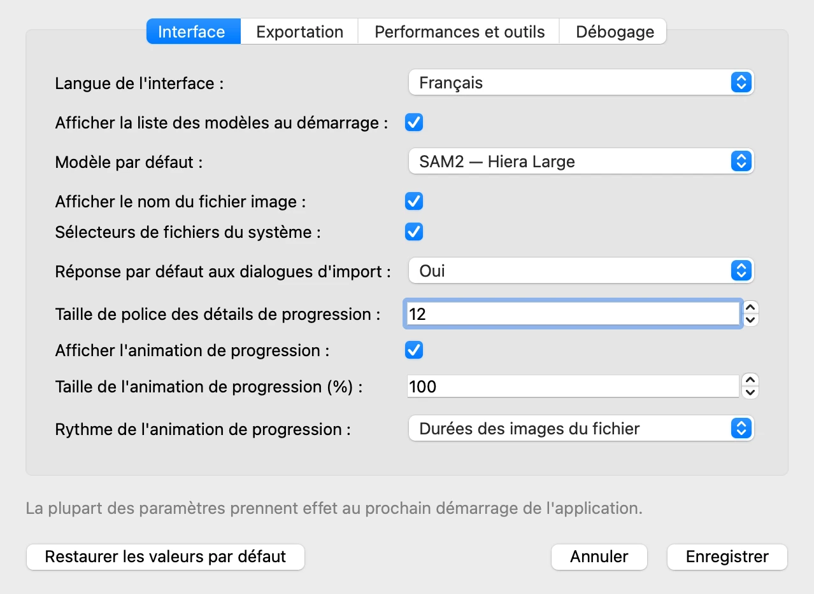
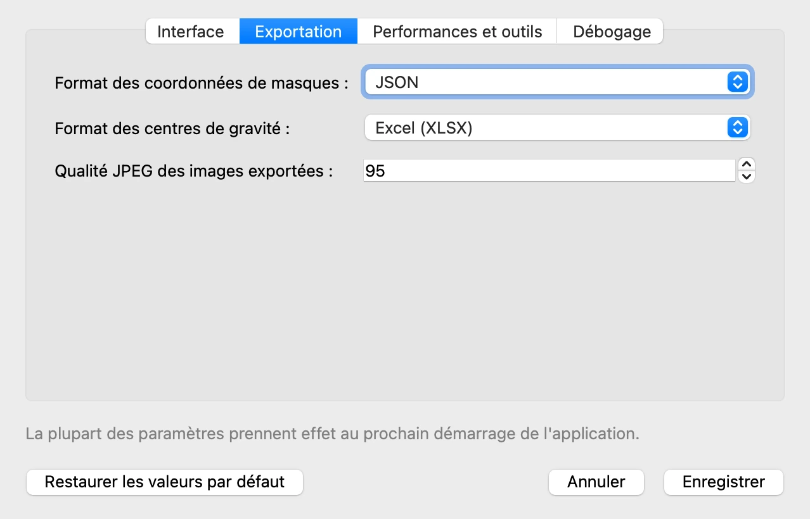
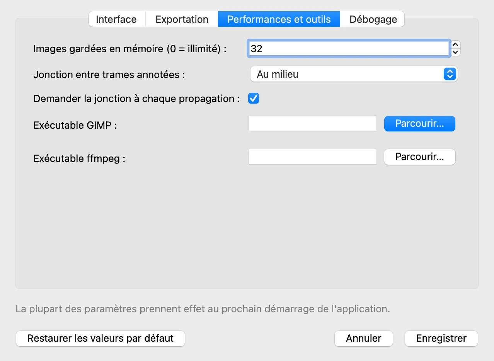

# 11. Paramètres, langue, raccourcis

*[English version](settings.md)*

Cette dernière étape passe en revue les réglages qui permettent d'adapter VOLUTE à vos
habitudes : choix des paramètres, de la langue, et les raccourcis clavier qui évitent de
passer par les menus.

## Paramètres

**Fichier › Paramètres…** ouvre les paramètres, en quatre onglets. La plupart prennent
effet au prochain démarrage de VOLUTE, comme le rappelle le bas de la fenêtre.
**Enregistrer** les sauvegarde, **Annuler** les laisse tels qu'ils étaient, et **Restaurer
les valeurs par défaut** rétablit les valeurs de l'installation.

**Interface**

- **Langue de l'interface** : la langue dans laquelle VOLUTE démarre.
- **Afficher la liste des modèles au démarrage** et **Modèle par défaut** : la fenêtre de
  choix du modèle de l'étape 1, et le modèle qu'elle présélectionne, ou que VOLUTE lance
  directement quand la liste n'est pas affichée.
- **Afficher le nom du fichier image** : affiche ou non le nom du fichier correspondant à
  la trame, sous le titre au-dessus de l'image.
- **Sélecteurs de fichiers du système** : utiliser les fenêtres d'ouverture et
  d'enregistrement du système (fenêtres similaires à celles que vous avez l'habitude
  d'utiliser sur votre ordinateur), ou celles de Qt, la bibliothèque graphique qu'utilise
  VOLUTE. Sur Mac, celles du système peuvent rester en anglais quelle que soit la langue
  de VOLUTE ; celles de Qt suivent toujours la langue choisie.

**Exportation**

Le format proposé pour les coordonnées des masques et les centres de gravité, et la
qualité des images JPEG exportées (étape 8).

**Performances et outils**

- **Images gardées en mémoire** : sur une longue vidéo, un nombre plus faible ménage la
  mémoire de l'ordinateur, au prix de la vitesse.
- **Exécutable GIMP** et **Exécutable ffmpeg** : laissés vides, VOLUTE trouve GIMP
  (étape 5) et ffmpeg (étape 2) de lui-même. Ne les remplissez que s'il n'y parvient
  pas.

L'onglet **Débogage** fait écrire à VOLUTE le détail de son travail, pour signaler un
problème.

## Langue

Le menu **Langue** fait passer VOLUTE de l'anglais au français, immédiatement, sans
redémarrer. Le démarrage suivant reprend la **Langue de l'interface** des paramètres.

## Raccourcis clavier

Sur Mac, ⌘ remplace Ctrl, et ⇧ désigne Maj.

| Raccourci | Action |
|---|---|
| ← / → | Trame précédente / suivante |
| Ctrl + D | Sélectionner un dossier d'images |
| Ctrl + S / Ctrl + O | Exporter / importer les données du projet |
| Ctrl + Z / Ctrl + Maj + Z | Annuler / rétablir |
| Ctrl + Maj + G | Importer des masques |
| Ctrl + Maj + B | Exporter la trame pour édition (GIMP) |
| Ctrl + Maj + F | Exporter toutes les trames pour édition (GIMP) |
| Ctrl + Maj + J | Importer les points suivis |
| Ctrl + Maj + I | Exporter les images avec masques (ou avec les points suivis) |
| Ctrl + Maj + M | Exporter les coordonnées des masques |
| Ctrl + Maj + T | Exporter les centres de gravité |
| Ctrl + Maj + K | Exporter les points de masque les plus proches (ou les distances aux points de référence) |
| Ctrl + Maj + H | Exporter les coordonnées des enveloppes convexes |
| Ctrl + Maj + U | Exporter les coordonnées des contours |
| Ctrl + Maj + A | Exporter l'analyse point/masque |
| Ctrl + Maj + P | Exporter les points suivis |

## Pour aller plus loin

Le tutoriel s'arrête ici. La
[documentation détaillée](https://github.com/nicolasaudibert/VOLUTE/blob/main/DOCUMENTATION.md),
en anglais, décrit toutes les fonctionnalités, y compris celles laissées de côté ici, et
la [FAQ](../faq.fr.md) répond aux questions les plus courantes.

Précédent : [10. Suivre des points avec SAM2++](points.fr.md)
