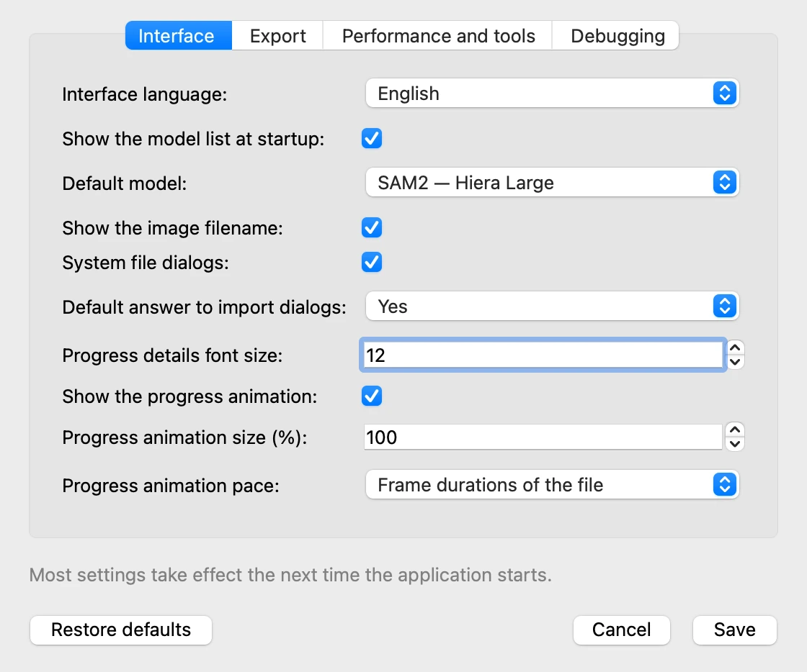
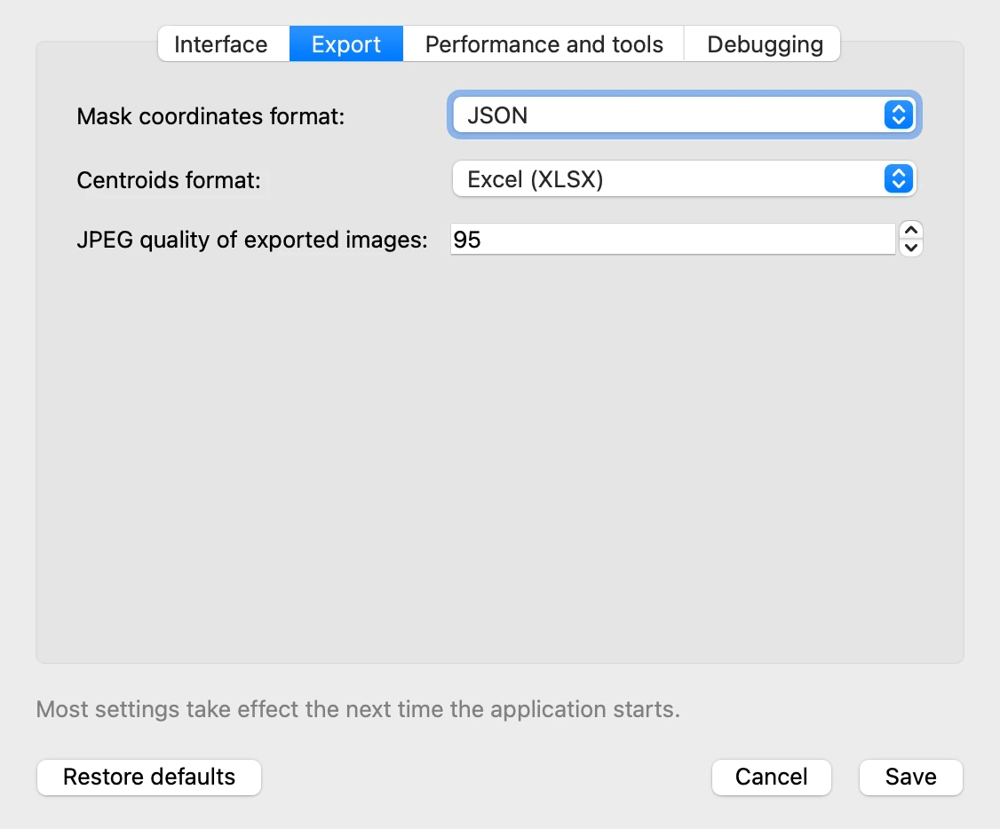
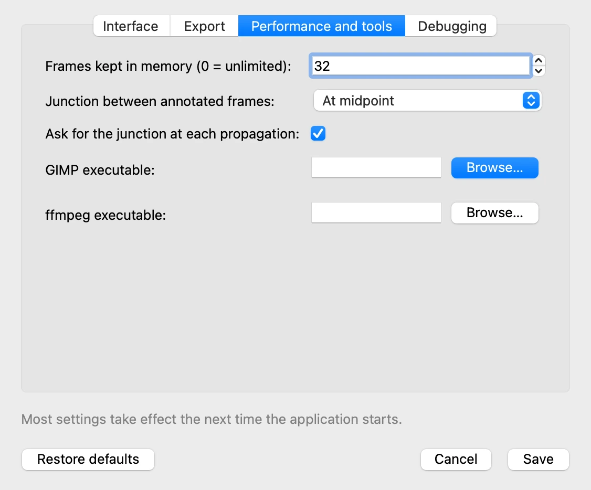

# 11. Settings, language, shortcuts

*[Version française](settings.fr.md)*

This last step goes through the options that adapt VOLUTE to your habits: the settings,
the language, and the keyboard shortcuts that save going through the menus.

## Settings

**File › Settings…** opens the settings, in four tabs. Most of them take effect the next
time VOLUTE starts, as the window recalls at the bottom. **Save** saves them, **Cancel**
leaves them as they were, and **Restore defaults** puts back the values VOLUTE was
installed with.

**Interface**

- **Interface language**: the language VOLUTE starts in.
- **Show the model list at startup** and **Default model**: the model selection window of
  step 1, and the model it preselects, or starts directly when the list is not shown.
- **Show the image filename**: shows or hides the name of the frame's file, under the
  title above the image.
- **System file dialogs**: use the system's open and save windows (similar to the ones you
  are used to on your computer), or those of Qt, the graphical toolkit VOLUTE uses. On a
  Mac, the system's may stay in English whatever VOLUTE's language; Qt's always follow the
  chosen language.

**Export**

The format suggested for the mask coordinates and the centroids, and the quality of the
JPEG images exported (step 8).

**Performance and tools**

- **Frames kept in memory**: on a long video, a lower number spares the computer's memory,
  at the cost of speed.
- **GIMP executable** and **ffmpeg executable**: left empty, VOLUTE finds GIMP (step 5)
  and ffmpeg (step 2) by itself. Fill them in only if it does not.

The **Debugging** tab makes VOLUTE write details of its work, for reporting a problem.

## Language

The **Language** menu switches VOLUTE between English and French at once, without
restarting. The next start uses the **Interface language** of the settings.

## Keyboard shortcuts

On a Mac, ⌘ replaces Ctrl, and ⇧ stands for Shift.

| Shortcut | Action |
|---|---|
| ← / → | Previous / next frame |
| Ctrl + D | Select image folder |
| Ctrl + S / Ctrl + O | Export / import project data |
| Ctrl + Z / Ctrl + Shift + Z | Undo / redo |
| Ctrl + Shift + G | Import masks |
| Ctrl + Shift + B | Export frame for editing (GIMP) |
| Ctrl + Shift + F | Export all frames for editing (GIMP) |
| Ctrl + Shift + J | Import tracked points |
| Ctrl + Shift + I | Export images with masks (or with tracked points) |
| Ctrl + Shift + M | Export mask coordinates |
| Ctrl + Shift + T | Export centroids |
| Ctrl + Shift + K | Export closest mask points (or closest tracked point distances) |
| Ctrl + Shift + H | Export convex hull coordinates |
| Ctrl + Shift + U | Export contour coordinates |
| Ctrl + Shift + A | Export point/mask analysis |
| Ctrl + Shift + P | Export tracked points |

## Going further

The tutorial ends here. The
[detailed documentation](https://github.com/nicolasaudibert/VOLUTE/blob/main/DOCUMENTATION.md)
describes every feature, including those left aside here, and the [FAQ](../faq.md)
answers the most common questions.

Previous: [10. Following points with SAM2++](points.md)
