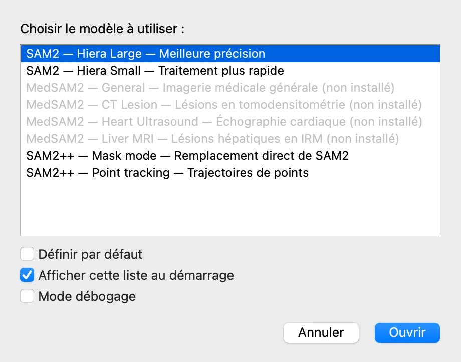
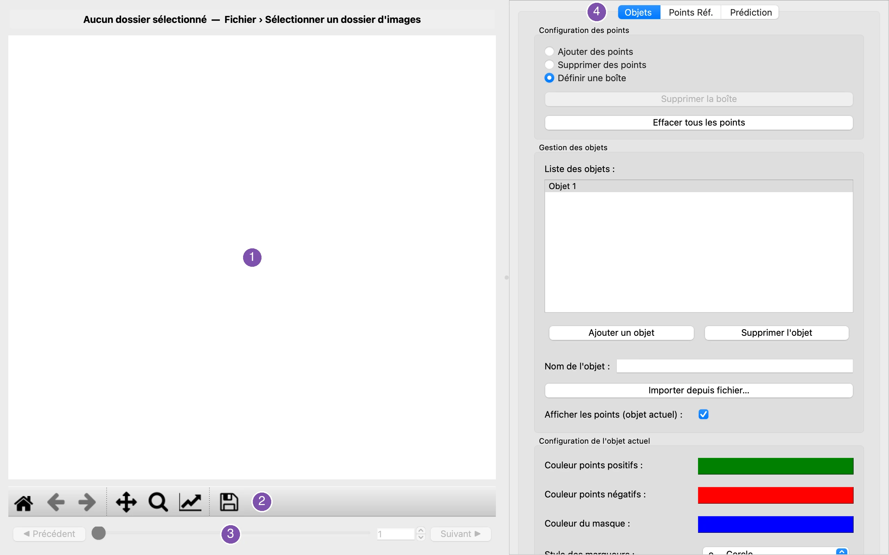

# 1. Avant de commencer

*[English version](start.md)*

## Lancer VOLUTE

- **Sous macOS**, ouvrez **VOLUTE** dans le dossier Applications de votre dossier
  personnel : dans le Finder, **Aller › Départ** (⇧ + ⌘ + H), puis **Applications**.
- **Sous Windows**, double-cliquez sur l'icône **VOLUTE** du Bureau.

## Choisir un modèle

VOLUTE demande d'abord quel **modèle** utiliser. Un modèle est l'intelligence
artificielle qui repère les objets dans les images ; VOLUTE en propose plusieurs, adaptés
à des usages différents.

Pour ce tutoriel, gardez **SAM2 — Hiera Large**, le plus précis, et cliquez sur
**Ouvrir**. Son chargement prend quelques secondes.

- **SAM2 — Hiera Small** est plus rapide et un peu moins précis : à essayer sur un
  ordinateur sans carte graphique adaptée.
- Les entrées **MedSAM2** sont entraînées sur des images médicales. Elles restent
  grisées tant que MedSAM2 n'est pas installé : si vous ne l'avez pas déjà fait lors de
  l'installation initiale, relancez la commande d'installation et choisissez-le. Ils se
  guident par une boîte tracée autour de la structure (voir l'étape
  [3](first-object.fr.md)), complétée au besoin par des points positifs ou négatifs.
- **SAM2++ — Point tracking** suit des points plutôt que de délimiter des objets ;
  l'étape [10](points.fr.md) du tutoriel s'en sert.

Un modèle qui n'est pas installé apparaît en grisé, avec la mention « non installé », et
ne peut pas être choisi ; son infobulle indique comment l'obtenir.

Laissez les trois cases sous la liste telles quelles. **Définir par défaut** fait du
modèle choisi celui qui sera présélectionné la prochaine fois ; décocher **Afficher cette
liste au démarrage** lance directement VOLUTE avec ce modèle par défaut, sans cette
fenêtre.

## Se repérer dans la fenêtre

1. **L'image.** La trame en cours s'affiche ici une fois les images chargées ; c'est là
   que l'on clique pour désigner les objets.
2. **Les outils de l'image**, de gauche à droite : revenir à l'image entière, vue
   précédente et vue suivante, déplacer l'image, zoomer sur un rectangle, options de la
   figure, et enregistrer la vue comme fichier image. Un zoom est conservé quand on change
   de trame.
3. **La navigation entre les trames** : **◀ Précédent** et **Suivant ▶**, le curseur, et
   le numéro de la trame affichée.
4. **Les onglets** qui regroupent les commandes : **Objets**, pour nommer les objets et
   les désigner ; **Points Réf.**, pour les points de référence ; **Prédiction**, pour
   calculer les contours et choisir ce qui est affiché.

Les **menus** — **Fichier**, **Édition**, **Langue**, **Aide** — sont en haut de l'écran
sous macOS, et en haut de la fenêtre sous Windows. **Langue** fait passer VOLUTE du
français à l'anglais immédiatement.

> **Astuce.** Tant que l'outil de déplacement ou de zoom est actif, un clic sur l'image la
> déplace ou l'agrandit au lieu de désigner un objet. Cliquez de nouveau sur le bouton de
> l'outil pour le désactiver.

Suite : [2. Charger les trames](load-frames.fr.md)
