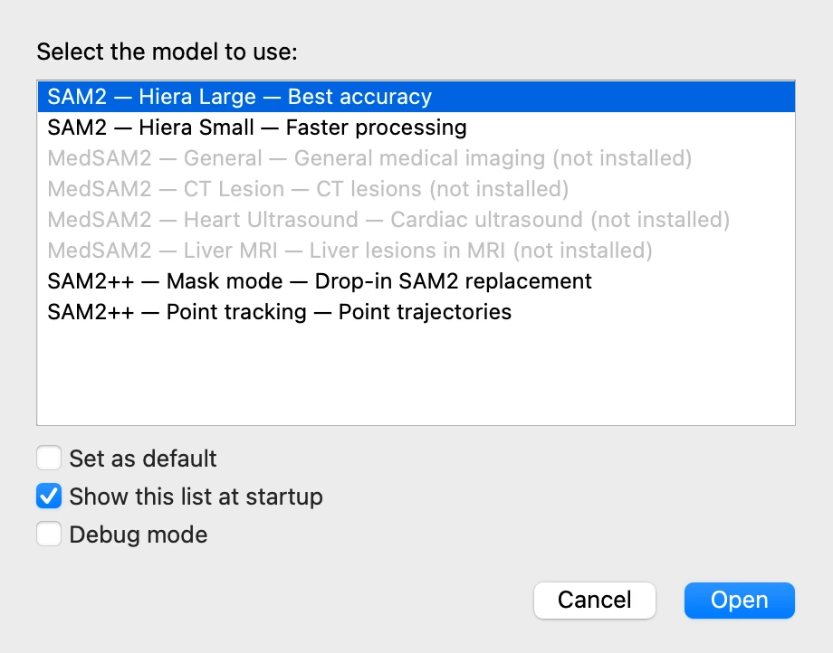
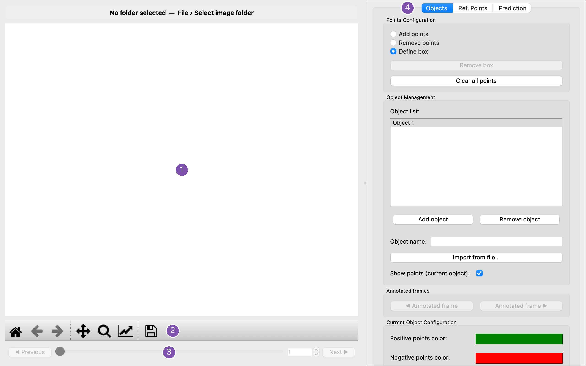

# 1. Before you start

*[Version française](start.fr.md)*

## Starting VOLUTE

- **On macOS**, open **VOLUTE** in the Applications folder of your home folder: in the
  Finder, **Go › Home** (⇧ + ⌘ + H), then **Applications**.
- **On Windows**, double-click the **VOLUTE** icon on the Desktop.

## Choosing a model

VOLUTE first asks which **model** to use. A model is the artificial intelligence that
finds the objects in the images; VOLUTE offers several, suited to different uses.

For this tutorial, keep **SAM2 — Hiera Large**, the most accurate, and click **Open**.
Loading it takes a few seconds.

- **SAM2 — Hiera Small** is faster and slightly less accurate: worth trying on a computer
  without a suitable graphics card.
- The **MedSAM2** entries are trained on medical images. They stay greyed out until
  MedSAM2 is installed: unless you already chose it when first installing VOLUTE, run the
  installation command again and choose it. They are prompted with a box drawn around
  the structure (see step [3](first-object.md)), completed with positive or negative
  points if needed.
- **SAM2++ — Point tracking** follows points rather than outlining objects; step
  [10](points.md) of the tutorial uses it.

A model that is not installed is greyed out, marked "not installed", and cannot be
chosen; its tooltip says how to get it.

Leave the three boxes below the list as they are. **Set as default** makes the chosen
model the one preselected here next time; unticking **Show this list at startup** starts
VOLUTE straight away with that default model, without this window.

## Finding your way around the window

1. **The image.** The current frame is shown here once images are loaded; this is where
   you click to point at objects.
2. **The image tools**, from left to right: back to the whole image, previous and next
   view, move the image, zoom into a rectangle, figure options, and save the view as an
   image file. A zoom stays on when you change frames.
3. **Frame navigation**: **◀ Previous** and **Next ▶**, the slider, and the number of the
   frame shown.
4. **The tabs** gathering the controls: **Objects**, to name objects and point at them;
   **Ref. Points**, for reference points; **Prediction**, to compute the outlines and
   choose what is displayed.

The **menus** — **File**, **Edit**, **Language**, **Help** — are at the top of the screen
on macOS, and at the top of the window on Windows. **Language** switches VOLUTE between
English and French at once.

> **Tip.** While the move or zoom tool is on, clicks on the image move or zoom it instead
> of pointing at objects. Click the tool's button again to turn it off.

Next: [2. Loading the frames](load-frames.md)
