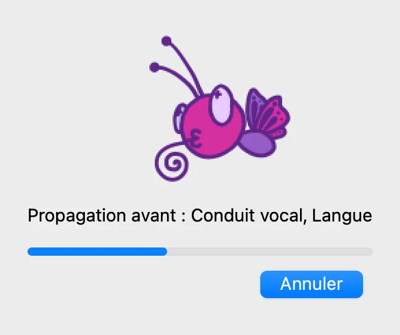
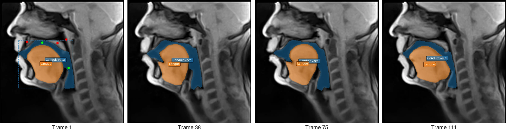
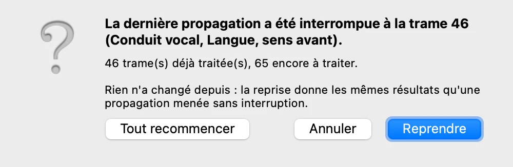
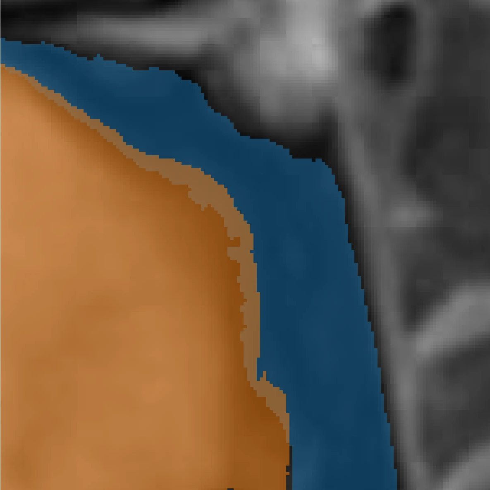
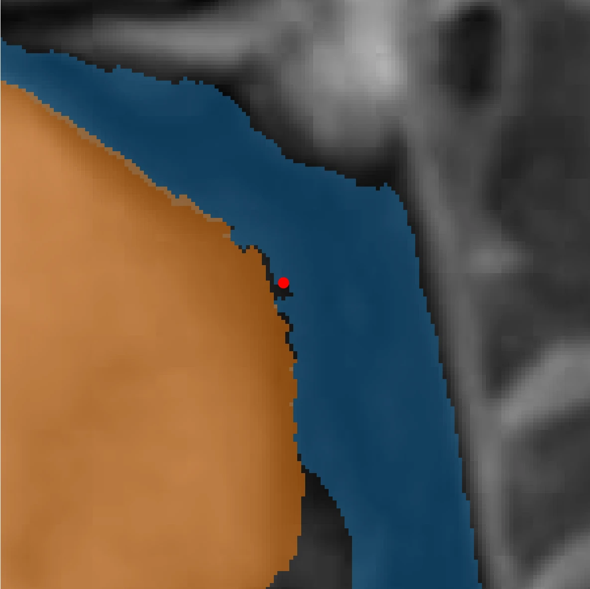
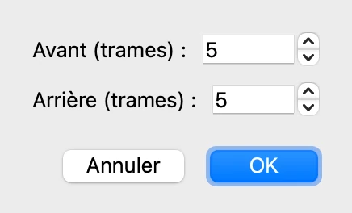
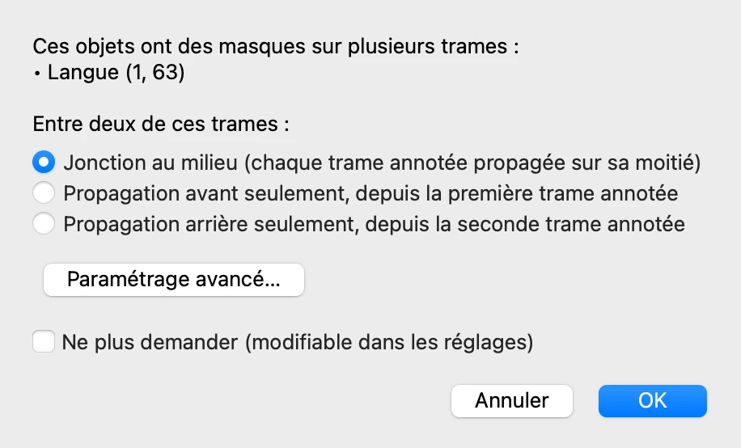
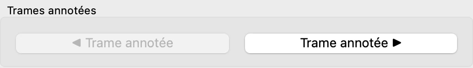
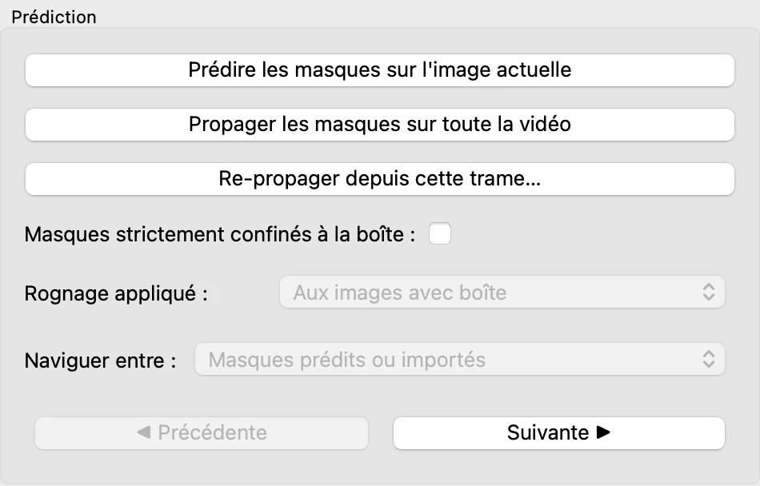

# 6. Suivre les objets dans la vidéo

*[English version](tracking.md)*

Les deux objets sont maintenant délimités sur la trame 1, et leurs masques corrigés.
Cette étape les suit dans toute la vidéo, puis corrige le suivi là où il se trompe.

## Propager les masques

Dans l'onglet **Prédiction**, cliquez sur **Propager les masques sur toute la vidéo** :
VOLUTE suit le conduit vocal et la langue d'une trame à l'autre, depuis la trame 1, où ils
ont été délimités, jusqu'à la fin de la vidéo. Pour le conduit vocal, le suivi part du
masque retouché dans GIMP à l'étape 5.

Cela prend un peu moins de deux minutes sur un Mac récent ou avec une carte graphique
NVIDIA, et davantage sans. Les deux objets, délimités sur la même trame, sont suivis
ensemble. À la fin, VOLUTE indique combien de masques
il a générés : cliquez sur **OK**.

Parcourez les trames avec le curseur : les masques suivent la langue et les lèvres dans
leurs mouvements. Les points et les boîtes n'apparaissent que sur la trame 1, où ils ont
été placés.

La trame affichée n'a pas d'importance : la propagation part des trames où chaque objet
a été délimité. Elle avance de là jusqu'à la fin de la vidéo, et revient en arrière
jusqu'au début pour un objet délimité plus loin que la trame 1. Un objet délimité sur
plusieurs trames est suivi à partir de chacune d'elles (voir
[Plusieurs trames annotées](#plusieurs-trames-annotées), plus bas).

## Interrompre et reprendre la propagation

La fenêtre de progression a un bouton **Annuler**, qui arrête la propagation : les masques
déjà calculés sont conservés, et peuvent être examinés ou exportés. Au clic suivant sur
**Propager les masques sur toute la vidéo**, VOLUTE propose de reprendre là où il s'était
arrêté :

**Reprendre** donne les mêmes masques qu'une propagation menée d'une traite. Si des
points, des boîtes, des masques ou des objets ont changé entre-temps, la fenêtre le
signale, et **Tout recommencer** devient le choix proposé par défaut.

## Vérifier le suivi

Le suivi n'est pas infaillible : il faut parcourir les trames pour repérer celles où un
masque se trompe. Pour examiner un contour de près, agrandissez la région qui vous
intéresse avec l'outil de zoom, sous l'image
(voir l'[étape 1](start.fr.md#se-repérer-dans-la-fenêtre)) : VOLUTE garde ce zoom quand
on change de trame, et le premier de ces outils revient à l'image entière.

Allez à la trame 63, cliquez sur **Langue** dans la liste des objets de l'onglet
**Objets**, et zoomez sur la racine de la langue et le pharynx. Si les noms des objets
cachent le contour, décochez **Afficher les étiquettes** dans l'onglet **Prédiction**
(voir l'[étape 7](display.fr.md)). Le masque de la langue déborde en arrière, sur l'air
du pharynx, qui appartient au conduit vocal.

Sur les trames voisines, le masque de la langue suit bien son bord : l'erreur se limite à
cette trame et à ses environs.

## Corriger sur la trame

La correction se fait comme sur la trame 1 à l'étape 5. **Langue** étant sélectionnée,
faites un clic droit dans la bande d'air que le masque de la langue recouvre à tort, puis
prédisez depuis l'onglet **Prédiction**. Le masque de la langue revient au bord de la
langue.

Au bas de la région agrandie, une petite zone d'air sombre n'est plus couverte par aucun
des deux masques : sur cette trame, le conduit vocal ne s'étend pas jusque-là. Un clic
gauche dans cette zone, **Conduit vocal** étant sélectionné, suivi d'une prédiction, la
lui rattacherait de la même façon.

## Reporter la correction sur les trames voisines

La correction n'a modifié que le masque de la trame 63. Dans l'onglet **Prédiction**,
cliquez sur **Re-propager depuis cette trame…** : seul l'objet sélectionné est suivi de
nouveau, à partir de la trame affichée, et les autres objets gardent leurs masques.

La fenêtre demande jusqu'où aller. **Illimité** va jusqu'à la fin de la vidéo vers
l'avant, et jusqu'à son début vers l'arrière ; un nombre de trames limite la
re-propagation. L'erreur ne s'étendant pas au-delà de quelques trames, indiquez `5` dans
**Avant (trames)** et dans **Arrière (trames)**, puis cliquez sur **OK**.

Les trames 58 à 68 sont suivies de nouveau en tenant compte de la correction, et le reste
de la vidéo demeure inchangé. Les points de toutes les trames sont pris en compte
ensemble.

**Propager les masques sur toute la vidéo** prendrait aussi la correction en compte, mais
suivrait de nouveau tous les objets, dans toute la vidéo. **Re-propager depuis cette
trame…** est plus rapide, et ne touche ni aux autres objets ni aux trames situées hors de
l'empan choisi.

## Plusieurs trames annotées

La trame 63 compte désormais comme une trame annotée de la langue, au même titre que la
trame 1. Une nouvelle propagation suivrait donc la langue à partir de ces deux trames, et
VOLUTE demanderait d'abord comment partager les trames qui les séparent :

- **Jonction au milieu** : chaque trame annotée est propagée sur sa moitié, vers l'avant
  pour la première, vers l'arrière pour la seconde. C'est le choix par défaut.
- **Propagation avant seulement** : la première trame annotée est propagée jusqu'à la
  seconde, comme si celle-ci n'existait pas.
- **Propagation arrière seulement** : la seconde trame annotée est propagée en arrière
  jusqu'à la première.

Avec la jonction au milieu, les deux suivis se rejoignent entre deux trames voisines, le
*point de jonction*. S'ils ne s'accordent pas tout à fait, le masque y change brusquement
de forme d'une trame à l'autre : c'est un endroit à vérifier après la propagation (voir
[Naviguer entre les trames annotées](#naviguer-entre-les-trames-annotées), plus bas).

**Paramétrage avancé…** règle ce choix séparément pour chaque objet et chaque intervalle
entre deux trames annotées. **Ne plus demander** retient le choix, qui se modifie ensuite
dans les paramètres (voir l'[étape 11](settings.fr.md#paramètres)). Inutile de propager
de nouveau ici : la re-propagation a déjà corrigé les trames voisines de la trame 63. Si
vous ouvrez cette fenêtre, cliquez sur **Annuler**.

Annoter un objet sur plusieurs trames est aussi le moyen de guider le suivi quand il
confond l'objet avec un voisin qui lui ressemble : délimitez-le sur une trame plus loin
dans la vidéo, puis propagez. Les objets délimités sur les mêmes trames sont suivis
ensemble ; des objets délimités sur des trames différentes sont propagés séparément, l'un
après l'autre, ce qui allonge la propagation.

## Naviguer entre les trames annotées

Après une propagation, les trames à vérifier en priorité sont souvent connues d'avance :

- les trames annotées, pour revoir les points et les boîtes qui y ont été placés ;
- les trames voisines d'une correction, où le masque corrigé rejoint le suivi qui
  l'entoure, et peut changer brusquement de forme ;
- les points de jonction, où se rejoignent deux suivis partis de trames annotées
  différentes.

Deux séries de boutons y mènent directement, pour les objets sélectionnés. Dans l'onglet
**Objets**, **◀ Trame annotée** et **Trame annotée ▶** vont
à la trame précédente ou suivante qui porte des points ou une boîte :

Dans l'onglet **Prédiction**, **◀ Précédente** et **Suivante ▶** vont à la trame
précédente ou suivante choisie par la liste **Naviguer entre** :

- **Masques prédits ou importés** : les trames dont le masque vient d'une prédiction ou
  d'un import, et non de la propagation ;
- **Points de jonction** : les trames où se rejoignent les suivis partis de deux trames
  annotées, après une propagation ;
- **Les deux**.

Un point de jonction mène à la dernière trame suivie depuis la première des deux trames
annotées. La trame d'après, la première suivie depuis la seconde, s'atteint avec
**Suivant ▶**, sous l'image : passer de l'une à l'autre, avec **◀ Précédent** et
**Suivant ▶**, montre si les deux suivis s'accordent.

Tant qu'aucun objet sélectionné n'a de point de jonction, la liste reste grisée et les
boutons vont d'un masque prédit ou importé à l'autre : la langue étant sélectionnée sur
la trame 1, **Suivante ▶** mène à la trame 63.

Précédent : [5. Corriger les masques](corrections.fr.md) · Suite : [7. Affichage et points de référence](display.fr.md)
