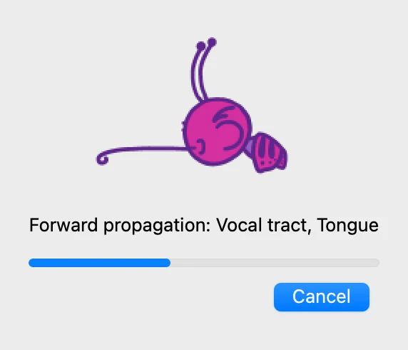
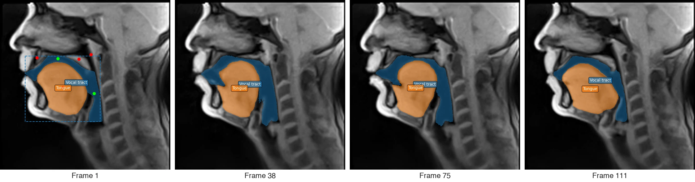
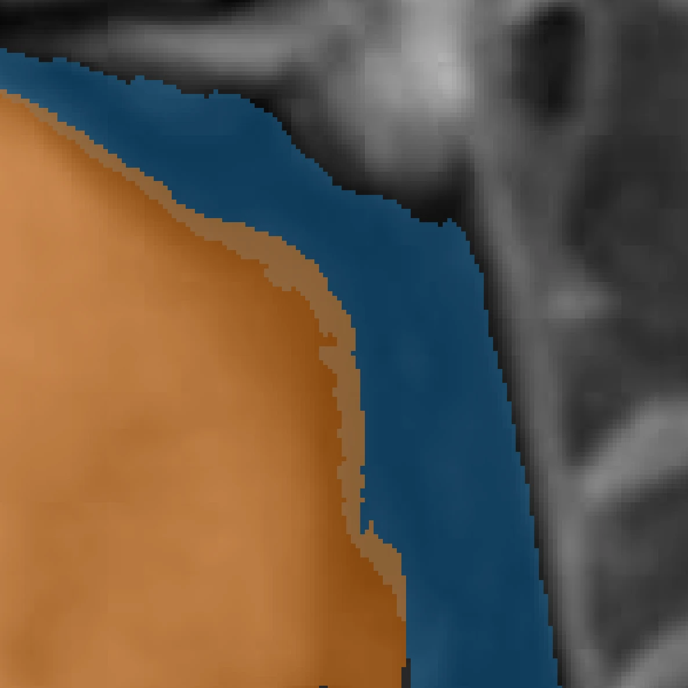
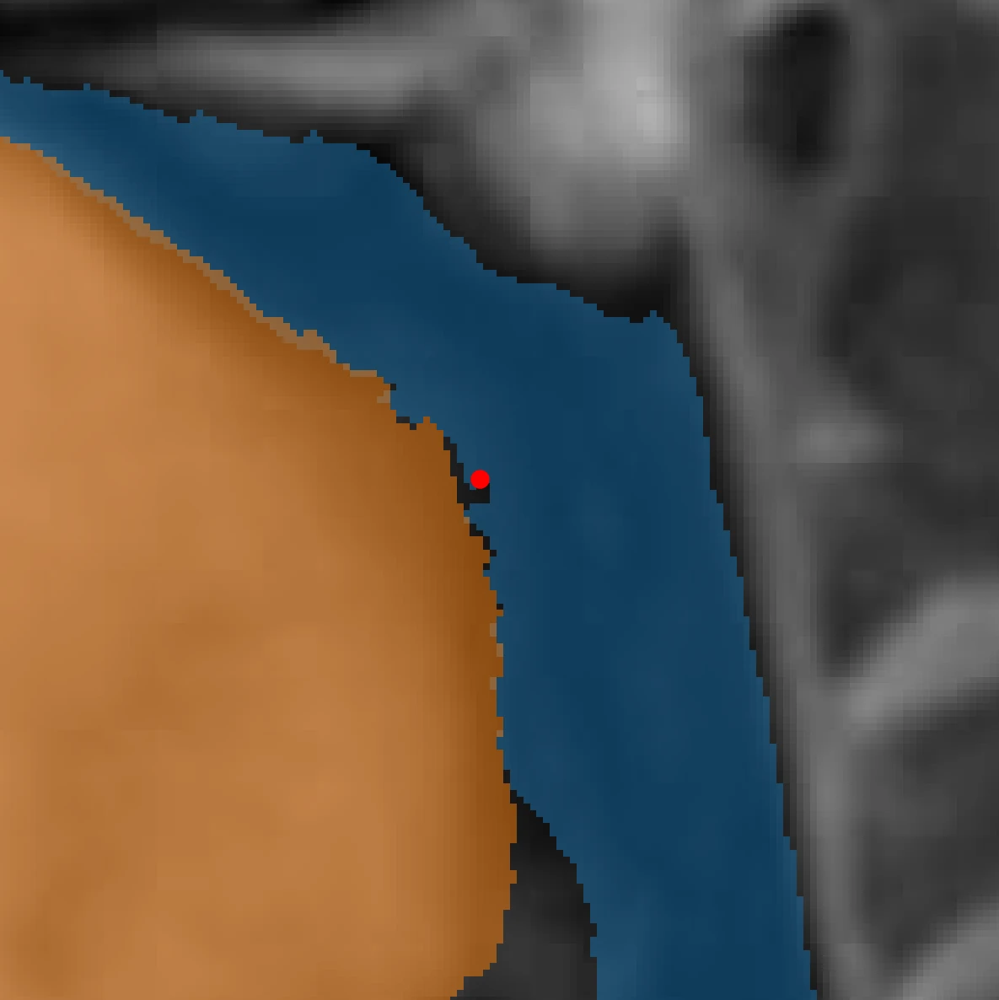
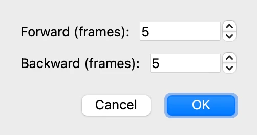

# 6. Following the objects through the video

*[Version française](tracking.fr.md)*

Both objects are now outlined on frame 1, and their masks corrected. This step follows
them through the whole video, then corrects the tracking where it goes wrong.

## Propagating the masks

Go back to frame 1. In the **Prediction** tab, click **Propagate masks through video**:
VOLUTE follows the vocal tract and the tongue from frame to frame, to the end of the
video. For the vocal tract, the tracking starts from the mask retouched in GIMP in
step 5.

This takes about three and a half minutes on a recent Mac or with an NVIDIA graphics
card, and longer without one: the objects are followed one after the other. When it is
over, VOLUTE reports how many masks it generated: click **OK**.

Move through the frames with the slider: the masks follow the tongue and the lips as they
move. The points and the boxes appear only on frame 1, where they were placed.

Propagation starts from the frame shown. Started from a frame in the middle of the video,
it goes forwards to the end, then backwards to the beginning.

## Checking the tracking

Tracking is not infallible: the frames have to be gone through to spot those where a
mask goes wrong. To look at an outline closely, enlarge the region of interest with the
zoom tool, below the image
(see [step 1](start.md#finding-your-way-around-the-window)): VOLUTE keeps that zoom when
the frame changes, and the first of these tools goes back to the whole image.

Go to frame 63, click **Tongue** in the object list of the **Objects** tab, and zoom in
on the root of the tongue and the pharynx. If the object names hide the outline, untick
**Show labels** in the **Prediction** tab (see [step 7](display.md)). The tongue's mask
spills backwards over the air of the pharynx, which belongs to the vocal tract.

On the neighbouring frames, the tongue's mask follows its edge well: the error is
confined to this frame and those around it.

## Correcting on the frame

The correction is made as on frame 1 in step 5. With **Tongue** selected, right-click in
the band of air that the tongue's mask wrongly covers, then predict from the
**Prediction** tab. The tongue's mask goes back to the edge of the tongue.

At the bottom of the enlarged region, a small area of dark air is now covered by neither
mask: on this frame, the vocal tract does not reach that far. A left click in that area,
with **Vocal tract** selected, followed by a prediction, would add it in the same way.

## Passing the correction on to the neighbouring frames

The correction changed the mask of frame 63 only. In the **Prediction** tab, click
**Re-propagate from this frame…**: only the selected object is followed again, from the
frame shown, and the other objects keep their masks.

The window asks how far to go. **Unbounded** goes to the end of the video forwards and to
its beginning backwards; a number of frames limits the re-propagation. As the error does
not extend beyond a few frames, enter `5` under **Forward (frames)** and under
**Backward (frames)**, then click **OK**.

Frames 58 to 68 are followed again, taking the correction into account, and the rest of
the video is left as it was. The points of every frame are taken into account together.

**Propagate masks through video** would also take the correction into account, but would
follow every object again, through the whole video. **Re-propagate from this frame…** is
quicker, and touches neither the other objects nor the frames outside the chosen span.

Previous: [5. Correcting masks](corrections.md) · Next: [7. Display and reference points](display.md)
