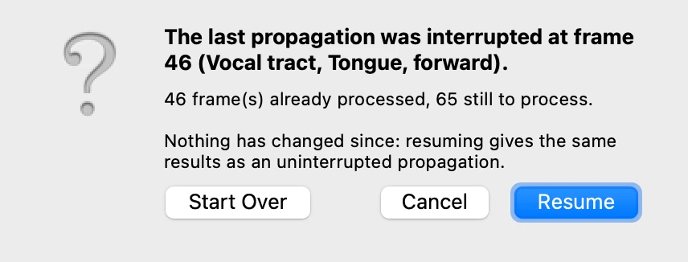
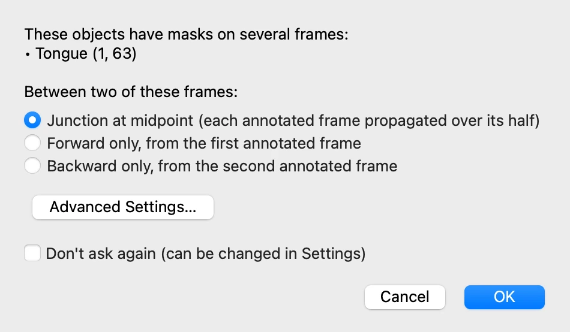
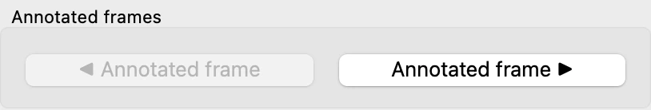
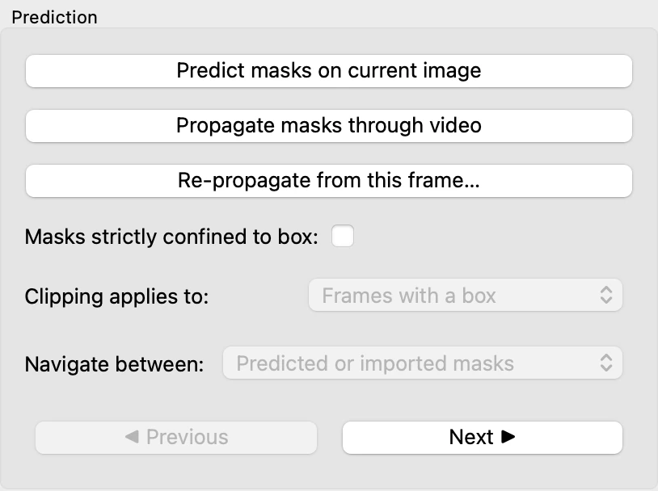

# 6. Following the objects through the video

*[Version française](tracking.fr.md)*

Both objects are now outlined on frame 1, and their masks corrected. This step follows
them through the whole video, then corrects the tracking where it goes wrong.

## Propagating the masks

In the **Prediction** tab, click **Propagate masks through video**: VOLUTE follows the
vocal tract and the tongue from frame to frame, from frame 1, where they were outlined, to
the end of the video. For the vocal tract, the tracking starts from the mask retouched in
GIMP in step 5.

This takes just under two minutes on a recent Mac or with an NVIDIA graphics card, and
longer without one. Both objects, outlined on the same frame, are followed together. When
it is over, VOLUTE reports how many masks it generated: click **OK**.

Move through the frames with the slider: the masks follow the tongue and the lips as they
move. The points and the boxes appear only on frame 1, where they were placed.

The frame shown does not matter: propagation starts from the frames on which each object
was outlined. From there it goes forwards to the end of the video, and backwards to the
beginning for an object outlined further on than frame 1. An object outlined on several
frames is followed from each of them (see
[Several annotated frames](#several-annotated-frames), below).

## Interrupting and resuming the propagation

The progress window has a **Cancel** button, which stops the propagation: the masks
already computed are kept, and can be looked at or exported. At the next click on
**Propagate masks through video**, VOLUTE offers to resume where it stopped:

**Resume** gives the same masks as a propagation run in one go. If points, boxes, masks
or objects have changed in the meantime, the window says so, and **Start Over** becomes
the default choice.

## Checking the tracking

Tracking is not infallible: the frames have to be gone through to spot those where a
mask goes wrong. To look at an outline closely, enlarge the region of interest with the
zoom tool, below the image
(see [step 1](start.md#finding-your-way-around-the-window)): VOLUTE keeps that zoom when
the frame changes, and the first of these tools goes back to the whole image.

Go to frame 63, click **Tongue** in the object list of the **Objects** tab, and zoom in
on the root of the tongue and the pharynx. If the object names hide the outline, untick
**Show labels** in the **Prediction** tab (see [step 7](display.md)). The tongue's mask
spills backwards over the air of the pharynx, which belongs to the vocal tract.

On the neighbouring frames, the tongue's mask follows its edge well: the error is
confined to this frame and those around it.

## Correcting on the frame

The correction is made as on frame 1 in step 5. With **Tongue** selected, right-click in
the band of air that the tongue's mask wrongly covers, then predict from the
**Prediction** tab. The tongue's mask goes back to the edge of the tongue.

At the bottom of the enlarged region, a small area of dark air is now covered by neither
mask: on this frame, the vocal tract does not reach that far. A left click in that area,
with **Vocal tract** selected, followed by a prediction, would add it in the same way.

## Passing the correction on to the neighbouring frames

The correction changed the mask of frame 63 only. In the **Prediction** tab, click
**Re-propagate from this frame…**: only the selected object is followed again, from the
frame shown, and the other objects keep their masks.

The window asks how far to go. **Unbounded** goes to the end of the video forwards and to
its beginning backwards; a number of frames limits the re-propagation. As the error does
not extend beyond a few frames, enter `5` under **Forward (frames)** and under
**Backward (frames)**, then click **OK**.

Frames 58 to 68 are followed again, taking the correction into account, and the rest of
the video is left as it was. The points of every frame are taken into account together.

**Propagate masks through video** would also take the correction into account, but would
follow every object again, through the whole video. **Re-propagate from this frame…** is
quicker, and touches neither the other objects nor the frames outside the chosen span.

## Several annotated frames

Frame 63 now counts as an annotated frame of the tongue, just as frame 1 does. A new
propagation would therefore follow the tongue from both frames, and VOLUTE would first
ask how to share out the frames between them:

- **Junction at midpoint**: each annotated frame is propagated over its half, forwards
  for the first, backwards for the second. This is the default.
- **Forward only**: the first annotated frame is propagated up to the second, as if the
  second were not there.
- **Backward only**: the second annotated frame is propagated backwards to the first.

With the junction at the midpoint, the two trackings meet between two neighbouring
frames, the *junction point*. If they do not quite agree, the mask changes shape abruptly
from one frame to the next there: it is a place to check after the propagation (see
[Moving between the annotated frames](#moving-between-the-annotated-frames), below).

**Advanced Settings…** sets this choice separately for each object and each interval
between two annotated frames. **Don't ask again** keeps the choice, which can then be
changed in the settings (see [step 11](settings.md#settings)). There is no need to
propagate again here: the re-propagation has already corrected the frames around frame
63. If you open this window, click **Cancel**.

Annotating an object on several frames is also the way to guide the tracking when it
mistakes the object for a neighbour that looks like it: outline it on a frame further on
in the video, then propagate. Objects outlined on the same frames are followed together;
objects outlined on different frames are propagated separately, one after the other,
which makes the propagation longer.

## Moving between the annotated frames

After a propagation, the frames to check first are often known in advance:

- the annotated frames, to review the points and boxes placed on them;
- the frames next to a correction, where the corrected mask meets the tracking around it,
  and may change shape abruptly;
- the junction points, where two trackings started from different annotated frames meet.

Two sets of buttons lead straight to them, for the selected objects. In the **Objects**
tab, **◀ Annotated frame** and **Annotated frame ▶** go to the previous
or next frame carrying points or a box:

In the **Prediction** tab, **◀ Previous** and **Next ▶** go to the previous or next frame
of the kind chosen under **Navigate between**:

- **Predicted or imported masks**: the frames whose mask comes from a prediction or an
  import, not from the propagation;
- **Junction points**: where the trackings started from two annotated frames meet,
  after a propagation;
- **Both**.

A junction point leads to the last frame followed from the first of the two annotated
frames. The frame after it, the first followed from the second, is reached with
**Next ▶**, below the image: going from one to the other, with **◀ Previous** and
**Next ▶**, shows whether the two trackings agree.

As long as no selected object has a junction point, the list stays greyed out and the
buttons go from one predicted or imported mask to the next: with the tongue selected on
frame 1, **Next ▶** leads to frame 63.

Previous: [5. Correcting masks](corrections.md) · Next: [7. Display and reference points](display.md)
